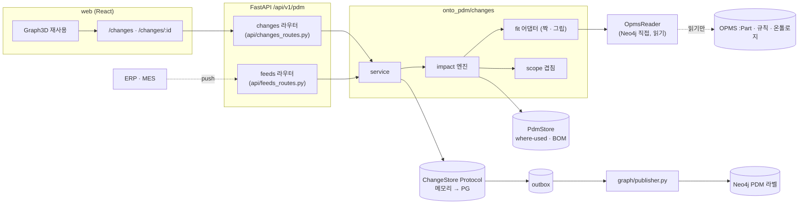

# 설계변경 영향 분석 — 개발 설계

| 항목 | 내용 |
|---|---|
| 버전 | v0.1 초안 (2026-11-12) |
| 상태 | **제안만 있다. 코드는 아직 한 줄도 없다.** 사용자 확인 전. 10장 "판단 필요" 항목이 정해지면 v0.2 |
| 한 줄 요약 | `BRK-M8`(M8 볼트·너트·와셔로 체결하는 브래킷 모듈) 하나를 기준으로, **부품 개정·교체가 일어났을 때 어느 BOM · 작업지시 · 발주 · 재고에 영향이 가는지 찾고, 볼트·너트 체결이 아직 맞는지 다시 판정하고, 항목마다 사람이 처분(어떻게 할지)을 정해 승인하는 흐름**을 PDM에 더한다 |
| 관련 문서 | [change-impact-prd.md](change-impact-prd.md)(요구 · 범위) · [change-impact-ontology.md](change-impact-ontology.md)(객체 · 관계 · 라벨) · [pdm-design.md](pdm-design.md) · [neo4j-lpg-design.md](neo4j-lpg-design.md) · [backend-plan.md](backend-plan.md) · [fit-check-plan.md](fit-check-plan.md) |
| 기준 | OPMS `PDM` 브랜치 `03331ba` (온톨로지 0.19.0 — `holeDepth`·`fit_check` 1개는 커밋 `58ffed2`. 처음 조사 때는 `7d1e484`였다) · 이 저장소 `Isaac0424/change-impact-bolt-nut`(`6d6013c`에서 분기) |

표기: ✅ 있음 · 🟡 일부 · ⬜ 없음. 근거는 `파일:줄`이다. **읽어서 확인한 것**과 **추정**을 구분한다. 요구 ID(F-CHG-*)는 [PRD](change-impact-prd.md)와 같다.

## 1. 범위와 출발점

### 1.1 이 문서가 정하는 것 / 정하지 않는 것

| 정한다 | 정하지 않는다 |
|---|---|
| 백엔드 모듈 · 저장소 · PG 표 · API 계약 · 영향 탐색 알고리즘 · 판정 어댑터 | 객체의 의미 · 관계 정의(→ [온톨로지 설계](change-impact-ontology.md)) |
| 웹 화면 · 컴포넌트 · `PdmApi` 변경 | 요구의 우선순위 · 사용자 시나리오(→ [PRD](change-impact-prd.md)) |
| Neo4j 발행 라벨 · 검사 · 질의 이름 | OPMS 쪽 구현(읽기만 한다. 요청서는 5.5) |
| 시험 전략 · 구현 단계 | ERP · MES 쓰기, 구매 · 재고 계산, 원가(PRD 비목표) |

### 1.2 현재 코드 상태 (어디서 시작하나)

| 필요한 것 | 상태 | 근거 · 메모 |
|---|---|---|
| 품목 · 리비전 · BOM 줄 · 승인본 불변 | ✅ | `db/schema.sql` `item`:87 · `item_revision`:186 · `bom_line`:327 · `guard_revision`:599 · `guard_locked_parent`:634 |
| 역전개(where-used) | ✅ PG · Neo4j 양쪽 | `where_used()` `db/schema.sql`:884 · `neo4j/queries.cypher` `@where_used`:36. 단 **현재 승인본만** 따라간다(리비전 비교 없음) |
| 재고 · 외부 입력 패턴 | ✅ 패턴만 | `inventory_balance`:540 · `pub.upsert_inventory`:1024(늦은 값 무시) · 역할 `inventory_feed`(`db/roles.sql`) |
| outbox → Neo4j 발행 | 🟡 | `outbox`:555, `aggregate` CHECK가 `item · item_revision · class`뿐. 발행기 `--loop` 미구현(`docs/backend-plan.md`) |
| 감사 로그 | ✅ | `audit_row()` 트리거 12개 표에 부착(`db/schema.sql`:824~835) |
| OPMS 읽기 | ✅ | `OpmsReader` Protocol(`backend/src/onto_pdm/opms/reader.py`:62), `Neo4jOpmsReader`, 읽기 전용 강제 |
| 설계변경 · 발주 · 작업지시 표 · 코드 | ⬜ | 저장소 전체에 문서 언급(F-REV-2 `docs/PRD.md`:171 · `pdm-design.md`:344)뿐 |
| 볼트↔너트 짝 · 그립 길이 판정 | ⬜ | OPMS 서버 판정 없음(`/fit/judge`는 길이–홈 깊이 1개, `/parts/match`는 보류). 규칙 명세만 OPMS 에 있다(`rules.yaml`:13~34) |
| 백엔드 저장소 | 🟡 메모리뿐 | `InMemoryPdmStore`(`store/memory.py`). `PgPdmStore` · 마이그레이션 러너 없음 |
| 웹 | 🟡 | `PdmApi`(`web/src/api/types.ts`:616~)에 설계변경 메서드 없음. 3D 그래프 · 목록 대안 · 빈 상태 컴포넌트는 있다 |
| 개정별 사양 값(판 두께 등) | ⬜ | `item_revision`에 속성 열이 없다(`description` · `change_note`뿐). 새 표가 필요(3.3 `revision_spec`) |

**시작점 결론**: 영향 탐색 엔진과 판정 어댑터는 **DB 없이 메모리 저장소 위에서 순수 함수로** 먼저 만들 수 있다(C1). PG 표는 같은 모양으로 이어 붙인다(C3). 이렇게 하면 PG 저장소 미구현이라는 위험(10.2)이 영향 분석 자체를 막지 않는다.

## 2. 아키텍처



원칙은 기존과 같다: **OPMS 에는 읽기만, 외부(ERP · MES)에는 받기만, 바꾸는 것은 PDM 소유 객체뿐**이다(PRD 4장, `neo4j-lpg-design.md` 1장).

### 2.1 백엔드 모듈 (`backend/src/onto_pdm/changes/`)

| 파일 | 책임 | 의존 |
|---|---|---|
| `models.py` | 도메인 모델(`ChangeRequest` `ChangeOrder` `ChangeTarget` `ApplicabilityScope` `ImpactRun` `ImpactFinding` `Disposition` `ChangeReview` `OntologyImpact`, 외부 `WorkOrder` `PurchaseOrderLine` `StockLot`). pydantic. 계약 모델은 `contracts.py`로 내보낸다 | — |
| `scope.py` | `ApplicabilityScope` 겹침 · 포함 판정 순수 함수: `overlaps(a, b)` `classify(scope, obj)` → `inside · outside · partial · unknown` | models |
| `fit.py` | **체결 적합성 판정 어댑터**. `FitJudge` Protocol + `PdmTemporaryFitJudge`(OPMS 스냅샷의 `mates_with` 명세로 계산, `temporary: true`)와 `grip_length()`. 5.2 | `onto_pdm.opms` |
| `impact.py` | 영향 탐색 엔진(4장). 입력: 변경 주문 · 저장소 · 판정기. 출력: `ImpactRun` + `ImpactFinding[]`. 부수 효과 없음 | scope, fit, store |
| `dispositions.py` | 처분 선택지 표(대상 종류별) · 기본 제안 · 검증(`DISPOSITION_REQUIRED`) | models |
| `service.py` | 유스케이스: 생성 · 대상 추가 · 영향 재계산 · 처분 · 검토 · 제출 · 승인 · 반려. 상태 전이와 권한 검사(6.4) | 위 전부 |
| `feeds.py` | 외부 push 수신 검증 · 늦은 값 무시(`as_of`) · 정규화 | models, store |
| `ontology_impact.py` | 온톨로지 버전 두 개를 비교한 **읽기 보고**(5.3). 부품 개정을 만들지 않는다 | opms |
| `store.py` | `ChangeStore` Protocol + `InMemoryChangeStore`. PG 구현은 `store_pg.py`(C3) | — |
| `api/changes_routes.py` · `api/feeds_routes.py` | `build_changes_router()` · `build_feeds_router()`. `create_app()`에 `include_router`(`api/app.py`:167~169와 같은 방식) | service |

`PdmStore` Protocol(`store/base.py`:43)에는 메서드를 **더하지 않는다**. 이미 15개 메서드가 있고 모든 구현 · 시험 대역이 같이 바뀌어야 해서, `ChangeStore`를 따로 두고 `create_app(store, opms, rulebook, changes=None)`로 주입한다(`api/app.py`:151 서명 확장). 읽기(역전개 · BOM)는 기존 `PdmStore.get_where_used` · `get_bom`을 그대로 쓴다.

## 3. 데이터 설계 (PostgreSQL)

> 객체의 의미 · 관계는 [온톨로지 설계](change-impact-ontology.md). 여기서는 표와 제약만 정한다. 모든 표는 기존 규칙을 따른다: 이름 snake_case, 소프트 삭제 없음(변경 기록은 지우지 않는다), `created_at/by`, `audit_row()` 부착.

### 3.1 변경 요청 · 지시

**`change_request`** — 요청(왜 바꾸나). `ChangeRequest`

| 컬럼 | 타입 | 제약 · 메모 |
|---|---|---|
| `id` | bigint identity PK | |
| `code` | text UNIQUE | `CR-2026-0001` 형식(발급 함수 `issue_change_code('CR')`, `issue_item_no()`와 같은 패턴) |
| `title` | text NOT NULL | |
| `reason` | text NOT NULL | 변경 이유 |
| `origin` | text CHECK IN (`design`,`quality`,`supplier`,`ontology_impact`,`other`) | `ontology_impact`면 `ontology_impact_id` 필수 |
| `ontology_impact_id` | bigint NULL FK `ontology_impact` | 온톨로지 변경 보고에서 열린 요청(보고는 개정이 아니다 — F-CHG-10) |
| `before_summary` · `after_summary` | text | 이전 · 이후 조건(자유 서술. 구조화 값은 `change_target`) |
| `status` | text CHECK IN (`draft`,`submitted`,`accepted`,`rejected`,`withdrawn`) | |
| `requested_by` | bigint FK `app_user` | |

**`change_order`** — 지시(어떻게 반영하나). `ChangeOrder`. 요청이 `accepted`일 때 1건을 연다(요청 1 : 지시 0..1로 시작, 분할은 10.3 판단 필요).

| 컬럼 | 타입 | 제약 · 메모 |
|---|---|---|
| `id` | bigint identity PK | |
| `code` | text UNIQUE | `CO-2026-0001` |
| `request_id` | bigint NOT NULL UNIQUE FK `change_request` | |
| `product_id` | bigint FK `product` | 분석 기준 제품(`BRK-M8`) |
| `status` | text CHECK IN (`draft`,`in_review`,`approved`,`rejected`,`implemented`,`cancelled`) | 6.4 전이표 |
| `approved_by` · `approved_at` | | 승인 때 채움 |
| `approved_run_id` | bigint NULL FK `impact_run` | **승인 때 본 영향 분석 실행**(11 감사, F-CHG-11) |

### 3.2 변경 대상 · 적용 범위

**`change_target`** — 무엇을 바꾸나. `ChangeTarget`

| 컬럼 | 타입 | 제약 · 메모 |
|---|---|---|
| `id` | bigint identity PK | |
| `order_id` | bigint NOT NULL FK | |
| `kind` | text CHECK IN (`revision`,`replacement`,`bom_line`) | **`ontology` 종류는 없다**(F-CHG-10). 온톨로지 변경은 `ontology_impact`로만 |
| `item_id` | bigint NOT NULL FK `item` | 대상 품목(교체면 이전 품목) |
| `from_revision_id` | bigint FK `item_revision` | `revision`: 현재 승인본. `released` 이어야 한다 |
| `to_revision_id` | bigint FK `item_revision` | `revision`: 새 개정(작업중으로 만들어 둔다). `replacement`: NULL |
| `replacement_item_id` | bigint FK `item` | `replacement`만. 새 품번(예: 너트 P-…22 → P-…23) |
| `parent_revision_id` | bigint FK `item_revision` | `bom_line`·`replacement`: 줄이 들어 있는 조립품 개정 |
| `note` | text | |

CHECK: `kind='revision' → to_revision_id NOT NULL AND replacement_item_id IS NULL`, `kind='replacement' → replacement_item_id NOT NULL AND replacement_item_id <> item_id`, `kind='bom_line' → parent_revision_id NOT NULL`. 같은 개정 · 품목을 한 지시에서 두 번 대상으로 잡지 못한다(UNIQUE `(order_id, item_id, kind)`).

**부품 개정 가드(F-CHG-10)**: `kind='revision'`의 `to_revision`이 OPMS 소유 식별 속성(`threadSize · length · pitch · material · strengthGrade` · 분류)을 바꾸는 `revision_spec` 값을 가지면 거부한다(오류 `REVISION_CHANGES_IDENTITY` 422, "규격이 바뀌면 새 품번이에요 — 교체로 등록하세요"). 개정으로 바꿀 수 있는 것은 **같은 품번 안의 값**(도면 · 공차 · 판 두께 · 검사 조건)이다. 근거: OPMS 는 부품 개정을 코드로 갖고 있지 않고(`DECISIONS.md`:410 설계만), `:Part` 값 = 온톨로지 값이라 같은 품번의 규격이 바뀌면 `:Part`와 어긋난다(`neo4j-lpg-design.md` 1장 · `revalidation_impacts`).

**`change_scope`** — 적용 범위. `ApplicabilityScope`. 한 대상에 0..N행(여러 구간).

| 컬럼 | 타입 | 제약 · 메모 |
|---|---|---|
| `id` | bigint identity PK | |
| `target_id` | bigint NOT NULL FK | |
| `effective_from` · `effective_to` | date NULL | 유효일. NULL = 열린 끝 |
| `site` | text NULL | 사업장. NULL = 전체 |
| `lot_nos` | text[] NULL | 생산 로트 목록. NULL = 전체(로트 범위 비교는 문자열이라 불안 → **목록으로 시작**, 10.3) |
| `serial_from` · `serial_to` | bigint NULL | 제품 일련번호 범위(양끝 포함) |
| `applies` | text CHECK IN (`new`,`old`) | `new` = 새 개정을 쓰는 범위, `old` = 기존 개정을 계속 쓰는 범위 |

CHECK `effective_to >= effective_from`, `serial_to >= serial_from`. 범위 행이 하나도 없으면 "전체 · 즉시"가 아니라 **미정**이다(승인 불가 — `SCOPE_REQUIRED`). 같은 대상에서 `applies='new'` 행끼리 겹치면 거부(`SCOPE_OVERLAP`).

### 3.3 개정별 사양 · 체결 구성 (새 입력)

그립 길이 계산(4.4)에는 판 두께, 너트 높이, 와셔 수가 필요하다. 지금 `item_revision`에는 이런 값을 둘 곳이 없다.

**`revision_spec`** — 개정별 사양 값(승인 후 잠긴다)

| 컬럼 | 타입 | 제약 · 메모 |
|---|---|---|
| `revision_id` | bigint FK `item_revision` | PK(`revision_id`,`key`) |
| `key` | text | `thickness` `nutHeight` `outerDiameter` … (OPMS 속성 키와 같은 이름. 소유 구분은 `source`) |
| `value` | numeric | |
| `unit` | text | 기본 `mm` |
| `source` | text CHECK IN (`drawing`,`opms`,`cad_estimate`,`manual`) | `cad_estimate`면 `inferred=true`로 취급(판정을 낮춘다. fit-check-plan 결정) |

승인 잠금은 기존 `guard_locked_parent('item_revision','revision_id')` 패턴으로 건다(`db/schema.sql`:634). **OPMS 가 값을 갖는 품목(볼트 · 너트 · 와셔)의 속성은 여기 복사하지 않고 `OF_PART`로 건너가 읽는다.** 가공품(판)은 OPMS `:Part`가 없어 이 표가 정본이다(10.3 `item_one_part` 예외).

**`fastening_joint`** — 한 체결부의 구성. 제품 조립품 개정에 붙는다.

| 컬럼 | 타입 | 제약 · 메모 |
|---|---|---|
| `id` | bigint identity PK | |
| `assembly_revision_id` | bigint FK `item_revision` | `BRK-M8` 개정 |
| `name` | text | "상·하판 체결" |
| `bolt_item_id` · `nut_item_id` | bigint FK `item` | |
| `washer_item_id` | bigint NULL FK `item` | |
| `washers_per_bolt` | smallint DEFAULT 2 | |
| `bolt_count` | smallint | 4 |
| `clamped` | jsonb | `[{"item_id": 상판, "thickness_key": "thickness"}, …]` 순서 포함 |

첫 판은 **사람이 입력**한다(시연은 픽스처). CAD 스튜디오가 이미 체결 부품과 묶인 부품을 탐지하므로(`src/core.js`:520~531 `host`) 나중에 초안을 자동으로 만들 수 있다(P2, 10.3).

### 3.4 영향 분석 결과 · 처분 · 검토

**`impact_run`** — 한 번의 영향 분석(판단 시점 스냅샷의 머리). 지우지 않고 쌓는다.

| 컬럼 | 타입 | 메모 |
|---|---|---|
| `id` · `order_id` | | |
| `computed_at` · `computed_by` | | |
| `input_hash` | text | 입력의 정규화 JSON sha256(4.6). 같은 입력 → 같은 해시 |
| `ontology_version` | text | 판정에 쓴 OPMS 온톨로지 버전 |
| `temporary` | boolean | 임시 판정을 썼으면 true (5.2) |
| `external_as_of` | jsonb | `{"work_order": ts, "purchase_order_line": ts, "stock_lot": ts}` 입력 시각 |
| `stale` | boolean DEFAULT false | 4.6의 재계산 규칙이 true 로 올린다 |
| `stale_reasons` | text[] | |

**`impact_finding`** — 탐지(영향이 있다). `ImpactFinding`. **변경해야 한다는 뜻이 아니다.**

| 컬럼 | 타입 | 제약 · 메모 |
|---|---|---|
| `id` · `run_id` FK | | |
| `kind` | text CHECK IN (`bom_usage`,`product`,`work_order`,`purchase_order_line`,`stock_lot`,`fit_pair`,`fit_grip`,`strength_grade`) | |
| `subject_type` · `subject_ref` | text | `item`/`revision`/`work_order`/… 와 그 식별자(`item_id`, `wo_no` …) |
| `severity` | text CHECK IN (`none`,`review`,`affected`,`blocked`) | 4.5 규칙표 |
| `verdict` | text NULL CHECK IN (`ok`,`conditional`,`no`,`unknown`) | 적합성 판정일 때만 |
| `rule_id` · `reason_code` · `message` | text | 예: `bolt_nut` · `mismatch` / `grip_length` · `shortfall` |
| `inputs` | jsonb | 계산에 쓴 값 전부(예: `{"plates": [8, 12], "washers": 2×1.6, "nutHeight": 6.8, "pitch": 1.25, "boltLength": 30}`) · 단위 · `inferred` · 출처 |
| `required` · `actual` · `gap` | numeric NULL | 길이 비교용 |
| `scope_class` | text NULL CHECK IN (`inside`,`outside`,`partial`,`unknown`) | 외부 객체와 적용 범위의 관계 |
| `suggested_disposition` | text NULL | 기본 제안(결정이 아니다) |

판정이 **어느 규칙 · 어느 온톨로지 버전 · 어느 시각의 외부 값**으로 나왔는지는 머리(`impact_run`)와 이 행에 남는다. 나중에 OPMS 규칙이 바뀌어도 승인 당시 판단은 재현된다(F-CHG-11).

**`change_disposition`** — 처분(어떻게 할지) = **사람의 결정**. `Disposition`

| 컬럼 | 타입 | 제약 · 메모 |
|---|---|---|
| `id` · `order_id` | | |
| `finding_id` | bigint FK `impact_finding` | |
| `action` | text NOT NULL | 4.7 선택지 표. 대상 종류별로 허용 값이 다르다 |
| `scope_id` | bigint NULL FK `change_scope` | 이 처분이 적용되는 범위 |
| `reason` | text NOT NULL | 왜 그렇게 정했나 |
| `decided_by` · `decided_at` | | |
| UNIQUE | `(order_id, finding_id)` | 재계산으로 finding 이 새로 생기면 새 처분이 필요 → 이전 처분은 이력으로 남고 `superseded_by`가 가리킨다 |

**`change_review`** — 설계 · 구매 · 생산 검토. 역할별 의견.

| 컬럼 | 타입 | 메모 |
|---|---|---|
| `id` · `order_id` | | |
| `function` | text CHECK IN (`design`,`purchasing`,`production`) | |
| `run_id` | bigint FK `impact_run` | **어느 분석을 보고 한 검토인지**. 분석이 stale 이 되면 이 검토는 무효 |
| `verdict` | text CHECK IN (`approve`,`reject`,`comment`) | |
| `comment` · `reviewer_id` · `reviewed_at` | | |

**`ontology_impact`** — 온톨로지 버전 변경이 기존 부품 · 체결에 미칠 후보 **보고**(읽기 결과). 이 표의 행은 부품 개정이나 변경 지시를 **만들지 않는다**.

| 컬럼 | 메모 |
|---|---|
| `id` · `from_version` · `to_version` · `computed_at` | |
| `summary` | jsonb `{rules_changed: [...], parts_flagged: [...]}` |
| `change_request_id` | 이 보고에서 요청이 열렸으면 연결(선택) |

### 3.5 외부 객체 읽기 사본 (ERP · MES 소유)

PDM 은 **받아 두기만** 한다. 주인이 아니므로 승인 · 수정 흐름이 없고, 모든 행에 출처와 기준 시각이 붙는다. 입구는 `inventory_balance`와 같은 패턴이다(`db/schema.sql`:540, `pub.upsert_inventory`:1024).

| 표 | 핵심 컬럼 | 메모 |
|---|---|---|
| `work_order` | `wo_no` · `source_system` · `site` · `product_item_id` · `bom_revision_id`(적용 BOM = 조립품 `item_revision`) · `process_rev` · `status`(`planned · released · in_progress · completed · closed`) · `qty_planned` · `qty_done` · `lot_no` · `serial_from/to` · `start_date` · `due_date` · `as_of` · `received_at` | PK(`source_system`,`wo_no`). 적용 범위와 맞춰 보려면 로트 · 일련번호 · 사업장이 필요하다 |
| `work_order_bom_ref` | `work_order_id` · `item_id` · `revision_id` · `qty_required` · `qty_issued` | 작업지시가 **실제로 쓰는 부품과 개정**의 스냅샷. 작업지시의 BOM 개정이 아니라 줄 단위로 영향을 찾는 데 쓴다 |
| `purchase_order_line` | `po_no` · `line_no` · `source_system` · `item_id` · `item_rev`(text, 발주 때의 개정) · `qty_ordered` · `qty_received` · `due_date` · `supplier` · `site` · `status` · `as_of` | 미입고 수량 = `qty_ordered - qty_received` |
| `stock_lot` | `lot_no` · `item_id` · `item_rev` · `site` · `location` · `qty_on_hand` · `qty_allocated` · `status`(`available · quarantine · hold`) · `as_of` | **`inventory_balance`는 그대로 둔다**(품목 · 사업장 · 위치 합계). `stock_lot`은 로트 단위이며 합계가 서로 맞아야 한다는 불변식은 두지 않는다(외부 시스템이 주인, 정합성 보고만 — 10.3) |

모든 외부 표의 `source_system` CHECK는 `('ERP','MES','fixture')`다(`inventory_balance`는 `('ERP','MES')`로 **바꾸지 않는다**). `fixture` 행은 시험 · 시연용이고 화면에서 "픽스처" 배지를 붙이며 `pub.*` 뷰에는 내보내지 않는다(사용자 지시 2026-11-11: 앱 화면에 목 데이터 금지).

### 3.6 불변 규칙 · 승인 흐름

승인된(`released`) 개정은 `guard_revision`으로 수정할 수 없고(`db/schema.sql`:599~625) 딸린 BOM 줄도 잠긴다(`guard_locked_parent`:634~653). 그래서 **변경은 언제나 새 개정을 만든다.** 승인 함수 `approve_change_order(order_id, user)`(SECURITY DEFINER, `approve_part_request`:496과 같은 패턴 · `REVOKE FROM PUBLIC` 후 `pdm_app`만 `GRANT`)가 **한 트랜잭션에서**:

1. 지시를 `FOR UPDATE`로 잠그고 상태가 `in_review`인지, `approved_run_id`가 될 **최신 `impact_run`이 stale 이 아닌지** 확인
2. `blocked` finding 이 남아 있지 않고, `affected` finding 마다 처분이 있고(`review`는 `no_action_needed`로 닫을 수 있다), 필요한 `function`의 `change_review`가 모두 `approve`이며 그 `run_id`가 최신 분석인지 확인
3. 모든 대상에 `change_scope`가 있는지 확인
4. 새 개정(`to_revision_id`)을 `wip → in_review → released` 순서로 올린다. **하위(자식)가 먼저**(`guard_release_children`:738). 교체(`replacement`)는 부모 조립품의 새 개정에서 `bom_line` 자식을 바꾼 것으로 표현되므로 부모 개정도 같이 올린다
5. **이전 개정을 `obsolete`로 내리는 것은 적용 범위가 "전체(모든 로트 · 일련번호)"일 때만** 같이 한다. 범위가 부분이면 이전 개정은 `released`로 남는다(이미 생산한 제품 · 진행 중 작업이 기존 사양을 계속 쓸 수 있어야 하기 때문)
6. `outbox`에 `('change_order', id, 'approved')` 기록, 지시를 `approved`로 변경
7. `audit_row()`가 전 과정을 `audit_log`에 남긴다(작업자는 `SET LOCAL app.user_id`)

> **판단 필요(핵심 설계 쟁점): 부분 적용 범위일 때 "어느 개정이 유효한가".** 기존 `effective_revision(item, rule)`(`db/schema.sql`:845)은 `released` 중 최신(`rev_seq` 최대)을 고른다. 범위가 부분이면 **같은 품목의 두 개정이 동시에 `released`** 이고, 어느 쪽을 쓸지는 로트 · 일련번호 · 사업장 · 날짜에 따라 다르다. 그래서 `effective_revision_at(item, site, lot, serial, on_date)`를 새로 두고 `change_scope`를 읽게 한다. 기존 `effective_revision`은 "범위 무시 최신"으로 이름 · 동작을 유지한다. 승인본이 늘면 `where_used()`(obsolete 제외)가 두 개정을 모두 돌려주는 점도 4.2에서 처리한다.

### 3.7 기존 객체에 가하는 변경 (증분)

| 대상 | 변경 | 근거 |
|---|---|---|
| `outbox.aggregate` CHECK | `'change_order'` 추가. 제약 이름은 `outbox_aggregate_check`로 **추정** → 실제 이름은 `\d outbox`로 확인 후 `DROP CONSTRAINT`/`ADD CONSTRAINT` | `db/schema.sql`:555 |
| `enqueue_publish()` | `change_order` 가 `approved`로 바뀔 때 기록하는 분기 추가 | :762 |
| `audit_row` 부착 | `change_request` `change_order` `change_target` `change_scope` `change_disposition` `change_review` `revision_spec` `fastening_joint` 8개 표(외부 사본 4표는 제외 — 주인이 외부, `received_at`이 이력) | :824~835 |
| 역할 | `change_feed`(신규): `pub.upsert_work_order` · `pub.upsert_work_order_bom_ref` · `pub.upsert_purchase_order_line` · `pub.upsert_stock_lot` 실행만. `pdm_app`은 `GRANT … ON ALL TABLES`와 `ALTER DEFAULT PRIVILEGES`(`db/roles.sql`:84)로 새 표를 자동으로 받는다 | `db/roles.sql` |
| RLS | **걸지 않는다.** 변경 요청은 작성자 · 관리자만 보게 하자는 요구가 PRD 에 없다. 요구가 생기면 `part_request_app`(`roles.sql`) 정책을 따른다 | |
| 사용자 기능 구분 | `app_user.role`(admin · engineer · approver · viewer) CHECK 는 **건드리지 않는다**. 설계 · 구매 · 생산 검토 자격은 새 표 `app_user_function(user_id, function)`로 둔다(role CHECK 변경은 기존 DB 마이그레이션이 필요) | `db/schema.sql`:47 |

### 3.8 마이그레이션 방침

마이그레이션 러너가 없다(`docs/backend-plan.md` 결정 4 계획만). 우선:

- `db/changes.sql`(신규 표 · 함수 · 트리거 · 증분 ALTER — **여러 번 실행해도 되게** `IF NOT EXISTS` / `CREATE OR REPLACE` / 제약 이름 존재 검사)
- `db/changes-roles.sql`(신규 역할 · GRANT. `roles.sql`을 공유 DB 에 그대로 실행하면 안 된다는 기존 결정을 따라 따로 둔다)
- 시험은 PGlite(`db/test/changes.test.mjs`, 기존 `schema.test.mjs` 방식, `pnpm test`)로 `schema.sql` → `changes.sql` 순서로 적재해 돌린다.
- 러너는 이 기능의 범위가 아니다. `changes.sql`이 `schema.sql` 다음에 한 번 실행되는 파일이라는 것만 README 에 적는다.

## 4. 영향 탐색 알고리즘

입력: 지시 `order`(대상 · 적용 범위 포함), `PdmStore`, `OpmsReader`, 외부 사본 조회. 출력: `ImpactRun` 1개 + `ImpactFinding[]`. **순수 함수**(저장은 service 가 한다).

### 4.1 개요

```
impact(order):
  run = new ImpactRun(order, ontology_version = opms.ontology().version)
  # 1. 변경 후 상태를 가상으로 만든다 (DB 에는 쓰지 않는다)
  after = virtual_state(order.targets)         # 대상별로 새 개정 · 교체를 메모리 BOM 위에 덮는다
  # 2. 영향 대상 탐색 (역전개)
  usages = []
  for t in order.targets:
      rows = store.get_where_used(t.item_id)   # 상위 품목 · 경로 · 수량
      usages += expand_revisions(rows, t)      # 4.2: 상위 조립품이 어느 개정으로 쓰는지
  products = { u.top for u in usages if u.top is product_root }
  # 3. 적용 범위로 거른다
  # 4. 외부 객체 연결
  # 5. 체결 적합성 재판정 (변경 후 BOM 위에서)
  # 6. finding 정렬 · 심각도 부여 · 기본 제안
  return run, findings
```

### 4.2 역전개와 개정 해석

1. 대상 품목마다 `get_where_used(item_id)`로 상위 품목과 경로를 얻는다(`WhereUsedRow`. 기존 계약).
2. BOM 줄은 **자식이 품목**이고 개정은 조회 때 정해진다(`neo4j-lpg-design.md` 3장). 그래서 **자식의 개정이 바뀌어도 상위 BOM 줄은 바뀌지 않는다.** 이 사실이 SC-2(판 두께 개정)에 중요하다: 상위 `BRK-M8` BOM은 그대로이고, **판정 입력(판 두께)만 바뀐다.** 반대로 SC-1(너트 교체)은 체결 세트의 새 개정이 필요하다(자식 품목이 바뀌므로).
3. 승인본이 둘 이상인 품목(부분 적용 중)은 `where_used()`가 obsolete 만 빼므로 두 개정을 모두 돌려준다. `expand_revisions`가 각 상위 개정을 `usage(item, parent_revision, path, qty)`로 나누고, 4.3에서 범위로 거른다.
4. 결과 중 `product_root`(`ProductModel.root_item`)에 닿는 것을 `product` finding 으로 모은다. **사용처가 없는 대상**(어디에도 안 쓰임)은 finding 이 0건이므로 화면에 "쓰이는 곳 없음"을 명시한다(빈 결과와 구별).

### 4.3 적용 범위 필터

`scope.classify(scope, obj)`는 외부 객체가 변경 범위에 **들어가는가**를 돌려준다.

| 외부 객체 필드 | 판정 |
|---|---|
| 범위의 모든 조건(사업장 · 날짜 · 로트 · 일련번호)이 객체 값으로 확정되고 전부 안 | `inside` |
| 하나라도 명확히 밖 | `outside` |
| 일련번호 구간이 범위 경계를 걸침(예: 작업지시 #100~#150, 범위 #120~) | `partial` |
| 비교에 필요한 객체 필드가 비어 있다 | `unknown` — **`inside`로 가정하지 않는다**(안전한 쪽). finding 은 `review` |

범위 행이 여러 개이면 `applies='new'`와 `'old'`를 각각 평가한다(`new`에 들어가면 새 개정 적용 대상, `old`에 들어가면 영향 없음 확인).

### 4.4 체결 적합성 재판정

변경 후(`after`) BOM 에서 모든 `fastening_joint`를 다시 판정한다. **짝**과 **그립 길이**와 **강도등급**을 따로 판정해 각각 finding 으로 남긴다.

**① 짝(mates_with)** — OPMS 규칙 `bolt_nut`(blocking `threadSize`, match `pitch`), `bolt_washer` · `nut_washer`(blocking `threadSize`)(`ontology/rules.yaml`:13~34, `relations.yaml` `matesWith`). OPMS 판정 4상태(`mates_with.py`:34)를 PDM 4상태로 옮긴다:

| OPMS `mates_with` | 의미 | PDM verdict | severity |
|---|---|---|---|
| `fits` | blocking · match 모두 같음 | `ok` | `none` |
| `mismatch` | blocking 같고 match 다름(예: M8 보통 ↔ 가는 나사) | `no` | `blocked` |
| `unrelated` | blocking 값이 다름 | `no` | `blocked` (체결부의 짝이 아니다) |
| `unknown` | 한쪽 값이 없다 | `unknown` | `review` |

**② 그립 길이** — **시연용 가정**이다. OPMS 에는 관통 볼트+너트 판정 규칙이 없다(`fit_check`는 길이–홈 깊이 1개, `rules.yaml`:176~188). 기준 출처 · 담당자 미지정이라 "PDM 참고 판정"으로 표시한다.

```
필요 볼트 길이 = Σ(판 두께) + (볼트당 와셔 수 × 와셔 두께) + 너트 높이(nutHeight) + 2 × 피치
여유(margin)   = 볼트 length − 필요 길이
margin ≥ 1.0 (warn_within)  → ok        (OPMS fit_check 의 margin/warn_within 모양을 따른다)
0 ≤ margin < 1.0            → conditional  (thin_margin)
margin < 0                  → no           (shortfall: gap = −margin)
입력 값이 없다               → unknown      (value_missing: 빠진 키를 reasons 에 적는다)
입력 중 inferred(CAD 추정)가 있다 → ok 는 conditional 로 낮춘다(no 는 그대로, "추정" 표시) — OPMS 가 추정 입력의 판정을 낮추는 fit-check-plan 결정과 같은 방향
```

옛 목업 식(`두께 + 1.5×지름`, `backend/src/onto_pdm/rules.py`:111)은 **쓰지 않는다**. `fit-check-plan.md`:55가 이중 구현이라며 빼기로 한 계산이고 용도(커버 나사)도 다르다. 볼트가 필요 길이보다 **너무 긴 경우**(나사 끝이 길게 튀어나옴)는 이번엔 판정하지 않는다(정보로만 `actual−required`를 보인다).

| 시나리오 | 입력 | 필요 길이 | 판정 |
|---|---|---|---|
| R00 (기준) | 판 8+8, 와셔 2×1.6, 너트 6.8, 피치 1.25 | 16 + 3.2 + 6.8 + 2.5 = **28.5** | 볼트 30 → margin 1.5 → `ok` |
| SC-2 상판 12mm | 판 12+8 | 20 + 3.2 + 6.8 + 2.5 = **32.5** | 볼트 30 → margin −2.5 → `no`(shortfall 2.5) |

**③ 강도등급** — OPMS 는 `strengthGrade`를 문자열로 두고 **순서 비교가 없다**(`CR-NEXT-mating-rules.md`:233, 보류). 볼트와 너트의 등급이 다르면(예: A2-70 ↔ A4-80) 판정하지 않고 `strength_grade` finding 을 `review` · verdict `unknown`으로 남긴다("강도 등급 조합은 사람이 확인"). 같은 값이면 finding 을 만들지 않는다.

### 4.5 심각도 규칙표

| finding 종류 | 조건 | severity | 기본 제안 처분 |
|---|---|---|---|
| `fit_pair` / `fit_grip` | verdict `no` | **blocked** | `block_change`(변경안 수정 또는 대안 필요) |
| `fit_pair` / `fit_grip` / `strength_grade` | verdict `conditional` · `unknown` | review | `review_with_design` |
| `fit_pair` / `fit_grip` | verdict `ok` | none | — |
| `bom_usage` · `product` | 사용처 있음 | none | — (영향이 있다는 정보 자체) |
| `work_order` | `completed` · `closed` 이고 `inside` | none | `use_as_is` |
| `work_order` | `in_progress` 이고 `inside`/`partial`/`unknown` | **affected** | `change_in_progress` 검토 |
| `work_order` | `planned` · `released`(미착수) 이고 `inside` | affected | `apply_new` |
| `purchase_order_line` | 미입고 > 0 이고 구 개정 · 구 품번 | affected | `amend_or_cancel` |
| `stock_lot` | 재고 > 0 이고 구 개정 · 구 품번 · 범위 `inside` | affected | `use_up_or_quarantine` |
| 외부 객체 | `scope_class='unknown'` | review | `confirm_scope` |

`blocked`가 남아 있으면 **승인할 수 없다**(기본). `blocked`는 "제안대로면 체결이 성립하지 않는다"는 뜻이라, 처분(`choose_substitute` 등 해소 수단)이 아니라 변경안을 고쳐서 풀어야 한다 — 가장 안전한 쪽을 기본으로 두는 [worker-view-proposal.md](worker-view-proposal.md) 1장의 원칙과 같고, 온톨로지 설계의 검사 `blocked_not_approvable`과 일치한다. `affected`는 **처분이 있어야** 승인할 수 있고, `review`는 `no_action_needed`로 닫을 수 있으며, `none`은 처분이 필요 없다. **승인자가 사유를 적고 `blocked`를 예외로 승인하게 할지**(`accept_risk`)는 안전 · 품질 정책이라 시스템이 정하지 않는다 → 10.3 판단 필요.

### 4.6 결정성 · 재계산(stale)

- **결정성**: 같은 입력이면 같은 finding 목록 · 같은 순서(정렬 키 `severity → kind → subject_type → subject_ref → rule_id`). 시각 · 난수에 의존하지 않는다(`computed_at`은 머리에만).
- **`input_hash`** = sha256(정규화 JSON { 대상 · 범위 · 영향 품목들의 승인 개정 id 목록 · `revision_spec` 값 · 판정에 쓴 OPMS 부품 속성 해시 · `ontology_version` · 외부 3종의 `max(as_of)` · 외부 행 수 }).
- **stale 규칙**: 다음 중 하나라도 달라지면 최신 `impact_run.stale=true`로 올리고 `stale_reasons`를 적는다 — ① 외부 feed 가 더 새로운 `as_of`로 들어옴 ② 대상 · 범위 · `revision_spec` · 체결 구성 수정 ③ 영향 품목의 새 개정이 승인됨 ④ OPMS 온톨로지 버전이 바뀜. **stale 이면 승인할 수 없다**(`IMPACT_STALE` 409). 사용자는 `POST /impact`로 재계산하고, 이전 `impact_run`은 이력으로 남는다.
- **처분 승계**: 재계산 후 같은 `(kind, subject_type, subject_ref)` finding 에는 이전 처분을 **제안으로만** 가져온다(자동 확정하지 않는다). 사람이 다시 확인한다.

### 4.7 처분 선택지 (대상 종류별)

| 대상 | 선택지(`action`) |
|---|---|
| 작업지시 | `continue_old`(기존 사양으로 계속) · `change_in_progress`(진행 중 변경 — 별도 검토 필요) · `cancel_reissue`(취소 후 재발행) · `use_as_is`(완료분 허용) · `apply_new` |
| 발주 항목 | `receive_and_use`(받아서 기존 사양 사용) · `amend`(수량 · 사양 정정 요청) · `cancel` · `accept_risk` |
| 재고 로트 | `use_up`(소진 후 전환) · `quarantine`(격리) · `return`(반품) · `scrap`(폐기) · `accept_risk` |
| 적합성 finding | `block_change`(변경안 수정) · `choose_substitute`(대체 부품 선택 → 새 대상으로 등록) · `review_with_design` · `accept_risk`(**`review`에만**. `blocked`에 쓸 수 있게 할지는 10.3 판단 필요) |
| 사용처 · 제품 | `acknowledge`(확인) |

선택지는 **PDM 안의 결정 기록**이다. ERP · MES 에 쓰지 않는다(F-CHG-8). 후속 업무는 승인된 지시를 내보내거나(JSON · CSV 다운로드) 그래프로 발행하는 데까지다.

## 5. OPMS 연동

### 5.1 읽기 경로 (`onto_pdm.opms`에 더할 것)

현재 OPMS API 는 로그인이 필요하고 PDM 이 OPMS 계정을 만들 수 없어서 **Neo4j 직접 읽기(읽기 트랜잭션만)** 가 임시 경로다(`neo4j-lpg-design.md` 6장 6). 이 경로를 유지하고 `OpmsReader` Protocol(`opms/reader.py`:62)에 **읽기 메서드만** 더한다.

| 추가 메서드 | 돌려주는 것 | 읽는 곳(추정 포함) |
|---|---|---|
| `mates_rules()` | `mates_with` 규칙 명세: `[{rule_id, left_class, right_class, blocking[], match[], prefer[]}]` | 현재 스냅샷의 `rules`(`:OntologyVersion {current:true}.snapshot`). 스냅샷에 규칙이 들어 있는지는 **미확인** → 확인 후 `RawPart` 읽기와 같은 방식으로 |
| `part_attrs(part_no)` | 판정에 쓰는 값만: `threadSize · pitch · length · nutHeight · thickness · strengthGrade · material` + 단위 | 기존 `part(part_no)` 재사용(신규 불필요일 수 있음) |
| `ontology_version()` | 현재 버전 문자열 | 기존 `ontology()` 스냅샷에서 |
| `ontology_at(version)` | 버전 지정 스냅샷(`OntologyImpact`용) | 버전별 스냅샷이 남는지 **미확인**. 안 남으면 `ontology_impact`는 "현재 vs 호출자가 올린 이전 스냅샷" 비교로 축소 |

`UnconfiguredOpmsReader`는 모두 `OPMS_NOT_CONFIGURED` 503을 낸다(기존 동작). 이 경우 영향 분석은 **외부 · BOM 영향 탐색까지는 하고, 적합성 판정은 `unknown`(value_missing 아님, "OPMS 연결 안 됨")** 으로 둔다.

### 5.2 판정 어댑터 (임시 → 정식)

```python
class FitJudge(Protocol):
    def judge_pair(self, left: PartRef, right: PartRef) -> FitVerdict: ...      # mates_with
    def judge_joint(self, joint: JointInput) -> list[FitVerdict]: ...           # 짝 + 그립 + 강도
```

| 구현 | 언제 | 하는 일 |
|---|---|---|
| `PdmTemporaryFitJudge` | **지금** | `OpmsReader.mates_rules()`로 규칙 명세를 읽어 4.4 ①을 계산, ②·③은 PDM 참고 판정. 모든 결과에 `temporary: true` · `ontology_version` · `rule_id` |
| `OpmsApiFitJudge` | OPMS 가 mates 판정 API 를 열면 | OPMS 호출 결과를 **그대로** 쓴다(점수 · 판정을 다시 계산하지 않는다 — 기존 원칙). 그립 길이는 OPMS 규칙이 생기기 전까지 PDM 참고 판정 유지 |

교체는 `service`의 판정기 주입(`ChangeService(judge=…)`)만 바꾸면 된다. `matching.py`(`opms/matching.py`:3~4)가 `POST /parts/match` 보류 때문에 임시 판정을 둔 방식과 같다. 정식 연결 시 `temporary`가 `false`가 되고 화면의 "임시 판정" 표시가 사라진다.

**알려진 한계(숨기지 않는다)**: 지금 OPMS 에는 mates 판정 REST API 가 **없고**(`CR-NEXT-part-relation-rule.md` 결정 5 · 미결 5에서 "하지 않음" 확정), `fit/judge`(A-42)는 길이–홈 깊이 1개 규칙만 낸다. 그래서 "볼트가 바뀌면 너트 영향"은 OPMS 가 서버에서 판정해 주지 않는다. 이 문서의 어댑터는 **규칙 명세를 읽어 PDM 이 같은 4상태로 계산**하는 임시 방편이다. OPMS 에 판정 API 를 정식으로 요청할지는 5.5 요청서 ①이다.

### 5.3 `OntologyImpact` — 온톨로지 버전은 부품 개정이 아니다

OPMS 온톨로지 버전(`0.18.0 → 0.19.0`)이 바뀌어도 PDM 의 `ItemRevision`은 **만들지 않는다**. 대신 읽기 보고를 만든다.

```
ontology_impact(from_v, to_v):
  diff = opms.ontology_at(to_v) 와 opms.ontology_at(from_v) 비교    # 규칙 추가 · 변경 · 삭제, 속성 제약 변경
  for each fastening_joint in PDM(승인본):                          # PDM 이 가진 체결 구성
      rerun fit (pair/grip/strength) with to_v rules
      if verdict(to_v) != verdict(from_v): flag(joint, before, after, rule_id)
  return OntologyImpact(summary)                                    # 보고만. 변경 요청은 사람이 연다(origin='ontology_impact')
```

OPMS 의 `revalidation_impacts`(`src/registry/ontology/diff.py`:249)는 `:Part` 값에 대한 error 등급 위반만 보고하고 sync 를 막지 않는다(보고 전용). PDM 의 이 보고는 그 **체결부 판정판**이다. `change_request.origin='ontology_impact'`로 요청을 열 수는 있으나, 그 요청의 대상은 PDM 품목 · 개정이지 온톨로지 버전이 아니다(`change_target.kind`에 `ontology`가 없는 이유).

### 5.4 쓰기 허용 목록 (코드로 지킨다)

Community 에디션은 DB 를 나눌 수 없어 쓰기 범위를 코드로 막는다(`neo4j-lpg-design.md` 6장 5). 이 기능이 Neo4j 에 쓰는 것은 **8장 라벨뿐**이다.

| 구분 | 라벨 · 관계 |
|---|---|
| 쓴다(PDM 소유) | `ChangeOrder` `ChangeTarget`(+ 기존 `PdmItem` `ItemRevision` 관계), 관계 `FROM_REVISION` `TO_REVISION` `REPLACES` `AFFECTS` `ORDER_OF` |
| 읽기만 | `Part` `Class` `Concept` `Rule` `OntologyVersion` 등 OPMS 소유 전부 |
| 쓰지 않는다 | `:Part`에 라벨 · 속성(`OF_PART`로만 잇는다), OPMS 소유 라벨 전부, `record_origin='pdm'` |

발행기는 쓰기 문장을 보내기 전에 **라벨 허용 목록**을 검사하는 가드(`publisher.py`에 `assert_pdm_labels(cypher)`)를 둔다. OPMS `registry ontology sync`는 YAML 에 없는 `Class` · `Concept` 등을 지우는데 PDM 라벨은 건드리지 않는다는 기존 전제를 그대로 이용한다.

### 5.5 OPMS 에 요청할 것 (요청서 후보 — 아직 보내지 않는다)

OPMS 저장소는 읽기만 하고 수정 · 커밋하지 않는다. 요청서는 `docs/opms-request-*.md`로 정리해 사람이 전달한다. **기준 브랜치와 커밋(`PDM` `03331ba`)을 요청서에 적는다.**

| # | 요청서(제안 이름) | 내용 | 없어도 막히나 |
|---|---|---|---|
| ① | `opms-request-mates-judge.md` | 볼트↔너트↔와셔 `mates_with` 서버 판정 API(`verdict` · `reasons` · `ontology_version`) | 막히지 않는다(임시 판정으로 대체) |
| ② | `opms-request-grip-length-rule.md` | 관통 체결 그립 길이 `fit_check` 규칙(두께 합 + 와셔 + 너트 높이 + 여유)과 **기준 출처 · 담당자** | 막히지 않는다(PDM 참고 판정) |
| ③ | `opms-request-strength-grade-order.md` | `strengthGrade` 순서 비교(볼트 ≥ 너트 등급 조합 판정) | 막히지 않는다(`review`로 남긴다) |
| ④ | `opms-request-service-read.md` | PDM 서버용 읽기 인증(서비스 계정 또는 읽기 전용 토큰). 지금은 Neo4j 직접 | 막히지 않는다 |
| ⑤ | `opms-request-part-revision.md` | OPMS 의 부품 개정(`:PartRevision`, 설계만 있음) 계획과 PDM `ItemRevision`의 관계 합의 | 이 기능의 **중장기** 선결(PRD 중장기 확장) |
| ⑥ | `opms-request-fabricated-part.md` | 판(가공품)처럼 `:Part`가 없는 PDM 품목의 처리(`record_origin`, 분류) | `item_one_part` 예외(10.3) |

초안 전문(6건 통합, 전달 전): [opms-request-change-impact.md](opms-request-change-impact.md). 위 표의 ①~⑥ 순서와 같고, 파일 이름은 한 문서로 합쳤다. ③ 의 `nutHeight` 필수화는 ② 에, 온톨로지 변경 알림은 ④ 에 들어 있다.

## 6. API 계약

접두사 `/api/v1/pdm`(기존). 사용자는 헤더 `X-PDM-User: <login_id>`(없으면 첫 사용자) · `X-PDM-Admin-Mode: 1`(관리자 모드)로 정한다 — **인증은 아직 없다**(`api/app.py`:49~, PRD 비목표). 선 형식 snake_case, 응답은 `response_model_exclude_none`, 오류는 기존 `errors.py`의 `{"error": {code, message, details}}`(`ApiException`)이다. 계약 모델은 `contracts.py`에 `ContractModel`로 더하고 **`onto-pdm contracts export`로 `backend/contracts/pdm_api.schema.json`을 다시 만들어 같이 커밋한다**(`test_contracts`가 오래된 계약을 막는다).

### 6.1 변경 요청 · 지시

| 메서드 · 경로 | 요청 핵심 | 응답 핵심 | 오류 |
|---|---|---|---|
| `GET /changes` | `?status=&product=&q=&page=&size=` | `Page[ChangeSummary]`: `code · title · status · product · run_summary{blocked,affected,review,none, stale}` | — |
| `POST /changes` | `{title, reason, origin, before_summary, after_summary, product_code}` | `Change`(요청 + 빈 지시) | 400 `INVALID_REQUEST`(422), 403 |
| `GET /changes/{id}` | | `Change`: 요청 · 지시 · 대상 · 범위 · 최신 분석 요약 · 처분 · 검토 | 404 `CHANGE_NOT_FOUND` |
| `POST /changes/{id}/targets` | `{kind, item_no, from_revision?, to_revision_spec?, replacement_item_no?, parent_revision?}` | `ChangeTarget` | 404 `ITEM_NOT_FOUND`, 409 `TARGET_NOT_RELEASED`, 422 `REVISION_CHANGES_IDENTITY`, 400 `ONTOLOGY_NOT_A_TARGET`, 409 `CHANGE_STATE_INVALID` |
| `DELETE /changes/{id}/targets/{tid}` | | 204 | 409 `CHANGE_STATE_INVALID` |
| `PUT /changes/{id}/targets/{tid}/scope` | `{scopes: [{effective_from?, effective_to?, site?, lot_nos?, serial_from?, serial_to?, applies}]}` | `ChangeScope[]` | 422 `SCOPE_INVALID`, 409 `SCOPE_OVERLAP` |

### 6.2 영향 분석 · 처분 · 검토

| 메서드 · 경로 | 요청 핵심 | 응답 핵심 | 오류 |
|---|---|---|---|
| `POST /changes/{id}/impact` | `{}`(재계산) | `ImpactRun` + `findings[]`(스냅샷 필드 전부 · `temporary` · `ontology_version` · 각 finding `inputs`) | 404, 503 `OPMS_NOT_CONFIGURED`(적합성만 `unknown`으로 두고 200 — 아래) |
| `GET /changes/{id}/impact` | `?run_id=`(기본 최신) | 같은 모양 + `stale` · `stale_reasons` | 404 `IMPACT_NOT_COMPUTED` |
| `GET /changes/{id}/impact/graph` | | 영향 그래프(노드 · 간선 · 심각도). 3D 입력(7.4) | 404 |
| `PUT /changes/{id}/dispositions/{finding_id}` | `{action, reason, scope_id?}` | `Disposition` | 422 `DISPOSITION_INVALID`(대상 종류에 없는 선택지), 409 `IMPACT_STALE`, 404 |
| `POST /changes/{id}/reviews` | `{function, verdict, comment}` | `ChangeReview` | 403 `FORBIDDEN`(해당 `function` 자격 없음), 409 `IMPACT_STALE`, 409 `CHANGE_STATE_INVALID` |

`POST /impact`에서 OPMS 를 못 읽으면 **200으로 응답하되** 적합성 finding 을 `verdict:'unknown'` · `reason_code:'OPMS_UNAVAILABLE'`로 두고 `ImpactRun.partial=true`(`warnings:["OPMS에 연결되면 체결 적합성을 판정해요"]`)로 알린다. "문제 없음"으로 읽히면 안 된다는 기존 원칙(연결 전에 가짜 숫자를 만들지 않는다)과 같다. 단 `partial` 분석으로는 승인할 수 없다.

### 6.3 제출 · 승인 · 반려

| 메서드 · 경로 | 동작 | 오류 |
|---|---|---|
| `POST /changes/{id}/accept` | 요청 `submitted → accepted`, 지시 생성 | 409 `CHANGE_STATE_INVALID` |
| `POST /changes/{id}/submit` | 지시 `draft → in_review`. 대상 · 범위가 있는지, 분석이 있고 `stale`이 아닌지 | 409 `SCOPE_REQUIRED` · `IMPACT_STALE` · `IMPACT_NOT_COMPUTED` |
| `POST /changes/{id}/approve` | 3.6의 승인 함수. 지시 `in_review → approved → implemented`(새 개정 승인까지 한 트랜잭션) | 409 `DISPOSITION_REQUIRED`(`details.finding_ids`), `REVIEW_REQUIRED`(`details.functions`), `IMPACT_STALE`, `IMPACT_PARTIAL`, 403 |
| `POST /changes/{id}/reject` | 지시 `in_review → rejected`, `{reason}` 필수 | 409 |
| `GET /changes/{id}/export` | 승인된 지시의 내보내기 JSON(대상 · 범위 · 처분 · 영향 · `ontology_version`). **ERP · MES 에 쓰지 않는다** | 409 `CHANGE_NOT_APPROVED` |
| `GET /changes/ontology-impact` | `?from=&to=` 읽기 보고(5.3). 부품 개정을 만들지 않는다 | 503 `OPMS_NOT_CONFIGURED` |

### 6.4 상태 전이와 권한

| 대상 | 전이 | 누가 | 조건 |
|---|---|---|---|
| 요청 | `draft → submitted` | engineer · admin | 필수 필드 |
| 요청 | `submitted → accepted / rejected` | approver · admin | |
| 요청 | `draft/submitted → withdrawn` | 작성자 · admin | |
| 지시 | `draft → in_review` | engineer · admin | 대상 ≥ 1, 범위 있음, 분석 최신 |
| 지시 | `in_review → approved → implemented` | **approver · admin** | 모든 처분 · 검토 완료, 분석 최신(stale 아님 · partial 아님) |
| 지시 | `in_review → rejected / draft` | approver · admin | 사유 필수. 반려 시 새 개정(wip)은 남는다(삭제는 wip 만 가능 — `guard_revision`) |
| 지시 | `draft/in_review → cancelled` | 작성자 · admin | |
| 검토(`change_review`) | 작성 | 해당 `function` 자격 보유자 | `app_user_function` |

기존 4개 역할(admin · engineer · approver · viewer, `db/schema.sql`:47)은 그대로다. **viewer 는 조회만**이고 승인본 가시성 규칙을 따른다(작업중 · 검토중은 작성자 · 관리자만, `store/memory.py`:94). 변경 지시도 같은 가시성을 따른다(`in_review` 이전은 작성자 · 관리자만).

### 6.5 외부 입력 (feed)

| 메서드 · 경로 | 요청 핵심 | 응답 | 비고 |
|---|---|---|---|
| `POST /feeds/work-orders` | `{source_system, rows:[{wo_no, site, product_item_no, bom_revision, status, qty_planned, qty_done, lot_no, serial_from, serial_to, start_date, due_date, as_of, bom_refs:[{item_no, rev, qty_required, qty_issued}]}]}` | `{applied, ignored_stale, rejected:[{row, code}]}` | 늦은 `as_of`는 무시(`ignored_stale`), 등록 안 된 품번은 `rejected`(`ITEM_NOT_FOUND`) |
| `POST /feeds/purchase-order-lines` | `{rows:[{po_no, line_no, item_no, item_rev, qty_ordered, qty_received, due_date, supplier, site, status, as_of}]}` | 같음 | |
| `POST /feeds/stock-lots` | `{rows:[{lot_no, item_no, item_rev, site, location, qty_on_hand, qty_allocated, status, as_of}]}` | 같음 | |

feed 는 **한 요청에서 일부 행만 실패해도 나머지는 적용**한다(행별 결과). 입력 후 영향받는 최신 `impact_run`을 stale 로 올린다(4.6). 지금은 인증이 없으므로 **`X-PDM-Feed-Token` 헤더를 환경변수 `PDM_FEED_TOKEN`과 비교**하는 최소 보호를 둔다(없으면 feed 라우트는 403 `FEED_NOT_CONFIGURED`). 실제 ERP · MES 의 전송 방식(push · pull · 파일)은 미정이라 **형식은 임시**다(10.3).

## 7. 웹 설계

### 7.1 라우트 · 메뉴

| 위치 | 변경 |
|---|---|
| `web/src/App.tsx`:12~19 | `<Route path="/changes" …/>` `<Route path="/changes/:id" …/>`(`/rules` · `/rules/:ruleId`와 같은 패턴) |
| `web/src/components/AppShell.tsx`:10~14 | 새 `CHANGE_NAV: NavItem[] = [{ to: '/changes', icon: 'swap_horiz', label: '설계 변경' }]`을 만들어 **사이드바 NavSection "변경"** 으로. 제목 조회(:90)가 `[...VIEW_NAV, ...ASSEMBLY_NAV, ...MAKE_NAV]`에서 찾으므로 **같은 배열에도 넣는다** |
| `web/src/labels.ts` | `CHANGE_STATUS` · `VERDICT` · `SEVERITY` · `DISPOSITION` 라벨과 `*_TONE` |

### 7.2 `PdmApi` · 구현 3곳 동시 변경

`web/src/api/types.ts`:616~의 `PdmApi`에 아래를 더한다. **`httpApi.ts` · `emptyApi.ts` · `pages/studio/testApi.ts`(와 `api/testBackend.ts`)를 같은 커밋에서** 바꾼다. 빠지면 타입 검사(`pnpm typecheck`)가 막는다.

| 메서드 | `emptyApi`(`connected:false`) | `httpApi` |
|---|---|---|
| `listChanges(q)` | 빈 `Page` | `GET /changes` |
| `getChange(id)` | `ApiError(404)`가 아니라 `null` 반환(빈 상태 안내용) | `GET /changes/{id}` |
| `createChange(body)` · `addChangeTarget` · `setChangeScope` | 거부(`ApiError 503 'not connected'`) | 해당 `POST/PUT` |
| `getImpact(id, runId?)` · `recomputeImpact(id)` · `getImpactGraph(id)` | 빈 값 | `GET/POST …/impact` |
| `setDisposition` · `submitReview` · `submitChange` · `approveChange` · `rejectChange` | 거부 | 해당 `PUT/POST` |
| `getOntologyImpact(from,to)` | 빈 값 | `GET /changes/ontology-impact` |

feed 는 **웹에서 부르지 않는다**(서버 전용). **데이터가 없을 때(`connected:false`)** 목록은 기존 패턴대로 `NotConnected`("OPMS에 연결되면 표시돼요")만 보이고 **가짜 변경 건은 만들지 않는다**(사용자 지시 2026-11-11).

### 7.3 화면 구성

| 화면 | 내용 |
|---|---|
| **목록** `/changes` | 표: 코드 · 제목 · 상태 · 제품 · 영향 요약(`blocked`/`affected`/`review`/`none` 개수) · `stale` 배지 · 갱신 시각. 필터(상태 · 제품), 검색. "새 변경 요청" 버튼(engineer 이상) |
| **상세** `/changes/:id` | 머리: 코드 · 상태 · 요청 이유 · 이전 → 이후 조건 · 분석 시각 · **임시 판정 배너**(`temporary`) · **stale 배너**("외부 데이터가 바뀌었어요 — 다시 분석하세요", 승인 버튼 잠김). 탭 6개 ↓ |

| 탭 | 내용 | 비고 |
|---|---|---|
| ① 대상 | 변경 대상 표(종류 · 품목 · 이전 → 이후 · 새 개정 사양). "개정" vs "교체" 선택 도움말: *규격이 바뀌면 새 품번(교체), 같은 품번의 도면 · 공차는 개정* | 개정 시도가 식별 속성을 건드리면 `REVISION_CHANGES_IDENTITY` 메시지를 그대로 보인다 |
| ② 영향 | **영향 3D 그래프**(7.4) + 목록. finding 표: 종류 · 대상 · 판정(색 + 아이콘 + 글자) · 심각도 · 이유 · 입력값(펼침) · 범위 관계. 판정이 `temporary`면 "임시 판정" 표시. 입력 값이 CAD 추정이면 "추정" 배지 | 판정 문구는 "볼트 30mm, 필요 32.5mm — 2.5mm 부족"처럼 수치로 |
| ③ 적용 범위 | 대상별 범위 편집(유효일 · 사업장 · 로트 목록 · 일련번호 구간, `new`/`old`). 겹침 오류 인라인 표시 | `ScopeEditor` |
| ④ 처분 | finding 별 처분 선택(대상 종류별 선택지) + 사유 입력. 기본 제안은 **미리 채우지 않고** "제안: …" 칩으로 보인다(자동 확정 금지) | `DispositionTable` |
| ⑤ 검토 · 승인 | 설계 · 구매 · 생산 의견 카드(필요한 기능만 표시), 승인 · 반려 버튼. 막힌 이유를 목록으로("처분 3건 필요", "구매 검토 필요") | |
| ⑥ 이력 | 분석 실행 이력(`impact_run` 시각 · 해시 · 온톨로지 버전) · 처분 변경 · 상태 전이 | 감사(F-CHG-11) |

### 7.4 영향 3D 그래프 (`Graph3D` 재사용)

`pages/graph/Graph3D.tsx`(props `Graph3DProps{graph, selectedId, onSelect, label, onUnsupported}`)와 `graphData.ts`의 `Graph`(노드 · 간선 · 레벨)를 그대로 쓴다.

- `pages/changes/impactGraph.ts`: `GET …/impact/graph` 응답을 `Graph`로 바꾼다. 레벨: 제품 → 조립품 → 부품(기존 BOM 레벨)에 **외부 객체**(작업지시 · 발주 · 재고) 층을 더한다. 대상 노드에 `changed` 표식, 영향 노드는 심각도로 표시.
- **색 · 모양**: `graphStyle.ts`의 `TONE_COLOR`는 `ok · maybe · none`뿐이고 "빨강 계열은 쓰지 않는다"는 주석이 있다. 영향용으로 `NodeTone`에 **`impact_review`(호박색 #d97706, 기존 `maybe` 색 재사용)** 와 **`impact_blocked`(#dc2626)** 를 더하고, 빨강은 **`blocked`(오류 · 위험)에만** 쓴다(PRD 8장 색 사용 규칙). **판단 필요**: 기존 그래프의 "빨강 없음" 주석은 노드 종류 색에 대한 것이라 이 확장이 허용되는지 사용자 확인(10.3). 모양(링 · 테두리)으로도 구분해 **색에만 의존하지 않는다**.
- **목록 대안**: `GraphList`와 같은 키보드 접근 가능 목록을 항상 제공(3D 를 못 쓰거나 키보드만 쓸 때, PRD 8장). 3D 가 `onUnsupported`면 자동으로 목록으로 전환.
- 필터: 심각도 · 종류(BOM · 작업지시 · 발주 · 재고) · 적용 범위 안/밖(`GraphFilters` 확장).

### 7.5 파일 · 시험

| 파일 | 내용 |
|---|---|
| `web/src/pages/changes/ChangeListPage.tsx` · `ChangeDetailPage.tsx` · `changes.css` | 화면(+ 같은 폴더 `*.test.tsx`) |
| `…/tabs/{TargetsTab,ImpactTab,ScopeTab,DispositionTab,ReviewTab,HistoryTab}.tsx` | 탭 |
| `…/{ScopeEditor,DispositionTable,VerdictBadge,ImpactBanner}.tsx` | 공용 조각. `VerdictBadge`는 판정을 **색 + 아이콘 + 글자**로(`worker-view-proposal.md`의 4상태 표현과 맞춤) |
| `…/impactGraph.ts` · `useChange.ts`(`hooks/useAsync` 위) | 데이터 변환 · 로딩 |
| `web/src/api/{types,httpApi,emptyApi}.ts` · `pages/studio/testApi.ts` | 7.2 |
| `web/src/pages/changes/testChange.ts` | 시험 픽스처(`source_system:'fixture'`, 9.5) |

디자인은 OPMS 토큰 · 글래스 셸(`tailwind.config.ts`의 `glass` · `panel-head` · `status-*` · `space-*`)과 `styles.css`의 `.page .card .table .badge tone-* .banner .empty`를 쓴다(새 색을 만들지 않는다). 모바일 폭에서 가로 스크롤이 생기지 않게 표는 카드형으로 접는다(PRD 8장 반응형).

## 8. Neo4j 발행

승인된 지시만 발행한다(`neo4j-lpg-design.md` 3장 "승인본만"). 작업중 · 검토중 지시는 그래프에 없다. **외부 객체(작업지시 · 발주 · 재고)는 발행하지 않는다**(주인이 ERP · MES, 그래프는 승인본 사본이라는 원칙).

**온톨로지 설계와의 이름 대응** ([change-impact-ontology.md](change-impact-ontology.md)): 온톨로지 문서는 개념 모델과 Cypher 질의 기준을, 이 문서는 구현(PG 표 + 승인본 발행)을 정한다. 같은 것을 부르는 이름은 다음과 같다. 심각도 값은 두 문서 모두 `none · review · affected · blocked`로 통일했다.

| 온톨로지 설계(그래프) | 개발 설계(PG 표) | 메모 |
|---|---|---|
| `ReviewSignoff` | `change_review` | 부서별 서명 |
| `RevisionAttribute` | `revision_spec` | 판 두께 등 PDM 소유 수치 |
| `FastenedJoint` | `fastening_joint` | 어느 판을 어떤 볼트 세트가 조이는지 |
| `ImpactFinding` · `SUPERSEDES` | `impact_finding` · `impact_run` | 재분석 이력은 그래프에서 관계로, PG에서 실행 단위로 둔다 |
| `WorkOrder` · `PurchaseOrderLine` · `StockLot` | `work_order` · `purchase_order_line` · `stock_lot` | 온톨로지 문서의 경로 질의(8장)는 이 객체가 그래프에 있다고 보는 **기준 질의**다. 이 문서는 **영향 탐색을 PG에서 계산**(4장)하고 외부 객체는 발행하지 않는다. 그래프에 올리는 것은 승인된 `ChangeOrder` 결과뿐이다. 외부 객체까지 그래프에 두는 안은 C4에서 다시 정한다(**판단 필요**) |

| 구분 | 이름 | 내용 |
|---|---|---|
| 라벨(PDM 소유) | `ChangeOrder {change_order_id, code, status, reason, approved_at, ontology_version}` | `neo4j/schema.cypher`에 고유 제약 `change_order_id` · `change_order_code` |
| 라벨(PDM 소유) | `ChangeTarget {change_target_id, kind}` | 고유 제약 `change_target_id` |
| 관계 | `(:ChangeOrder)-[:HAS_TARGET]->(:ChangeTarget)` | |
| | `(:ChangeTarget)-[:FROM_REVISION]->(:ItemRevision)` · `[:TO_REVISION]->(:ItemRevision)` | `kind=revision` |
| | `(:ChangeTarget)-[:OF_ITEM]->(:PdmItem)` · `[:REPLACED_BY]->(:PdmItem)` | `replacement` |
| | `(:ChangeOrder)-[:AFFECTS {severity, kind}]->(:PdmItem)` | 영향 품목(승인 때 본 분석 기준) |
| | 적용 범위는 노드로 만들지 않고 `ChangeTarget`의 **속성**(`scopes` JSON 문자열, 또는 `AFFECTS`/`TO_REVISION` 관계의 `site · effective_from · effective_to · serial_from · serial_to · lot_nos`)으로 단다 — 시작은 단순하게 | 범위 질의가 필요해지면 `ApplicabilityScope` 노드로 승격 |

신규 검사(`neo4j/checks.cypher`에 같은 `// @이름` 표지로): `change_order_code_unique`(제약이 보장하지만 이름으로 두는 기존 방식) · `change_order_approved_only` · `change_target_kind_valid` · `change_target_revision_same_item`(`FROM`과 `TO`의 품목이 같다) · `change_target_to_released`(`TO_REVISION`이 승인본) · `change_target_replacement_distinct`(교체 전후 품목이 다르다) · `change_affects_exists`(`AFFECTS`가 가리키는 품목이 그래프에 있다) · `change_no_ontology_target`(`ChangeTarget`이 OPMS 소유 라벨 `Class`·`OntologyVersion`을 가리키지 않는다 — F-CHG-10) · `change_scope_serial_range`(`serial_to ≥ serial_from`). 검사는 PDM 소유 라벨과 `OF_PART` 연결만 본다(기존 원칙, `neo4j-lpg-design.md` 5장).

신규 질의(`neo4j/queries.cypher`): `@change_impact ($order_code)`(지시가 영향을 준 품목 · 심각도), `@changes_of_item ($part_no)`(이 품목이 대상이거나 영향받은 지시 목록), `@where_used_revision ($part_no, $rev)`(리비전 지정 역전개 — 지금 `@where_used`는 현재 승인본만 따라간다).

발행기(`backend/src/onto_pdm/graph/publisher.py`): `_publish`(:143)에 변경 지시 쓰기 단계를 더하고 `publish_change(driver, store, code)`(`publish_product`:186과 나란히)를 둔다. `outbox`의 `change_order`/`approved` 이벤트를 읽어 발행 시점의 승인본으로 다시 쓰고 **같은 트랜잭션에서 검사를 돌려 위반이 있으면 롤백**한다(기존 방식). 멱등: MERGE. 현재 리비전이 바뀌면 `CURRENT_REVISION` 관계를 바꾸는 기존 절차를 그대로 쓴다(새 개정이 승인되면 이 발행도 같이 일어난다). **PDM 소유 라벨 추가는 `neo4j-lpg-design.md` 1장 표와 [온톨로지 설계](change-impact-ontology.md)에도 반영한다.**

## 9. 시험 전략

| 층 | 대상 | 방식 · 위치 |
|---|---|---|
| 단위(백엔드) | 영향 엔진 · 그립 계산 · 범위 겹침 · 짝 판정 · 심각도 · stale · 해시 결정성 | `backend/tests/unit/test_changes_*.py`(pytest). 메모리 저장소 + 픽스처 |
| DB | 승인본 불변 · 승인 함수 원자성 · `outbox` · `audit_log` · 역할(`change_feed`) · 가드(식별 속성 개정 거부) | `db/test/changes.test.mjs`(PGlite, 기존 `schema.test.mjs` · `roles.test.mjs` · `concurrency.test.mjs` 방식). 동시 승인 경합 1건 |
| 라우트 | 6장 전체 · 오류 코드 · 상태 전이 · 권한 · feed 늦은 값 무시 | `backend/tests/unit/test_changes_routes.py`(`test_routes.py`와 같은 방식, `httpx`) |
| 계약 | 모델 변경 후 `contracts export --check` | `test_contracts`가 막는다 |
| Neo4j | 8장 라벨 · 검사 · 질의 | `neo4j/test/verify.py` 확장: 기존 49개 + 변경 지시 시험(최소 검사 9개 각각의 위반 시험 + 정상 발행 1 + 멱등 1 = 약 11개). `neo4j/test/break.cypher`에 위반 데이터 추가 |
| 웹 | 목록 · 상세 · 6탭 · 빈 상태 · stale 배너 · 판정 배지(색 + 글자) · 처분 선택지 | vitest + Testing Library(`SessionProvider api={…}` 주입, `testApi.ts`) |
| E2E | 아래 SC-1~3 | Playwright(`web/e2e/changes.spec.ts`), `fake-server.ts`로 백엔드 응답을 고정 |
| OPMS 실물 | 읽기 연결(임시 판정이 규칙 명세를 제대로 읽나) | `backend/tests/opms_live/`(기본 제외 마커, 기존 방식). OPMS 시드 `P-…01 · …22 · …23 · …25`로 |

### 9.1 시험 픽스처

- 위치: `backend/tests/fixtures/brk_m8.py`(백엔드), `web/src/pages/changes/testChange.ts`(웹), `db/test/fixtures/brk_m8.sql`(DB). 세 곳이 **같은 값**을 쓴다.
- **앱 데이터(`seed.json` · 화면)에는 넣지 않는다**(사용자 지시 2026-11-11). 시연이 필요하면 명시적으로 `PDM_FIXTURE=brk-m8`을 줘야 로드하고, 모든 행의 `source_system='fixture'`가 화면에 "픽스처" 배지로 보인다. 이 로드 방식은 **판단 필요**(10.3).
- 픽스처: `BRK-M8` — 상판 브래킷(두께 8) · 하판 브래킷(두께 8) · 체결 세트 = 육각볼트 M8×30 ×4(OPMS `P-00000000001`, 피치 1.25, SUS304, A2-70) · 육각너트 M8 ×4(`P-00000000022`, 1.25, SUS316, A4-80, 높이 6.8) · 평와셔 M8 ×8(`P-00000000025`, 두께 1.6, SUS304). 후보: `P-00000000023`(육각너트 M8 피치 **1.0**, SUS304, A2-70, **높이 없음**), `P-00000000015`(육각플랜지볼트 M8×**40**, SUS316, A4-80). 작업지시 3건(완료 · 진행 중 · 미착수) · 발주 1줄(미입고 있음) · 재고 로트 2개(사용 가능 · 격리). 판(가공품)은 OPMS `:Part`가 없어 `revision_spec`이 정본.
- OPMS 값은 읽기 대역(`backend/tests/unit/opms_fixtures.py`의 패턴, `HexNut`·`HexBolt` 이미 있음)과 `neo4j/test/opms-standin.cypher`에 같은 값을 넣는다.

### 9.2 수락 시험 (SC-1 ~ SC-3)

| ID | 입력 | 기대(수치 포함) |
|---|---|---|
| **SC-1** 너트 교체 | 체결 세트의 너트를 `P-…22` → `P-…23`(피치 1.0)로 **교체**, 범위 전체 | ① `fit_pair`(볼트 P-…01 ↔ 너트 P-…23): OPMS `bolt_nut` match `pitch` 1.25 ≠ 1.0 → `mismatch` → verdict **`no`** · severity **blocked** · reason `pitch` 1.25/1.0. ② `fit_grip`: 새 너트 `nutHeight` 6.8(OPMS 개발 DB 확인 2026-11-12) → 필요 16 + 3.2 + 6.8 + 2.5 = 28.5 ≤ 30 → verdict `ok` · severity none. (같은 시험에서 `nutHeight`를 비운 픽스처 너트로는 `unknown`(`value_missing`) · review가 나와야 한다 — "통과"로 나오면 실패.) ③ `strength_grade`: 볼트 A2-70 ↔ 새 너트 A2-70 같음 → finding 없음. ④ 체결 세트 → `BRK-M8` 사용처(`bom_usage`·`product`) 2건 none(정보). ⑤ 재고 · 발주에서 구 너트(`P-…22`) 항목이 `stock_lot`/`purchase_order_line` finding(affected) 으로. ⑥ 승인 시도: 처분 없으면 409 `DISPOSITION_REQUIRED`(finding_ids에 ①②), ① `blocked`는 변경안을 고쳐(예: 볼트도 피치 1.0으로 교체) 풀리기 전에는 409 `BLOCKED_FINDINGS`로 승인할 수 없다(`accept_risk` 예외는 10.3 판단 필요) |
| **SC-2** 판 두께 개정 | 상판 브래킷을 **개정**(R00 → R01, `thickness` 8 → 12), 범위는 일련번호 #120 이상 · `applies='new'` | ① `where_used(상판)` → `BRK-M8` 1건(상위 BOM 줄은 바뀌지 않음 — 4.2). ② `fit_grip`: 필요 = 12+8 + 3.2 + 6.8 + 2.5 = **32.5**, 볼트 30 → margin **−2.5** → verdict **`no`**(shortfall gap 2.5) · severity **blocked**. ③ 후보 `P-…15`(플랜지 M8×40): 길이 40 ≥ 필요 → 길이 판정은 통과(와셔 수 1이면 30.9, 2이면 32.5, 둘 다 ≤ 40)이나 ④ **전체 verdict `conditional`**: 분류가 `HexFlangeBolt`로 달라 OPMS `substitutes`(플랜지볼트가 육각볼트+평와셔를 대신) 규칙을 거치고, 강도등급 A4-80 ↔ 기존 A2-70 **순서 비교 불가 → `review`**, 와셔 수 변경은 사람이 확인. ⑤ 작업지시: 완료분 `use_as_is`(none), 진행 중 중 일련번호 구간이 #120 경계를 걸치면 `partial` → affected, 범위 밖이면 영향 없음. ⑥ 개정이 `thickness`만 바꿨으므로 `REVISION_CHANGES_IDENTITY`는 **발생하지 않는다**(같은 품번 안의 값) |
| **SC-3** 개정 vs 교체 | (a) 볼트 `P-…01`을 `length` 30 → 40 으로 **개정** 시도 (b) 같은 변경을 `P-…15`로 **교체** 등록 (c) 상판 도면 공차만 바꾼 **개정** | (a) 422 `REVISION_CHANGES_IDENTITY`("규격이 바뀌면 새 품번이에요"). (b) 허용 — 교체 대상으로 등록, 새 `P-…15`가 BOM 줄을 대신하므로 부모(체결 세트) 새 개정이 함께 필요. (c) 허용 — `revision_spec`의 식별 키가 아니라(공차) 같은 품번 안의 개정이고 BOM 줄은 그대로. 추가로 `POST /changes/{id}/targets`에 `kind:'ontology'` 시도 → 400 `ONTOLOGY_NOT_A_TARGET`, `GET /changes/ontology-impact?from=0.18.0&to=0.19.0`는 보고만 돌려주고 `item_revision`이 **하나도 생기지 않았음**을 확인 |

공통 확인: 같은 입력으로 두 번 `POST /impact` → 같은 `input_hash` · 같은 finding 순서(결정성). feed 로 새 `as_of` 행을 넣으면 `GET /impact`가 `stale:true` · 승인 409 `IMPACT_STALE`. OPMS 미연결이면 적합성 finding 이 `unknown`이고 `partial:true`, 승인 409 `IMPACT_PARTIAL`.

## 10. 구현 단계 · 위험 · 열린 문제

### 10.1 단계 (C0 ~ C5)

| 단계 | 산출물 | 완료 기준 | 규모(파일) | 의존 | 병렬 묶음 |
|---|---|---|---|---|---|
| **C0** 계약 · 픽스처 | `changes/models.py`, `contracts.py` 모델, `contracts export` 재생성, `brk_m8` 픽스처 3벌, `revision_spec`·`fastening_joint` 도메인 모델 | 계약 시험 통과, 픽스처가 메모리 저장소에 올라 `where_used`가 나온다 | ~8 | — | (직렬 첫 단계) |
| **C1** 엔진 · 판정 | `impact.py` · `fit.py` · `scope.py` · `dispositions.py` + 단위 시험 | SC-1 ~ SC-3 의 **엔진 수준** 수치가 단위 시험으로 통과(DB · API 없이) | ~10 | C0 | **A** |
| **C2** API · 저장소(메모리) | `store.py`(메모리) · `service.py` · `changes_routes.py` · `feeds_routes.py` · `opms.mates_rules()` · 라우트 시험 | 6장 전체가 메모리 위에서 동작, 9.2 수락 시험(백엔드) 통과 | ~9 | C1 | — |
| **C3** DB | `db/changes.sql` · `changes-roles.sql` · `effective_revision_at` · 승인 함수 · `store_pg.py` 초안 + PGlite 시험 | 승인 원자성 · 불변 · outbox · 가드 시험 통과 | ~7 | C0 | **B**(C1과 병렬) |
| **C4** 웹 | 7장 전부(`PdmApi` 3곳 + 화면 + 영향 그래프 + 시험 + e2e) | 빈 상태 · stale · SC 시나리오 e2e 통과, `pnpm typecheck · test · build` | ~22 | C0(계약) → 실제 연결은 C2 | **C**(C1 · C3과 병렬, `testApi` 대상으로 먼저) |
| **C5** 그래프 · OPMS 정식 | 8장(라벨 · 검사 · 질의 · 발행기) · `OntologyImpact` · OPMS 요청서 6건 초안 | `verify.py` 확장 시험 통과, 요청서 전달 가능 | ~8 | C2, C3 | **D**(C4와 병렬) |

병렬: **C0 이후 A(C1) · B(C3) · C(C4 화면, 계약 기반) 세 묶음을 동시에** 진행하고, C2 는 C1 직후, C5 는 C2 · C3 직후에 시작한다. 파일 소유를 묶음별로 나누면 충돌이 없다(백엔드 `changes/` · `db/` · `web/src/pages/changes/` · `neo4j/` 로 분리됨). 공용 파일(`contracts.py` · `AppShell.tsx` · `App.tsx` · `types.ts`)은 C0 · C4 시작 때 한 번에 바꾼다.

### 10.2 위험

| 위험 | 영향 | 대응 |
|---|---|---|
| **PG 저장소 구현 · 마이그레이션 러너 없음** | 승인 함수 · 불변 보장이 메모리에서는 흉내일 뿐 | C1 · C2 는 메모리, C3 에서 SQL 과 PGlite 시험으로 **불변을 DB 에서 증명**. `PgPdmStore` 연결(백엔드 계획 S-단계)은 이 기능과 별개 과제 |
| 외부 feed 형식 미정 | 6.5 형식이 실제 ERP · MES 와 안 맞을 수 있다 | 형식을 **임시**로 명시, 정규화 계층(`feeds.py`)만 바꾸면 되게 분리. 어떤 시스템인지 사용자 답 필요(PRD 열린 질문) |
| OPMS 판정 API 보류 | 짝 · 그립 판정이 PDM 임시 계산 | `temporary: true` 표시 · `FitJudge` Protocol 로 교체 지점 고정, 요청서 ①~③ |
| OPMS 가 갱신되는 중 규칙 명세를 못 읽음 | 스냅샷에 규칙이 없으면 짝 판정 불가 | 스냅샷 `rules`에 `bolt_nut` · `bolt_washer`가 있는 것을 개발 DB(온톨로지 0.19.0)에서 **확인했다(2026-11-12, 읽기 전용)**. C2에서 `opms_live` 시험으로 고정한다. 안 읽히면 `rules.yaml` 파일 경로 읽기(`PDM_RULES_OPMS_HOME`, 기존 환경변수)를 대안으로 |
| 부분 적용 시 유효 개정 해석 | 두 개정이 동시에 released → 기존 `effective_revision`이 틀린 개정을 고를 수 있다 | 3.6 `effective_revision_at` + 기존 함수 동작 유지 + 시험 |
| 그립 길이 공식이 시연용 가정 | 실제 설계 기준이 아님 | 화면 · 내보내기에 "PDM 참고 판정 · 기준 미지정" 표기, 요청서 ② |

### 10.3 판단 필요 (사용자 결정)

| # | 질문 | 제안 |
|---|---|---|
| 1 | 판(가공품)은 OPMS `:Part`가 없다. `item_one_part` 검사(`neo4j/checks.cypher`) 예외를 둘까, OPMS 에 가공품 등록을 요청할까(요청서 ⑥)? | 지금은 예외(`item_type='part'` 이고 `OF_PART` 없음 허용, 표시 "OPMS 미등록"), 요청서로 정식화 |
| 2 | `blocked`를 `accept_risk`(사유)로 예외 승인할 수 있게 둘까? 기본은 **막는다**(4.5). 누가 풀 수 있나? | 처음에는 예외 없이 막고, 필요가 확인되면 승인자만 · 사유 필수 — 안전 · 품질 정책이라 현장 합의 필요(`worker-view-proposal.md` 질의 2와 같은 성격) |
| 3 | 부분 적용 중 `released` 두 개정 공존을 허용하고 `effective_revision_at`을 도입할까? | 허용. 안 하면 "범위 부분 적용 = 이전 개정을 obsolete" 로 단순화되어 **이미 생산한 제품의 기존 사양 허용**이 표현되지 않는다 |
| 4 | 로트 범위를 목록으로 시작해도 되나(로트 번호 체계 미정)? | 목록으로 시작, 체계가 정해지면 범위형 추가 |
| 5 | 요청 : 지시를 1:1 로 시작해도 되나(한 요청이 여러 지시로 갈라지는 경우는 나중)? | 1:1 |
| 6 | 영향 그래프에 빨강(`impact_blocked`)을 허용? 기존 그래프 "빨강 없음" 주석과의 관계 | blocked 에만 허용, 모양으로도 구분 |
| 7 | 체결 구성(`fastening_joint`)을 사람이 입력(첫 판)할까, CAD 탐지에서 초안을 만들까? | 첫 판 수동 입력, CAD 초안은 P2 |
| 8 | 시연 픽스처를 `PDM_FIXTURE=brk-m8` 환경변수로만 로드해도 되나(앱 목 금지 지시와 충돌하지 않게)? | 예. 모든 행 `source_system='fixture'` + 화면 배지 |
| 9 | 외부(ERP · MES) 전송 방식과 인증은? (현재 feed 는 `X-PDM-Feed-Token` 임시) | PRD 열린 질문. 결정 전까지 임시 형식 |
| 10 | 개정 · 교체 판정 기준(식별 속성 목록 `threadSize · length · pitch · material · strengthGrade` · 분류)이 맞나? | 이 5개 + 분류로 시작, OPMS 와 목록 합의(요청서 ⑤) |
| 11 | `app_user_function`(설계 · 구매 · 생산 자격) 신설 vs `role` 확장? | 신설(기존 DB 마이그레이션 회피) |
| 12 | PRD 의 F-REV-2(설계변경 ⬜ P2)를 이 기능(F-CHG-*)이 대체하는 것으로 PRD 를 고칠까? | 예. PRD 6.7 에서 F-REV-2 를 F-CHG-1~12 로 연결 |
