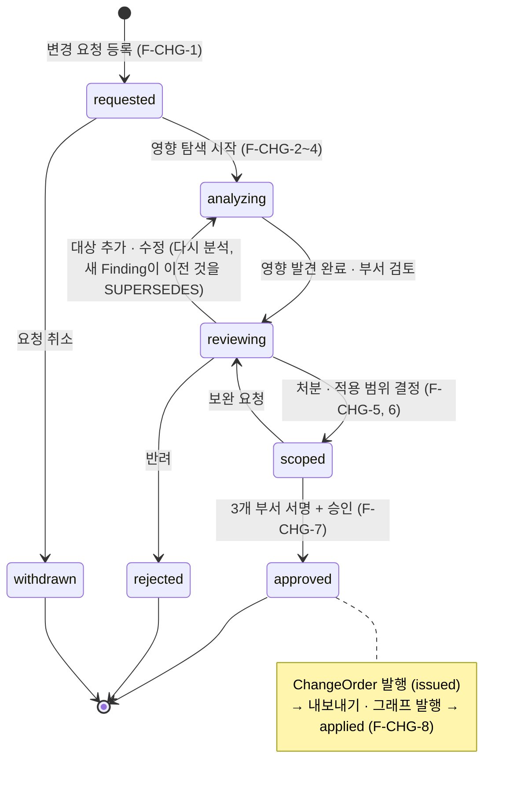
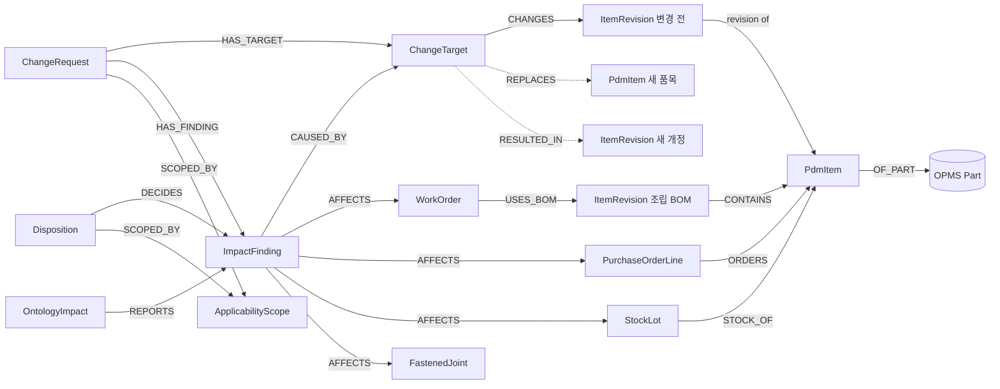

# 설계 변경 영향 분석 — 온톨로지 설계 (볼트 · 너트 체결 제품 `BRK-M8`)

| 항목 | 내용 |
|---|---|
| 버전 | v0.1 초안 (2026-11-12) |
| 상태 | **개념 모델은 구현됐다**(`backend/src/onto_pdm/changes/models.py` · `db/changes.sql`, 커밋 `b28c69b`, 2026-11-12). **그래프(Neo4j) 쪽은 아직이다**: 이 문서의 라벨 · 관계 · 9장 검사 · 8장 질의는 별도 묶음이 `neo4j/changes-*.cypher`로 옮기는 중이고, 이 문서의 Cypher 초안은 갱신 시점에 돌려 본 것이 아니다. 구현에서 이름이 달라진 곳은 아래 "구현과의 이름 대응"에 적었다. "판단 필요"는 사용자가 정할 것 |
| 한 줄 요약 | 규격 · 재질 · 치수 · 구성 부품을 바꾸려 할 때 **어디까지 영향이 가는지 찾고(`ImpactFinding`), 그중 무엇을 어떻게 바꿀지는 따로 결정한다(`Disposition`).** 영향은 BOM → 작업지시 → 발주 · 재고로 따라가고, 적용 범위는 날짜 · 사업장 · 로트 · 일련번호로 좁힌다 |
| 관련 문서 | [change-impact-prd.md](change-impact-prd.md)(요구사항 · 이 문서의 F-CHG-n) · [change-impact-design.md](change-impact-design.md)(개발 설계) · [neo4j-lpg-design.md](neo4j-lpg-design.md)(그래프 모델 · 소유 라벨) · [fit-check-plan.md](fit-check-plan.md)(OPMS 적합성 판정) · [fastener-classification.md](fastener-classification.md)(볼트 분류) · [worker-view-proposal.md](worker-view-proposal.md)(조회 전용 작업 화면) |

표기: ✅ 있음 · 🟡 일부 · ⬜ 없음 · **판단 필요** = 사용자가 정할 것 · *추정* = 읽은 근거로 짐작한 것. 근거는 `파일:줄`. 날짜는 절대 날짜.

> **근거 기준**: OPMS는 `D:\ernest_hemingway_OPMS`의 **PDM 브랜치**만 읽었다(HEAD `03331ba`, 온톨로지 0.19.0 — `holeDepth` · `fit_check` 1개는 커밋 `58ffed2`. 처음 조사 때는 `7d1e484`(0.18.0)였고 그 뒤 OPMS가 앞서 나갔다). OPMS는 읽기만 했고 수정하지 않았다. 이 PDM 저장소는 작업 트리 상태 그대로 읽었다.

### 구현과의 이름 대응 (2026-11-12, 커밋 `b28c69b`)

이 문서의 이름과 구현(계약 · 도메인 모델 · PG 표)이 다른 곳이다. 코드가 정본이고, **그래프 라벨 · 속성은 아래 오른쪽 이름을 따른다.**

| 구분 | 이 문서(개념) | 구현 | 근거 |
|---|---|---|---|
| 변경 종류 | `change_kind`: `replace` · `revise` · `bom_edit` · `attribute_edit` | 계약 · 도메인은 같은 값. **PG `change_target.kind`는 `replacement · revision · bom_line`** — `replace→replacement`, `revise`와 `attribute_edit→revision`(서비스가 둘을 같게 다룬다), `bom_edit→bom_line`. 변환은 PG 저장소가 연결될 때 한다(아직 없음) | `changes/models.py:25` · `service.py:514-521` · `db/changes.sql:156-168` |
| 영향 심각도 | `none · review · affected · blocked` | 같음 | `models.py:27` |
| 적용 범위 판정 | `pass · full · none · partial · unknown` | 4값 `inside · outside · partial · unknown`(`pass`와 `full`은 `inside`로 합쳐진다) | `changes/scope.py` |
| 작업지시 | `planned_start` · `actual_start` · `routing_rev` | `start_date`(날짜 기준은 `start_date`, 없으면 `due_date`) · `due_date` · `process_rev`. `serial_prefix`는 없다 | `models.py:556-570` · `scope.py:35-38` |
| 발주 항목 | `ordered_rev` · `qty_open` · `promised_date` | `item_rev` · `qty_received`(미입고 = `qty_ordered − qty_received`) · `due_date` | `models.py:581-591` |
| 재고 로트 | `quality_status`: `available · quarantine · blocked` | `status`: `available · quarantine · hold`(문서의 `blocked`는 `hold`) | `models.py:39` |
| 항목 키 | `ItemRevision`/`PdmItem` id | 도메인 모델은 품번 문자열 `item_no`. PG id 변환은 저장소 계층 | C0-코어 |
| 영향 종류 `FindingKind` | `bom_usage · product · work_order · purchase_order_line · stock_lot · fit_pair · fit_grip · strength_grade` | 위에 **`substitute`**(대체 후보 판정) 추가 | `models.py:29-32` |
| 오류 코드 | — | `IMPACT_STALE` · `BLOCKED_FINDINGS` · `DISPOSITION_REQUIRED` · `REVIEW_REQUIRED` · `REVISION_CHANGES_IDENTITY` 등(`ChangeErrorCode`). `ontology` 종류 대상은 400이 아니라 **422** | `models.py:97-119` |
| 상태 전이 | `can_transition(from, to)` | `can_transition(machine, from, to)`(요청 · 지시 두 기계) | `models.py:216` |

**처분 `action` 이름**(7.1절의 이름 → 구현). 구현의 선택지는 대상 종류별로 정해져 있다(`ALLOWED_ACTIONS`).

| 이 문서(7.1) | 구현 | 비고 |
|---|---|---|
| `accept_as_is` | `use_as_is` | 완료분 |
| `continue_old_revision` | 작업지시 `continue_old` · 발주 `receive_and_use` | 대상에 따라 다르다 |
| `switch_to_new_revision` | `apply_new` | 미착수 작업 |
| `hold` · `rework` · `retrofit` | **구현하지 않았다** | 진행 중 작업의 별도 검토는 `change_in_progress`, 취소 후 재발행은 `cancel_reissue`로 둔다 |
| `amend_order` · `cancel_order` | `amend` · `cancel` | |
| `use_up_stock` · `quarantine_stock` · `return_to_supplier` · `scrap_stock` | `use_up` · `quarantine` · `return` · `scrap` | |
| `substitute_by_approval` | `choose_substitute` | 적합성 finding |
| (없음) | `block_change` · `review_with_design` · `acknowledge` · `accept_risk` | `accept_risk`는 **`blocked`에 쓸 수 없다**(기본). 사용자 결정 대기 |
| `no_action_needed` | 같음 | `review`를 닫는 길. 모든 대상에 허용 |

처분이 필요한 것: `affected`(없으면 승인 불가 `DISPOSITION_REQUIRED`). `blocked`가 남으면 승인 불가(`BLOCKED_FINDINGS`). 필요한 검토: `design`은 항상, `purchasing` · `production`은 발주 · 재고 / 작업지시 영향이 `affected`일 때.

## 1. 무엇을 풀려는가

설계를 바꾸면 "영향이 있다"와 "바꿔야 한다"가 다르다. 이미 만든 제품은 옛 사양으로 허용될 수 있고, 진행 중인 작업은 별도 검토가 필요하며, 남은 재고를 쓸지 격리할지도 승인 판단이다. 그래서 이 설계는 **발견**과 **결정**을 두 종류의 객체로 가른다.

| 질문 | 객체 | 누가 정하나 |
|---|---|---|
| 이 변경이 무엇에 닿는가 | `ImpactFinding` (영향 발견) | 시스템이 계산한다. 근거(온톨로지 버전 · 규칙 · 시점)를 같이 저장한다 |
| 닿은 것을 어떻게 할 것인가 | `Disposition` (처분 결정) | 사람이 정한다(설계 · 구매 · 생산 검토 후 승인) |
| 어디까지 적용하는가 | `ApplicabilityScope` (적용 범위) | 사람이 정한다. 날짜 · 사업장 · 생산 로트 · 제품 일련번호 |

다섯 가지 원칙(세 문서 공통):

1. **규격이 바뀌면 새 품번(교체), 같은 품번 안의 도면 · 공차 · 검사 조건은 개정.** 규격 값(`threadSize` · `length` · `material` …)은 OPMS 소유라 PDM이 바꿀 수 없다. 바꾸려면 다른 `:Part`로 **교체**한다(5.5절).
2. **온톨로지 버전 ≠ 부품 개정.** 온톨로지 버전이 바뀌어도 `ItemRevision`을 만들지 않는다. 읽기 보고(`OntologyImpact`)로만 다룬다(10.3절). OPMS의 `revalidation_impacts`가 보고 전용인 것과 같은 방식이다.
3. **영향 ≠ 변경.** `ImpactFinding`이 있다고 처분이 자동으로 생기지 않는다. PDM은 ERP · MES에 아무것도 쓰지 않는다(처분은 결정 기록이고, 내보내기는 읽는 쪽이 가져가는 파일이다. F-CHG-8).
4. **판정은 OPMS 값만 쓴다.** 품번 · 분류 · 속성 · 짝 규칙은 OPMS가 주인이다. PDM이 임시로 계산한 판정은 `temporary: true`로 표시한다(5.1절).
5. **승인본은 바꾸지 않는다.** 승인(released) 리비전은 DB 트리거가 막는다(`db/schema.sql:599-625` `guard_revision`, `:634-651` `guard_locked_parent`). 바꾸려면 새 리비전이다.

## 2. 소유와 경계

### 2.1 누가 무엇의 주인인가

| 구분 | 객체 | 소유 | PDM이 하는 일 | 근거 |
|---|---|---|---|---|
| OPMS | `Class` `Property` `Concept` `Rule` `OntologyVersion` | OPMS | **읽기만** | `neo4j-lpg-design.md:22` |
| OPMS | `Part`(품번 · 규격 속성) `Supplier` `SupplierPart` | OPMS | **읽기만.** `:Part`에 라벨 · 속성을 달지 않는다 | `neo4j-lpg-design.md:23,28` |
| PDM (기존) | `PdmItem` `ItemRevision` `ProductModel` `PartIdentifier` `MaterialProfile`, 관계 `CONTAINS` `HAS_REVISION` `CURRENT_REVISION` `OF_PART` | PDM | 쓰고 지운다. 승인본만 그래프에 올린다 | `neo4j-lpg-design.md:24,70` |
| PDM (**신규**) | `ChangeRequest` `ChangeOrder` `ChangeTarget` `ApplicabilityScope` `ImpactFinding` `Disposition` `OntologyImpact` `ReviewSignoff` `RevisionAttribute` `FastenedJoint` | PDM | 쓰고 지운다 | 3장 |
| 외부 (ERP · MES) | `WorkOrder` `PurchaseOrderLine` `StockLot` | **ERP · MES가 주인.** PDM은 **읽기 사본** | 입력 경로(F-CHG-12)로 받아 `source_system` · `as_of`와 함께 보관. 쓰지 않는다 | `db/schema.sql:540` `inventory_balance` · `:1024` `pub.upsert_inventory` 패턴 |

- OPMS에는 부품 개정 · BOM · 발주 · 재고 · 작업지시 · 변경요청이 **코드에 없다**(설계 문서뿐: `:PartRevision` · `:BomLine` · `:Product`는 OPMS PRD 2906-2917 설계, 발주 · 설계변경은 범위 밖. 조사 2026-11-12). 그래서 PDM이 이 개념의 소유자가 된다. **이름이 겹치지 않게** PDM은 기존 `ItemRevision` · `CONTAINS`를 쓰고 `:PartRevision` · `:BomLine`을 만들지 않는다.
- 새 PDM 라벨은 OPMS `ontology sync`가 지우지 않는다. sync는 YAML에 있는 라벨 · 키로 한정해서 지운다(`neo4j-lpg-design.md:20`, OPMS `CR-NEXT-onto-pdm-merge-prep.md` 2장). 단, 새 라벨이 OPMS 라벨 이름과 겹치지 않는지는 **쓰기 전에 확인**한다(현재 OPMS에 `WorkOrder` `PurchaseOrderLine` `StockLot` `ChangeRequest` 등은 없다 — 확인 2026-11-12).

### 2.2 사용자 용어 ↔ 이 설계의 라벨

사용자가 정리한 "필요한 객체" 표를 그대로 옮기면 다음과 같다.

| 사용자 용어 | 이 설계 | 비고 |
|---|---|---|
| ChangeRequest / Order (변경 요청 · 지시) | `ChangeRequest` + `ChangeOrder` | 요청은 "무엇을 왜"이고 지시는 승인된 결과. 상태는 3.9절 |
| PartRevision (부품 개정) | **기존 `ItemRevision`** | 부품 품목(`PdmItem`)의 개정. 규격품은 OPMS `:Part`가 있고 개정은 PDM이 관리한다 |
| BOMRevision (BOM 개정) | 조립품 `PdmItem`의 `ItemRevision` | BOM의 **부모는 리비전**이다 (`neo4j-lpg-design.md:71`) |
| BOMLine (BOM 항목) | 관계 `(:ItemRevision)-[:CONTAINS {quantity, find_no}]->(:PdmItem)` | 관계에 수량을 단다 (`neo4j-lpg-design.md:46`) |
| PurchaseOrderLine (발주 항목) | `PurchaseOrderLine` (외부 사본) | 품번 · 발주한 개정 · 미입고 수량 |
| WorkOrder (작업지시) | `WorkOrder` (외부 사본) | 적용 BOM 개정(`USES_BOM`) · 공정 개정 · 진행 상태 |
| 재고 | `StockLot` (외부 사본) | 로트 · 가용 · 격리 상태 |
| 적용 범위 | `ApplicabilityScope` | 날짜 · 사업장 · 로트 · 일련번호 |

> 온톨로지 버전은 부품 개정으로 대신하지 않는다 — 사용자 지시(2026-11-12, 붙여 넣은 요구 문서의 "OPMS와의 연결" 절)이고 위 원칙 2와 같다.

## 3. 개념 모델

속성 표기: **필수**는 굵게. 단위는 mm 기본. 날짜 · 시각은 `datetime`(KST 오프셋 포함, 기존 `released_at` 형식과 같다).

### 3.1 `ChangeRequest` — 변경 요청

| 속성 | 타입 | 필수 | 설명 · 예 |
|---|---|---|---|
| `cr_no` | string | ✔ | 고유. `CR-2026-0001` |
| `title` | string | ✔ | "상판 두께 8 → 12 mm" |
| `reason_kind` | enum | ✔ | `design_improvement` · `defect` · `supplier` · `cost` · `regulation` · `other` |
| `reason` | string | ✔ | 변경 이유(자유 서술) |
| `status` | enum | ✔ | 3.9절 상태 머신 |
| `requested_by` · `requested_at` | string · datetime | ✔ | |
| `urgency` | enum | | `normal` · `urgent` |

### 3.2 `ChangeTarget` — 바꾸려는 한 가지

한 요청에 여러 개가 들어갈 수 있다(예: 볼트 교체 + 와셔 줄 수량 변경).

| 속성 | 타입 | 필수 | 설명 · 예 |
|---|---|---|---|
| `target_id` | string | ✔ | 고유 |
| `change_kind` | enum | ✔ | `replace`(품번 교체) · `revise`(같은 품번의 새 개정: 도면 · 공차 · 검사 조건) · `bom_edit`(BOM 줄 추가 · 삭제 · 수량) · `attribute_edit`(PDM 소유 수치 속성 변경: 두께 · 구멍 깊이 …) |
| `before_json` · `after_json` | string(JSON) | ✔ | 변경 전 · 후 값. 종류별 모양은 아래 표. Neo4j 속성은 맵을 못 담아 JSON 문자열로 둔다 |
| `proposed_rev` | string | | 새로 만들 리비전 이름(`R01`). 승인 전에는 PG의 작업중 리비전이라 **그래프에 없다**(3.9절) |

| `change_kind` | 승인 전에 바뀌는 것 | `after_json` 예 | 영향 재계산 |
|---|---|---|---|
| `replace` | 어느 BOM · 접합부의 품목 하나를 다른 품목으로 | `{"item": "P-00000000023"}` | **한다** (짝 · 그립 · 강도) |
| `attribute_edit` | PDM 소유 수치(`RevisionAttribute`) | `{"thickness": {"value": 12, "unit": "mm", "source": "drawing"}}` | **한다** (그립 길이) |
| `bom_edit` | 조립품 리비전의 `CONTAINS` 줄 | `{"find_no": 3, "quantity": 4}` | 한다 (구성 · 수량 · 접합부) |
| `revise` | 도면 · 공차 · 검사 조건(규격 값은 그대로) | `{"note": "표면 거칠기 Ra 1.6 추가"}` | **체결 판정은 안 한다**(규격이 같다). 사용처 · 작업지시 · 재고만 `review`로 보인다 |

### 3.3 `ImpactFinding` — 영향 발견

| 속성 | 타입 | 필수 | 설명 · 예 |
|---|---|---|---|
| `finding_id` | string | ✔ | |
| `kind` | enum | ✔ | `where_used` · `mates` · `grip_length` · `strength_grade` · `substitute` · `bom_diff` · `open_workorder` · `open_po` · `stock` · `scope_gap` |
| `severity` | enum | ✔ | `none`(영향 없음) · `review`(사람이 확인) · `affected`(영향 있음, 처분 필요) · `blocked`(제안대로면 성립하지 않음, 승인 전에 해소 필요) |
| `reason_code` | string | ✔ | OPMS 이유 코드를 그대로 쓴다: `shortfall` `thin_margin` `value_missing` `value_unreadable` `approximate_value` `unit_unconvertible` `no_rule` (`OPMS contracts.py:1769-1877`). PDM 고유: `pair_mismatch` `pair_unknown` `pair_unrelated` `strength_differs` `substitute_conditional` `used_in_completed` `used_in_progress` `open_po_line` `stock_on_hand` `scope_unknown` |
| `summary` | string | ✔ | 쉬운 말 한 줄: "필요 길이 32.5 mm, 볼트 30 mm — 2.5 mm 부족" |
| `basis_ontology_version` | string | ✔ | 판정에 쓴 OPMS 온톨로지 버전 (`0.19.0`) |
| `basis_rule_id` | string | | OPMS 규칙 id(`bolt_nut`). PDM 참고 판정이면 `pdm:grip_length` |
| `basis_as_of` | datetime | ✔ | 계산한 시각. 외부 사본이면 그 `as_of`도 근거에 같이 남긴다 |
| `temporary` | boolean | ✔ | OPMS 서버 판정이 아니라 PDM이 임시 계산했는가 (5.1절) |
| `approximate` | boolean | ✔ | 입력 중 CAD 추정값이 있었는가. 있으면 판정을 한 단계 낮춘다 |
| `computed_at` | datetime | ✔ | |

- **판단 시점 스냅샷(F-CHG-11)**: 처분이 달린 `ImpactFinding`은 바꾸지 않는다. 다시 분석하면 새 노드를 만들고 `(new)-[:SUPERSEDES]->(old)`로 잇는다. 그래서 "그때 어떤 근거로 결정했는지"가 남는다.

### 3.4 `Disposition` — 처분 결정

| 속성 | 타입 | 필수 | 설명 |
|---|---|---|---|
| `disposition_id` | string | ✔ | |
| `action` | enum | ✔ | `no_action_needed` · `accept_as_is` · `continue_old_revision` · `switch_to_new_revision` · `hold` · `rework` · `retrofit` · `amend_order` · `cancel_order` · `use_up_stock` · `quarantine_stock` · `return_to_supplier` · `scrap_stock` · `substitute_by_approval`. 종류별로 고를 수 있는 값은 7.1절 |
| `status` | enum | ✔ | `proposed`(시스템 제안) · `decided`(사람이 결정) |
| `decided_by` · `dept` · `decided_at` | string · enum · datetime | decided일 때 ✔ | `dept` = `design` · `purchasing` · `production` |
| `rationale` | string | decided일 때 ✔ | 결정 이유 |

### 3.5 `ApplicabilityScope` — 적용 범위

| 속성 | 타입 | 설명 · 예 |
|---|---|---|
| `scope_id` | string ✔ | |
| `cutover_basis` | enum ✔ | 무엇을 기준으로 갈라 적용하나: `order_start`(작업 시작일) · `lot` · `serial` · `receipt_date`(발주 입고 예정일) |
| `effective_from` · `effective_to` | date | 비우면 제한 없음 |
| `sites` | string[] | 사업장 코드. 비우면 전체 |
| `lots` | string[] | 생산 로트 목록 또는 `lot_from`~`lot_to` |
| `serial_prefix` · `serial_from` · `serial_to` | string · int · int | 제품 일련번호 구간 (`BRK-` + 0071 ~ 0120). 구간 끝이 없으면 "이후 전부" |
| `note` | string | |

겹침 판정은 7.2절.

### 3.6 `ReviewSignoff` · `ChangeOrder` · `OntologyImpact`

| 라벨 | 속성 | 설명 |
|---|---|---|
| `ReviewSignoff` | **`dept`**(design · purchasing · production) · **`decision`**(approved · rejected · needs_info) · `reviewer` · `at` · `comment` | 부서별 검토 서명. 세 부서가 모두 `approved`여야 승인 요청이 가능하다(9장). *개발 설계 문서와 표를 맞춘다* |
| `ChangeOrder` | **`co_no`** · **`status`**(issued · applied · cancelled) · `issued_by` · `issued_at` · `applied_at` | 승인된 변경 지시. 요청이 승인될 때 만든다. `applied`는 후속 내보내기 · 그래프 발행이 끝났다는 뜻(F-CHG-8) |
| `OntologyImpact` | **`oi_id`** · **`ontology_from`** · **`ontology_to`** · `generated_at` · `finding_count` · `status`(reported · acknowledged · dismissed) · `source`(opms_diff · pdm_scan) | 온톨로지 버전이 바뀌었을 때의 영향 **보고**. 리비전도 변경 요청도 만들지 않는다(10.3절) |

### 3.7 PDM 소유 설계 값 · 접합부 — `RevisionAttribute` · `FastenedJoint`

그립 길이를 계산하려면 "어느 판들을 어느 볼트 세트가 조이는지"와 "판 두께"가 필요한데, 둘 다 **OPMS에 없다**(판은 `:Part`가 없고, 접합 구조는 BOM에 없다). 그래서 PDM이 소유하는 노드로 둔다.

| 라벨 | 속성 | 설명 |
|---|---|---|
| `RevisionAttribute` | **`key`**(`thickness`) · **`value`**(number) · **`unit`**(`mm`) · **`source`**(`drawing` · `cad` · `manual`) · **`confirmed`**(boolean) · `approximate`(boolean) · `confidence` | 리비전이 가진 PDM 소유 수치. `(:ItemRevision)-[:HAS_ATTR]->(:RevisionAttribute)`. CAD 추정값은 `approximate: true` · `confirmed: false`로 들어가고, 사람이 확정하면 `confirmed: true` |
| `FastenedJoint` | **`joint_id`** · `name` · **`bolt_count`**(int) · `source`(manual · cad) · **`confirmed`**(boolean) | 볼트 · 너트로 조이는 접합부 하나. 모듈 리비전이 가진다: `(:ItemRevision)-[:HAS_JOINT]->(:FastenedJoint)`. 판 · 볼트 · 너트 · 와셔 연결은 4장 |

- 기존 CAD 분석은 체결 부품의 박힌 축 · 묶인 부품(`host`)까지만 구하고 구멍 깊이는 재지 않는다(`src/core.js:520-531`, `fit-check-plan.md:37`). 접합부 구조는 **엔지니어가 확정**하는 것이 기본이고, CAD가 후보를 제안하는 것은 후속이다(*추정*).

### 3.8 외부 사본 — `WorkOrder` · `PurchaseOrderLine` · `StockLot`

세 라벨 모두 공통으로 **`source_system`**(`ERP` · `MES` · `fixture`)과 **`as_of`**(사본 시각)가 필수다(`inventory_balance`와 같은 패턴). 시험 픽스처는 `fixture`로 구분하고 앱 화면에는 목 데이터를 넣지 않는다(사용자 지시 2026-11-11).

| 라벨 | 속성 | 설명 |
|---|---|---|
| `WorkOrder` | **`wo_no`** · **`status`**(`planned` · `released` · `in_progress` · `completed` · `closed` · `cancelled`) · `site` · `lot_no` · `serial_prefix` · `serial_from` · `serial_to` · `qty_planned` · `qty_done` · `planned_start` · `actual_start` · `routing_rev`(공정 개정 문자열, MES 값 그대로 읽기만) | 적용 BOM 개정은 관계 `USES_BOM`. 공정 개정은 PDM이 소유하지 않는다 |
| `PurchaseOrderLine` | **`po_no`** · **`line_no`** · **`ordered_rev`**(발주한 개정) · **`qty_ordered`** · **`qty_open`**(미입고) · `site` · `promised_date` · `status`(open · partial · closed) | 대상 품목은 관계 `ORDERS` |
| `StockLot` | **`lot_no`** · **`qty_on_hand`** · `qty_allocated` · `site` · `location` · **`quality_status`**(available · quarantine · blocked) | 대상 품목은 관계 `STOCK_OF`. 기존 `inventory_balance`(품목 · 사업장 · 위치 단위)보다 **로트 단위**로 세분했다 — 격리 · 로트 범위 판단에 필요하다(*판단 필요*: PG `inventory_balance`를 로트 단위로 확장할지, 로트 표를 새로 둘지 — 개발 설계 문서) |

### 3.9 상태 머신

붙여 넣은 업무 흐름(변경 요청 → 영향 대상 탐색 → 설계 · 구매 · 생산 검토 → 적용 시점 · 대상 결정 → 승인 → 후속 업무 반영)에 맞춘다.



- **승인 전 객체의 위치**: 변경 요청 · 대상 · 영향 발견 · 처분은 승인 전에 계속 바뀌므로 정본은 **PostgreSQL**이다. 영향 분석은 승인본 그래프(`CURRENT_REVISION`) 위에 변경 대상의 `after` 값을 덧씌워(what-if) 백엔드가 계산한다. 그래프는 **승인본만** 담는다는 기존 원칙(`neo4j-lpg-design.md:70`)을 지키기 위해, `ChangeOrder`가 `approved`된 뒤에 발행기가 `Change*` 노드를 그래프에 쓴다(이력 · 감사 질의용). *개발 설계 문서와 맞춘다 — 판단 필요: 승인 전 요청도 그래프에 올릴지.*

## 4. 관계와 그래프 한눈에

### 4.1 관계 표

| 관계 | 방향 | 속성 | 뜻 |
|---|---|---|---|
| `HAS_TARGET` | ChangeRequest → ChangeTarget | | 요청이 가진 변경 한 가지 |
| `CHANGES` | ChangeTarget → **ItemRevision** | | 바꾸려는 **현재 개정**(변경 전). `bom_edit`이면 조립품의 리비전 |
| `REPLACES` | ChangeTarget → PdmItem | `{role: 'new'}` | `replace`에서 새로 들어올 품목. 이미 OPMS `:Part`가 있는 품목이어야 한다 |
| `RESULTED_IN` | ChangeTarget → ItemRevision | | 승인 후 실제로 생긴 새 개정(승인 전에는 없다) |
| `HAS_FINDING` | ChangeRequest → ImpactFinding | | |
| `CAUSED_BY` | ImpactFinding → ChangeTarget | | 이 영향을 만든 변경 |
| `AFFECTS` | ImpactFinding → ItemRevision \| FastenedJoint \| WorkOrder \| PurchaseOrderLine \| StockLot | | 영향받는 대상 |
| `SUPERSEDES` | ImpactFinding → ImpactFinding | | 재분석이 이전 판단을 대체 |
| `DECIDES` | Disposition → ImpactFinding | | 이 영향에 대한 결정 |
| `SCOPED_BY` | ChangeRequest \| Disposition → ApplicabilityScope | | 요청 전체의 기본 범위, 또는 처분 하나의 범위(덮어씀) |
| `HAS_REVIEW` | ChangeRequest → ReviewSignoff | | |
| `ISSUED_FROM` | ChangeOrder → ChangeRequest | | |
| `REPORTS` | OntologyImpact → ImpactFinding | | 온톨로지 변경 보고가 담은 영향 |
| `TRIGGERED_BY` | ChangeRequest → OntologyImpact | | (선택) 이 보고를 보고 사람이 연 요청 |
| `USES_BOM` | WorkOrder → **ItemRevision** | | 작업지시가 쓰는 BOM 개정 |
| `ORDERS` | PurchaseOrderLine → PdmItem | | 발주한 품목 |
| `STOCK_OF` | StockLot → PdmItem | | 재고 품목 |
| `HAS_ATTR` | ItemRevision → RevisionAttribute | | 개정이 가진 PDM 소유 수치 |
| `HAS_JOINT` | ItemRevision → FastenedJoint | | 모듈 개정의 접합부 |
| `CLAMPS` | FastenedJoint → PdmItem | `{stack_order}` | 접합부가 조이는 판(위에서부터 1, 2 …) |
| `USES_BOLT` · `USES_NUT` | FastenedJoint → PdmItem | | 접합부의 볼트 · 너트 품목 |
| `USES_WASHER` | FastenedJoint → PdmItem | `{side: 'head' \| 'nut', per_bolt}` | 와셔. 머리 쪽 · 너트 쪽 |

### 4.2 한눈에 (핵심 연결)

사용자 문서의 핵심 연결 — "변경 대상 개정에서 사용 중인 BOM → 관련 작업지시 → 발주 · 재고" — 을 그대로 경로로 만든다.

```
 (:ChangeRequest)-[:HAS_TARGET]->(t:ChangeTarget)-[:CHANGES]->(target:ItemRevision)      ← 변경 대상 개정 (PDM)
                                                                    ▲
                                       [:CONTAINS {quantity}]       │ 사용처: BOM의 부모는 '리비전'
 (:PdmItem 대상품목)◀─[:HAS_REVISION]──────────────────────── 대상이 들어 있는 모든 개정 (승인 · 폐기 포함)
        │  ▲                                                        ▲
        │  └──[:ORDERS]── (:PurchaseOrderLine {qty_open})           │ [:USES_BOM]
        └──────[:STOCK_OF]─ (:StockLot {lot_no, quality_status})    └── (:WorkOrder {status, lot_no, serial_*})   ← 외부 사본

 영향 발견:  (:ImpactFinding {severity, reason_code, basis_*})─[:AFFECTS]→ 위의 어느 노드든
 처분:       (:Disposition {action})─[:DECIDES]→ (:ImpactFinding),  ─[:SCOPED_BY]→ (:ApplicabilityScope)
```



## 5. 볼트 · 너트 도메인 규칙

### 5.1 판정을 누가 하는가 (임시 판정의 경계)

| 판정 | OPMS가 서버로 주나 | 그래서 PDM은 | 표시 |
|---|---|---|---|
| 길이 ↔ 홈 깊이 (`fit_check` `bolt_length_vs_hole_depth`: 볼트 길이 ≥ 홈 깊이 + 2.0) | ✅ `POST /api/v1/fit/judge` (A-42 · 43, 4상태) — 0.19.0(커밋 `58ffed2`) | 이 변경 분석의 **관통 볼트 · 너트에는 쓰지 않는다**(탭 구멍용) | `OPMS` |
| 볼트 ↔ 너트 · 와셔 짝 (`mates_with`) | ❌ 서버 판정 API 없음. 규칙은 `rules.yaml:11-34` · `relations.yaml` `matesWith`에 있고 계산형이다 (`CR-NEXT-mating-rules.md:86-105`). `POST /parts/match`는 중복 매칭용이고 **보류**다(`CR-NEXT-parts-match-api.md:3`) | OPMS 스냅샷(A-31 `ontology/versions/{v}/schema`)에서 `mates_with` 명세를 읽어 **같은 4상태 의미**로 계산 | `temporary: true` · "임시 판정" |
| 그립 길이 (두께 + 와셔 + 너트 + 나사 끝 여유) | ❌ 규칙이 없다. 어느 문서에도 이 공식이 없다(조사 2026-11-12) | PDM이 **참고 판정**으로 계산. OPMS 규칙이 아니다 | `PDM 참고` |
| 강도 등급 짝 | ❌ 순서 비교가 없어 `mates_with`로 못 쓴다(`CR-NEXT-mating-rules.md:233`) | 같은 문자열이면 같음, **다르면 항상 "검토 필요"** | `review` |

원칙: PDM은 OPMS의 판정을 **다시 계산하거나 바꾸지 않는다**(`fit-check-plan.md:9-14`). 위 임시 계산은 OPMS에 서버 판정이 생길 때까지의 자리이고, 생기면 호출로 바꾼다(5.6절 요청서 목록). 계산 결과에는 항상 `basis_ontology_version`을 붙인다.

### 5.2 짝 규칙 (`mates_with`)

| 쌍 | blocking(같아야 짝) | match(같아야 맞음) | prefer(같으면 좋음) | OPMS 근거 |
|---|---|---|---|---|
| 볼트 ↔ 너트 | `threadSize` | `pitch` (+ `threadDirection`: `relations.yaml` `matesWith`) | `material` · `surfaceTreatment` | `rules.yaml:11-34` `bolt_nut` |
| 볼트 ↔ 와셔 | `threadSize` | — | — | `bolt_washer` |
| 너트 ↔ 와셔 | `threadSize` | — | — | `nut_washer` |

짝 판정 4상태 (`src/registry/ontology/rules/mates_with.py:34`)와 **영향 심각도** 매핑:

| 판정 | 뜻 | 이 설계의 `severity` | `reason_code` | 예 |
|---|---|---|---|---|
| `fits` | blocking · match 모두 같다 | `none` | — | M8 1.25 볼트 ↔ M8 1.25 너트 |
| `mismatch` | blocking은 같고 match가 다르다 | **`blocked`** | `pair_mismatch` | M8 보통나사(1.25) 볼트 ↔ M8 가는나사(1.0) 너트 |
| `unrelated` | blocking이 다르다(짝이 아님) | **`blocked`** | `pair_unrelated` | M8 볼트 ↔ M10 너트 |
| `unknown` | 한쪽 값이 없다. 추측하지 않는다 | `review` | `pair_unknown` | 너트의 `pitch` 값이 비어 있음 |

`prefer`가 어긋나는 것(재질 · 도금이 다름)은 짝 성립에 영향이 없다(OPMS도 안내만). `note`에 "재질 다름(SUS304 ↔ SUS316)"을 적고 `severity`는 `none`으로 둔다.

### 5.3 그립 길이 (PDM 참고 판정 — **시연용 가정**)

> ⚠ **기준 출처 · 담당자 미지정.** 아래 공식과 임계값은 이 설계가 정한 시연용 가정이다. OPMS의 `fit_check` 숫자(`margin.add 2.0`, `warn_within 1.0`)도 같은 이유로 "시험용 가정"이다(`rules.yaml:176-188` 주석, `fit-check-plan.md:43`). 실제 사내 기준은 **판단 필요**.

```
필요 볼트 길이  =  Σ 판 두께   +   Σ 와셔 두께   +   너트 높이(nutHeight)   +   2 × 나사 피치(pitch)
                  (clamped)       (볼트 1개당)        (OPMS 값)                 (나사 끝 여유)
여유(margin)   =  볼트 length  −  필요 볼트 길이
```

| 입력 | 어디서 | 비고 |
|---|---|---|
| Σ 판 두께 | `FastenedJoint -[:CLAMPS]->` 판 품목의 현재 개정 `RevisionAttribute(key='thickness')` (what-if면 변경 후 값) | 출처 `drawing` · `manual`(확정)이면 정상. `cad` 추정이면 `approximate` |
| Σ 와셔 두께 | `USES_WASHER` 개수 × 와셔 `:Part`의 `thickness` (OPMS `Washer` 필수 속성) | 볼트 1개당 머리 쪽 1 + 너트 쪽 1 |
| 너트 높이 | 너트 `:Part`의 `nutHeight` | **필수가 아니다**(`Nut`에서 `required: false`) → 없으면 `value_missing` |
| 피치 | 볼트 `:Part`의 `pitch` | 볼트 필수 속성 |
| 볼트 길이 | 볼트 `:Part`의 `length` (머리 아래 길이) | 필수 속성 |

판정:

| 조건 | 4상태 | 이유 코드 | `severity` |
|---|---|---|---|
| 여유 ≥ 1.0 | `ok` | — | `none` |
| 0 ≤ 여유 < 1.0 | `conditional` | `thin_margin` | `review` |
| 여유 < 0 | `no` | `shortfall` | **`blocked`** |
| 필요한 값(`nutHeight` · 판 두께 …)이 비어 있다 | `unknown` | `value_missing` | `review` |
| 입력에 `approximate`가 있다 | **한 단계 낮춘다**: `ok → conditional`, 이미 `conditional`/`no`는 유지 | `approximate_value` | `review` 이상 |

- 너무 긴 볼트(나사 끝이 지나치게 튀어나옴)는 **판정하지 않는다**. 안내 문구만 남긴다. *판단 필요*: 상한 기준을 둘지.
- 단위는 mm. 다른 단위로 들어오면 OPMS `units.csv`로 바꾸고, 못 바꾸면 `unit_unconvertible`(`unknown`).

### 5.4 강도 등급 · 대체(substitutes)

| 항목 | 규칙 | `severity` |
|---|---|---|
| 강도 등급(`strengthGrade`) | 볼트와 너트의 값이 **같은 문자열이면 같음**. 다르면 순서를 비교할 수 없어 `review`: "강도 등급 조합 확인 필요(A2-70 ↔ A4-80)". 변경으로 **짝이 바뀐 접합부에만** 검사한다(기준선 R00은 분석 대상이 아니다) | 같음 `none` · 다름 `review` (`strength_differs`) |
| 대체(substitutes) | OPMS는 `substitutes` 규칙 6개를 갖고 있다(`rules.yaml:36-161`). 이 중 **플랜지볼트가 육각볼트 + 평와셔를 대신한다**(조사 2026-11-12). 적용되면 그 접합부에서 **머리 쪽 와셔(`side:'head'`)가 없어지고** 와셔 줄 수량이 바뀌므로 `bom_edit`이 함께 필요하다 | `substitute_conditional` → `review` (대체는 승인 판단) |
| 대체 판정 자동 적용 | **하지 않는다.** 대체 후보를 *제안*할 뿐이고, 채택은 `Disposition(action='substitute_by_approval')`이다 | |

### 5.5 개정 vs 교체 판별

| 바꾸려는 것 | 규격 값(OPMS)이 바뀌나 | 처리 | `change_kind` | 예 |
|---|---|---|---|---|
| 볼트 길이 · 나사 호칭 · 피치 · 재질 · 표면처리 · 강도 등급 · 머리 모양 | **바뀐다** | **새 품번으로 교체.** 새 `:Part`가 OPMS에 **이미 있어야** 한다. 없으면 OPMS 검토 경로(A-01 → 승인)로 등록한다 — 이 경로는 현재 **보류**다(`neo4j-lpg-design.md:114`) | `replace` | 볼트 SUS304 → SUS316 |
| 너트 높이 · 피치 · 재질 | 바뀐다 | 새 품번 | `replace` | 너트 P-…22 → P-…23 |
| 판 두께 · 구멍 위치 · 치수 공차 (PDM 소유 수치) | 아니다(`:Part` 없음 또는 값 불변) | **같은 품번의 새 개정** | `attribute_edit` | 상판 8 → 12 mm |
| 도면 · 표면 거칠기 · 검사 조건 · 포장 · 문서 | 아니다 | **같은 품번의 새 개정** | `revise` | 볼트 P-…01 도면에 검사 조건 추가 |
| BOM 줄 추가 · 삭제 · 수량 | — | 조립품(체결 세트 · 모듈)의 **새 개정** | `bom_edit` | 와셔 8 → 4 |

- 규칙의 근거: PDM은 OPMS `:Part`의 속성을 바꾸지 않는다(`neo4j-lpg-design.md:28`). OPMS는 규격이 다르면 다른 품번으로 본다(중복 판정이 `blocking_key` · 속성 일치로 한다 — OPMS 코드 조사 2026-11-12).
- OPMS 리비전은 품번 형식에 넣지 않고 `(part_no, rev)` 키로 둔다는 설계가 OPMS DECISIONS.md:410에 있다(*설계만, 코드 없음*). PDM의 `ItemRevision`이 지금은 그 자리를 대신하고, OPMS가 `:PartRevision`을 만들면 `(ItemRevision)-[:OF_PART_REV]->`를 추가하는 방식을 검토한다(*추정, 판단 필요*).

## 6. 목표 제품 `BRK-M8` — 인스턴스와 시나리오

### 6.1 제품 구성 (기준선 R00)

M8 볼트 · 너트 · 와셔로 두 장의 브래킷을 조인 모듈. 한 접합부(`J1`)에 볼트 4개.

| 품목 | 종류 | OPMS 부품 | 규격 값 (OPMS data) | 수량 |
|---|---|---|---|---|
| `BRK-M8` M8 체결 브래킷 모듈 | 조립품 | ❌ 없음 (열린 문제 1) | — | 1 |
| 상판 브래킷 | 가공품 | ❌ 없음 | 두께 8 mm (`RevisionAttribute`) | 1 |
| 하판 브래킷 | 가공품 | ❌ 없음 | 두께 8 mm | 1 |
| 체결 세트 | 조립품 | ❌ 없음 | — | 1 |
| ├ 육각볼트 M8×30 | 구매 규격품 | `P-00000000001` `HexBolt` | M8, 피치 1.25, 길이 30, SUS304, A2-70, 우나사 | 4 |
| ├ 육각너트 M8 | 구매 규격품 | `P-00000000022` `HexNut` | M8, 1.25, SUS316, A4-80, 이면폭 13, **높이 6.8** | 4 |
| └ 평와셔 M8 | 구매 규격품 | `P-00000000025` `FlatWasher` | M8, 내경 8.4, 외경 16, **두께 1.6**, SUS304 | 8 |

근거: OPMS `data/demo_seed/parts.yaml`(조사 2026-11-12). 이 저장소 `neo4j/sample.cypher`의 `P-…01`~`03`은 **다른 뜻의 설명용 번호**(너트가 `P-…02`)라서 이 문서는 OPMS 시연 데이터의 번호를 쓴다.

기준선 그립 계산(시연용 가정): 필요 길이 = 8 + 8 + 1.6×2 + 6.8 + 2×1.25 = 16 + 3.2 + 6.8 + 2.5 = **28.5** ≤ 볼트 30 → 여유 **1.5** → `ok`.

### 6.2 기준선 Cypher 초안 (`neo4j/fixtures`에 둘 시험 데이터. 지금은 파일을 만들지 않는다)

```cypher
// 모듈 · 판 · 체결 세트 (OPMS :Part 가 없는 품목. item_one_part 예외는 열린 문제 1)
UNWIND [
  {id: 2000, name: 'M8 체결 브래킷 모듈', type: 'assembly'},
  {id: 2001, name: '상판 브래킷',        type: 'part'},
  {id: 2002, name: '하판 브래킷',        type: 'part'},
  {id: 2003, name: '체결 세트',          type: 'assembly'}
] AS row
MERGE (i:PdmItem {pdm_item_id: row.id}) SET i.name = row.name, i.item_type = row.type, i.uom = 'EA';

// 규격품은 OPMS :Part 에 OF_PART 로 잇는다 (읽기만. :Part 를 만들지 않는다)
UNWIND [
  {id: 2101, part_no: 'P-00000000001'},   // HexBolt M8x30
  {id: 2102, part_no: 'P-00000000022'},   // HexNut M8
  {id: 2103, part_no: 'P-00000000025'},   // FlatWasher M8
  {id: 2104, part_no: 'P-00000000023'},   // HexNut M8 pitch 1.0  (SC-1 후보)
  {id: 2105, part_no: 'P-00000000015'}    // HexFlangeBolt M8x40  (SC-2 후보)
] AS row
MATCH (p:Part {part_no: row.part_no})
MERGE (i:PdmItem {pdm_item_id: row.id}) SET i.item_type = 'standard', i.uom = 'EA'
MERGE (i)-[:OF_PART]->(p);

// 승인 리비전 R00 (시험 id 대역 3000~3105)
UNWIND [
  {id: 3000, item: 2000}, {id: 3001, item: 2001}, {id: 3002, item: 2002}, {id: 3003, item: 2003},
  {id: 3101, item: 2101}, {id: 3102, item: 2102}, {id: 3103, item: 2103}, {id: 3104, item: 2104}, {id: 3105, item: 2105}
] AS row
MATCH (i:PdmItem {pdm_item_id: row.item})
MERGE (r:ItemRevision {pdm_revision_id: row.id})
  SET r.rev = 'R00', r.rev_seq = 0, r.status = 'released', r.released_at = datetime('2026-11-01T09:00:00+09:00'), r.change_note = '최초 승인'
MERGE (i)-[:HAS_REVISION]->(r) MERGE (i)-[:CURRENT_REVISION]->(r);

// BOM 줄 (부모는 리비전, 자식은 품목)
UNWIND [
  {rev: 3000, child: 2001, qty: 1, find: 1}, {rev: 3000, child: 2002, qty: 1, find: 2}, {rev: 3000, child: 2003, qty: 1, find: 3},
  {rev: 3003, child: 2101, qty: 4, find: 1}, {rev: 3003, child: 2102, qty: 4, find: 2}, {rev: 3003, child: 2103, qty: 8, find: 3}
] AS row
MATCH (r:ItemRevision {pdm_revision_id: row.rev}), (c:PdmItem {pdm_item_id: row.child})
MERGE (r)-[l:CONTAINS]->(c) SET l.quantity = row.qty, l.find_no = row.find;

// PDM 소유 수치 · 접합부
MATCH (t1:ItemRevision {pdm_revision_id: 3001}), (t2:ItemRevision {pdm_revision_id: 3002})
MERGE (t1)-[:HAS_ATTR]->(:RevisionAttribute {key:'thickness', value: 8.0, unit:'mm', source:'drawing', confirmed:true, approximate:false})
MERGE (t2)-[:HAS_ATTR]->(:RevisionAttribute {key:'thickness', value: 8.0, unit:'mm', source:'drawing', confirmed:true, approximate:false});

MATCH (m:ItemRevision {pdm_revision_id: 3000})
MERGE (m)-[:HAS_JOINT]->(j:FastenedJoint {joint_id:'J1'}) SET j.name = '상·하판 체결', j.bolt_count = 4, j.source = 'manual', j.confirmed = true
WITH j
MATCH (top:PdmItem {pdm_item_id: 2001}), (bot:PdmItem {pdm_item_id: 2002}),
      (b:PdmItem {pdm_item_id: 2101}), (n:PdmItem {pdm_item_id: 2102}), (w:PdmItem {pdm_item_id: 2103})
MERGE (j)-[:CLAMPS {stack_order: 1}]->(top) MERGE (j)-[:CLAMPS {stack_order: 2}]->(bot)
MERGE (j)-[:USES_BOLT]->(b) MERGE (j)-[:USES_NUT]->(n)
MERGE (j)-[:USES_WASHER {side:'head', per_bolt:1}]->(w) MERGE (j)-[:USES_WASHER {side:'nut', per_bolt:1}]->(w);

// 외부 사본 시험 픽스처 (source_system = 'fixture' — 앱 화면에는 쓰지 않는다)
UNWIND [
  {wo:'WO-FX-0001', st:'completed',   lot:'LOT-2610', from:1,  to:50,  site:'S1', done:50, plan:50},
  {wo:'WO-FX-0002', st:'in_progress', lot:'LOT-2611', from:51, to:80,  site:'S1', done:12, plan:30},
  {wo:'WO-FX-0003', st:'released',    lot:'LOT-2612', from:81, to:120, site:'S2', done:0,  plan:40}
] AS row
MATCH (r:ItemRevision {pdm_revision_id: 3000})
MERGE (w:WorkOrder {wo_no: row.wo}) SET w.status = row.st, w.lot_no = row.lot, w.serial_prefix = 'BRK-', w.serial_from = row.from,
      w.serial_to = row.to, w.site = row.site, w.qty_done = row.done, w.qty_planned = row.plan, w.source_system = 'fixture', w.as_of = datetime('2026-11-12T09:00:00+09:00')
MERGE (w)-[:USES_BOM]->(r);

MATCH (nut:PdmItem {pdm_item_id: 2102}), (bolt:PdmItem {pdm_item_id: 2101})
MERGE (p1:PurchaseOrderLine {po_no:'PO-FX-100', line_no: 10}) SET p1.ordered_rev='R00', p1.qty_ordered=200, p1.qty_open=120, p1.site='S1', p1.status='partial', p1.source_system='fixture', p1.as_of=datetime('2026-11-12T09:00:00+09:00')
MERGE (p1)-[:ORDERS]->(nut)
MERGE (s1:StockLot {lot_no:'LT-N-01'}) SET s1.qty_on_hand=300, s1.site='S1', s1.quality_status='available', s1.source_system='fixture', s1.as_of=datetime('2026-11-12T09:00:00+09:00')
MERGE (s1)-[:STOCK_OF]->(nut);
```

### 6.3 SC-1 — 너트를 가는나사 너트로 교체 (규격 교체 · 짝 불일치)

**요청**: `CR-2026-0001` "너트 P-…22 → P-…23". `change_kind = replace`, `CHANGES → 너트 R00(3102)`, `REPLACES → 품목 2104`.

| 단계 | 하는 일 | 결과 |
|---|---|---|
| 1 | 사용처 탐색(8.1절): 너트 품목 2102 ← 체결 세트 R00(3003) ← 모듈 R00(3000) ← `WO-FX-0001·0002·0003` | `where_used` `affected`: BOM 2개 개정 · 작업지시 3건 |
| 2 | 짝 판정(what-if: J1의 `USES_NUT`을 2104로): 볼트 P-…01(M8, 피치 **1.25**) ↔ 너트 P-…23(M8, 피치 **1.0**) | `mismatch` → **`blocked`**, `pair_mismatch`, "피치가 다릅니다(1.25 ↔ 1.0)". `temporary: true`, rule `bolt_nut`, 온톨로지 0.19.0 |
| 3 | 그립 판정: 너트 P-…23의 `nutHeight` = 6.8(2026-11-12 OPMS 개발 DB에서 확인). 필요 = 16 + 3.2 + 6.8 + 2×1.25 = 28.5 ≤ 30 | `ok` → `none` (값이 비어 있는 너트였다면 `unknown` · `value_missing` → `review`) |
| 4 | 강도 등급: 볼트 A2-70 ↔ 너트 A2-70 | 같음 → `none` (재질 SUS304 ↔ SUS304로 `prefer`도 일치) |
| 5 | 발주 · 재고: `PO-FX-100/10`(미입고 120), `LT-N-01`(재고 300)이 기존 너트 | `open_po` · `stock` `affected` — 처분 필요 |

**결론**: 이 요청은 **그대로 승인할 수 없다**(`blocked`). 해소 방법은 (가) 볼트도 피치 1.0으로 같이 교체 — 이런 볼트가 OPMS에 있는지는 **확인하지 못했다**(데모 시드에는 가는나사 볼트가 없다. 없으면 OPMS 검토 경로로 등록해야 하고 그 경로는 보류), (나) 요청을 반려. `blocked`가 있는 요청은 해소 대상 `ChangeTarget`이 추가되어 재분석에서 `blocked`가 사라지거나 요청이 `rejected`여야 한다(9장 `blocked_not_approvable`).

### 6.4 SC-2 — 상판 두께 8 → 12 mm (PDM 소유 수치 변경 · 그립 부족)

**요청**: `CR-2026-0002`. `attribute_edit`, `CHANGES → 상판 R00(3001)`, `after_json {thickness: 12 mm, source: drawing}`, `proposed_rev = R01`.

| 단계 | 하는 일 | 결과 |
|---|---|---|
| 1 | 사용처: 상판 2001 ← 모듈 R00(3000) ← `WO-FX-0001·0002·0003` | `affected` |
| 2 | 그립 재계산(what-if: 상판 두께 12): 12 + 8 + 1.6×2 + 6.8 + 2×1.25 = **32.5** | 볼트 30 < 32.5 → 여유 **−2.5**, `no` · `shortfall` → **`blocked`**, "필요 길이 32.5 mm, 볼트 30 mm — 2.5 mm 부족" (`PDM 참고`) |
| 3 | 후보 탐색(OPMS 읽기): 분류 `Bolt` 계열, `threadSize=M8`, 길이 ≥ 32.5, 너트 P-…22와 `fits` | OPMS 데모 시드에서는 **`P-00000000015` HexFlangeBolt M8×40(SUS316, A4-80)** 한 개. (육각 M8×35 같은 후보는 **확인하지 못했다**) |
| 4 | 후보 P-…15 what-if: 플랜지볼트가 육각볼트 + 평와셔를 대신(`substitutes`) → 머리 쪽 와셔 제거 | 필요 길이 = 12 + 8 + 1.6×1 + 6.8 + 2.5 = **30.9** ≤ 40 → 여유 9.1 → `ok` |
| 5 | 후보의 짝 · 강도: P-…15(M8, 1.25, A4-80, SUS316) ↔ 너트 P-…22(M8, 1.25, A4-80, SUS316) | `fits`, 강도 같음, 재질 `prefer` 일치 → `none` |
| 6 | 대체 · 구성 변경: 볼트 교체(`replace`) + 와셔 줄 8 → 4(`bom_edit`) 동반 | `substitute_conditional` → `review`. 과대 길이(여유 9.1)는 판정 안 함 — 안내만 |

**결론**: 원안은 `blocked`지만 "상판 두께 변경 + 볼트 교체 + 와셔 수량 변경"의 **세 대상 묶음**으로 다시 분석하면 `blocked`가 풀리고 `review`(대체 승인) 하나가 남는다. 처분 · 범위 예는 7.3절.

### 6.5 SC-3 — 볼트 변경이 개정인가 교체인가

| 변경 | 판별 | 처리 |
|---|---|---|
| (가) 볼트 P-…01 **도면 · 검사 조건** 추가(규격 값 그대로) | 같은 품번 안 | `revise`: `P-…01` 품목의 `R00 → R01`. 체결 판정은 하지 않는다(`fits`가 그대로). 사용처 · 작업지시 · 재고는 `review`("문서가 바뀐 개정을 쓰는 곳") |
| (나) 볼트 **재질 SUS304 → SUS316** | OPMS 규격 값이 바뀜 | **`replace`**: 다른 `:Part`가 필요. OPMS 데모 시드에는 이 재질의 육각 M8×30이 **없다**(`P-…15`는 플랜지 M8×40). 없으면 OPMS 등록 경로(보류). 이 때 PDM이 `P-…01` 개정 R01로 재질을 바꾸면 **원칙 위반**이다 |
| (다) 볼트 **표면처리 ZincPlated → Plain** | 규격 값(`surfaceTreatment`)이 바뀜 | (나)와 같다: `replace` |
| (라) 볼트 **나사 호칭 · 길이** | 규격 값이 바뀜 | `replace` |

가드: `replace` 대상이 아닌데 OPMS 규격 값을 `RevisionAttribute`로 흉내 내는 것을 검사로 막는다(`no_opms_value_shadow`, 9장).

## 7. 적용 범위와 처분 모델

### 7.1 영향 대상별 처분 (기본 제안은 **판단 필요**)

> 자동 변경 금지 원칙: 진행 중 오더를 무조건 자동 변경하지 않고 통제된 변경 절차를 두는 취지(사용자 자료가 인용한 SAP 생산오더 변경 관리 — 출처 `learning.sap.com`은 이 설계에서 직접 확인하지 않았다). PDM은 결정을 **기록**하고 파일로 내보낼 뿐 ERP · MES를 바꾸지 않는다.

| 영향 대상 | 허용되는 `action` | 시스템 기본 제안(`proposed`) | 이유 |
|---|---|---|---|
| **생산 완료 제품** (`completed` · `closed` 작업지시, 출하품) | `accept_as_is` · `retrofit`(개조 · 교체 서비스) · `no_action_needed` | `accept_as_is` | 이미 만든 제품은 기존 사양으로 허용될 수 있다. 개조 여부는 승인 판단 |
| **진행 중 작업** (`in_progress`) | `continue_old_revision` · `hold` · `rework` · `switch_to_new_revision` | **`hold`** (별도 변경 검토) | 진행 중 작업은 별도 변경 검토가 필요하다. 자동 전환은 제안하지 않는다 |
| **미착수 작업** (`planned` · `released`, `actual_start` 없음) | `switch_to_new_revision` · `continue_old_revision` · `hold` | `switch_to_new_revision` | 시작 전이라 새 개정을 쓰는 것이 자연스럽다. 결정은 사람 |
| **미입고 발주** (`PurchaseOrderLine.qty_open > 0`) | `amend_order` · `cancel_order` · `continue_old_revision` · `hold` | `hold` (구매 검토) | 공급사 계약이 걸려 있다. 구매 부서 판단 |
| **재고** (`StockLot`) | `use_up_stock`(소진 후 전환) · `quarantine_stock` · `return_to_supplier` · `scrap_stock` · `hold` | `hold` | 계속 쓸지 격리할지는 승인 판단. 격리는 ERP 재고 상태를 바꾸므로 **PDM이 직접 하지 않고** 결정만 기록해 내보낸다 |
| **BOM · 접합부** (`ItemRevision` · `FastenedJoint`) | `substitute_by_approval` · `no_action_needed` | — | 설계 부서 판단 |

- 모든 `affected` · `blocked` 영향에는 **`decided` 처분이 있어야** 승인할 수 있다(`disposition_required_for_affected`). `none`은 처분이 필요 없다. `review`는 `no_action_needed`로 닫을 수 있다.
- 처분은 영향 하나(`DECIDES`)마다 달고, 범위는 요청의 기본 범위(`cr SCOPED_BY`)를 따르되 처분이 자기 범위(`d SCOPED_BY`)로 덮어쓸 수 있다.

### 7.2 적용 범위 표현 · 겹침 판정

표현: 4가지 차원(날짜 · 사업장 · 로트 · 일련번호) 중 **지정한 것만** 제한한다. 지정하지 않은 차원은 제한 없음.

| 영향 대상 | 날짜 차원에서 쓰는 값 | 사업장 | 로트 | 일련번호 |
|---|---|---|---|---|
| 작업지시 | `actual_start`, 없으면 `planned_start` (`cutover_basis = order_start`) | `site` | `lot_no` | `serial_from ~ serial_to` |
| 발주 | `promised_date` (`receipt_date`) | `site` | — | — |
| 재고 | — | `site` | `lot_no` | — |

한 차원의 결과와 종합:

| 한 차원의 결과 | 뜻 |
|---|---|
| `pass` | 범위가 그 차원을 지정하지 않았다 |
| `full` | 대상 값이 범위 안에 완전히 들어간다 |
| `none` | 대상 값이 범위 밖이다 |
| `partial` | 구간이 일부만 겹친다(일련번호 · 날짜 구간) |
| `unknown` | 범위는 지정했는데 **대상에 그 값이 없다** |

| 종합 | 조건 | 다음 |
|---|---|---|
| 범위 밖 | 하나라도 `none` | 처분 불필요. "범위 밖(기존 개정 유지)"으로 기록 |
| 범위 안 | 모두 `pass` 또는 `full` | 처분 필요 |
| **부분** | `none` 없이 `partial`이 있다 | 처분 필요 + 분할 제안("일련번호 71~80만 새 개정") |
| 알 수 없음 | `none` 없이 `unknown`이 있다 | `scope_gap` · `scope_unknown` `review` |

예 (SC-2 승인안): 범위 = 효력 시작 2026-12-01, 사업장 S1 · S2, 일련번호 `BRK-0071` 이후.

| 대상 | 판정 | 처분 |
|---|---|---|
| `WO-FX-0001` completed, 일련번호 1~50 | 일련번호 `none` → **범위 밖** | `accept_as_is`(구현: SC-2 범위에서는 영향 목록에 나오지 않는다. 범위가 전체인 SC-1에서는 `none` · `use_as_is`) |
| `WO-FX-0002` in_progress, 일련번호 51~80, 시작 2026-11-02 | 일련번호만 보면 `partial`(71~80만 겹침)이지만 **날짜가 `none`**(시작일 2026-11-02 < 효력일 2026-12-01) → 하나라도 `none`이면 **범위 밖**(구현: `scope.py` `_combine`) | 영향 목록에서 빠진다(시험 `test_changes_scenarios.py`가 고정). 진행 중 작업을 `review`로 남길지는 **사용자 결정 대기**([PRD 11장 11](change-impact-prd.md)). 분할 제안(51~70은 옛 개정, 71~80은 별도 검토)은 구현하지 않았다 |
| `WO-FX-0003` released, 일련번호 81~120, 사업장 S2, 시작 2026-12-01 | 모두 `full`(구현: `inside`) | `switch_to_new_revision`(구현: `apply_new`) |
| `PO-FX-100/10` 너트(SC-1 아님, 참고) | 날짜 · 사업장 | `amend_order` 등 구매 판단 |

## 8. 질의 초안 (`neo4j/queries.cypher` 스타일, 시험 전)

PG 쪽 `where_used()` · `bom_explode()`(`db/schema.sql:854,884`)와 기존 `neo4j/queries.cypher`의 `@where_used` · `@bom_explode`는 **승인 BOM(`CURRENT_REVISION`)만** 따라간다. 변경 영향 분석은 **옛 개정과 폐기 개정도 봐야 한다**(진행 중 작업이 옛 개정을 쓸 수 있다)는 점이 다르다. 그래서 `HAS_REVISION` 전체를 따라가는 별도 질의를 둔다. 단순 사용처 목록은 기존 질의를 재사용한다.

### 8.1 대상 품목이 들어간 모든 BOM 개정 → 작업지시 → 발주 · 재고

```cypher
// @cr_where_used_revisions ($part_no)
//   대상 품목이 직접 · 간접으로 들어 있는 상위 품목의 '모든' 리비전(승인 · 폐기 포함)과 그 BOM 줄 수량.
//   보수적이다: 상위 리비전이 하위의 어느 개정을 쓰는지는 조회 시점 효력 규칙(CURRENT)으로 정하므로 후보 전체를 낸다.
MATCH (leaf:PdmItem)-[:OF_PART]->(:Part {part_no: $part_no})
MATCH (r:ItemRevision)-[:CONTAINS]->(:PdmItem)
      ( (:PdmItem)-[:HAS_REVISION]->(:ItemRevision)-[:CONTAINS]->(:PdmItem) )* (leaf)
MATCH (top:PdmItem)-[:HAS_REVISION]->(r)
RETURN DISTINCT top.pdm_item_id AS item_id, r.pdm_revision_id AS revision_id, r.rev AS rev, r.status AS status
ORDER BY item_id, rev;

// @cr_impacted_work_orders ($part_no)
MATCH (leaf:PdmItem)-[:OF_PART]->(:Part {part_no: $part_no})
MATCH (r:ItemRevision)-[:CONTAINS]->(:PdmItem) ( (:PdmItem)-[:HAS_REVISION]->(:ItemRevision)-[:CONTAINS]->(:PdmItem) )* (leaf)
MATCH (w:WorkOrder)-[:USES_BOM]->(r)
RETURN DISTINCT w.wo_no AS wo_no, w.status AS status, w.site AS site, w.lot_no AS lot_no,
       w.serial_from AS serial_from, w.serial_to AS serial_to, w.source_system AS source_system, w.as_of AS as_of
ORDER BY wo_no;

// @cr_open_po_and_stock ($part_no)
//   발주와 재고는 BOM 을 거치지 않고 품목에 바로 걸린다.
MATCH (leaf:PdmItem)-[:OF_PART]->(:Part {part_no: $part_no})
OPTIONAL MATCH (po:PurchaseOrderLine)-[:ORDERS]->(leaf) WHERE po.qty_open > 0
OPTIONAL MATCH (s:StockLot)-[:STOCK_OF]->(leaf)
RETURN collect(DISTINCT {po: po.po_no, line: po.line_no, qty_open: po.qty_open, site: po.site}) AS open_po,
       collect(DISTINCT {lot: s.lot_no, qty: s.qty_on_hand, status: s.quality_status, site: s.site}) AS stock;
```

### 8.2 로트 · 사업장 범위 필터

```cypher
// @cr_scope_work_orders ($part_no, $sites, $lot_from, $serial_from)
//   범위에 걸리는 작업지시만. 파라미터를 지정하지 않은 차원은 null 로 넘기면 통과한다. 'partial' 은 종합 판정(7.2)이 한다.
MATCH (leaf:PdmItem)-[:OF_PART]->(:Part {part_no: $part_no})
MATCH (r:ItemRevision)-[:CONTAINS]->(:PdmItem) ( (:PdmItem)-[:HAS_REVISION]->(:ItemRevision)-[:CONTAINS]->(:PdmItem) )* (leaf)
MATCH (w:WorkOrder)-[:USES_BOM]->(r)
WHERE ($sites IS NULL OR w.site IN $sites)
  AND ($serial_from IS NULL OR w.serial_to >= $serial_from)        // 구간의 끝이 범위 시작 이후면 겹침(부분 포함)
RETURN w.wo_no AS wo_no, w.serial_from AS serial_from, w.serial_to AS serial_to,
       CASE WHEN $serial_from IS NULL THEN 'pass'
            WHEN w.serial_from >= $serial_from THEN 'full'
            ELSE 'partial' END AS serial_overlap
ORDER BY wo_no;
```

### 8.3 개정 비교 (R00 vs R01 BOM diff)

```cypher
// @cr_bom_diff ($item_id, $rev_a, $rev_b)
MATCH (i:PdmItem {pdm_item_id: $item_id})-[:HAS_REVISION]->(a:ItemRevision {rev: $rev_a})
MATCH (i)-[:HAS_REVISION]->(b:ItemRevision {rev: $rev_b})
MATCH (a)-[la:CONTAINS]->(c:PdmItem)
OPTIONAL MATCH (b)-[lb:CONTAINS]->(c)
RETURN c.pdm_item_id AS child, la.quantity AS qty_a, lb.quantity AS qty_b,
       CASE WHEN lb IS NULL THEN 'removed' WHEN la.quantity <> lb.quantity THEN 'qty_changed' ELSE 'same' END AS change
UNION
MATCH (i:PdmItem {pdm_item_id: $item_id})-[:HAS_REVISION]->(a:ItemRevision {rev: $rev_a})
MATCH (i)-[:HAS_REVISION]->(b:ItemRevision {rev: $rev_b})
MATCH (b)-[lb:CONTAINS]->(c:PdmItem) WHERE NOT (a)-[:CONTAINS]->(c)
RETURN c.pdm_item_id AS child, null AS qty_a, lb.quantity AS qty_b, 'added' AS change;
```

- 승인 전 새 개정(작업중)은 그래프에 없으므로, 이 질의는 **승인 뒤**의 이력 비교다. 승인 전 what-if 비교는 백엔드가 `ChangeTarget.after_json`을 덧씌워 계산한다(3.9절).
- 영향이 깊은 단계까지 퍼질 때를 대비해 경로 길이 상한을 둔다(`*..8`). *판단 필요*: 상한 값.

## 9. 검사 규칙 초안 (`neo4j/checks.cypher` 스타일: `// @이름`, 결과가 없으면 통과)

기존 27개 검사와 같은 규칙으로 발행기가 `Change*`를 쓰는 트랜잭션에서 돌린다(`neo4j/checks.cypher:1-17`). 속성이 없을 때 조용히 빠지지 않도록 `coalesce(..., false)`를 쓴다.

| 이름 | 지키는 것 | 위반 조건(요약) |
|---|---|---|
| `change_has_target` | 변경 요청은 대상이 하나 이상 | `HAS_TARGET`이 0개 |
| `target_changes_released_revision` | `CHANGES`는 **승인(released)** 리비전을 가리킨다 | 가리키는 리비전이 `released`가 아님 |
| `released_revision_immutable` | 승인본을 고치지 않고 새 개정이 생긴다 | `RESULTED_IN` 리비전의 `rev_seq`가 `CHANGES` 리비전보다 크지 않음, 또는 같은 리비전 |
| `replace_target_has_part` | 교체할 새 품목은 OPMS 부품이 있다 | `REPLACES` 대상 `PdmItem`에 `OF_PART`가 없음 (`item_one_part`와 같은 취지) |
| `no_opms_value_shadow` | OPMS 규격 값을 PDM이 흉내 내지 않는다 | `RevisionAttribute.key`가 OPMS 속성 키(`threadSize` `length` `pitch` `material` …)인 경우 |
| `finding_has_basis` | 모든 영향은 판정 근거를 가진다 | `basis_ontology_version` · `basis_as_of` · `temporary` 중 하나가 없음 |
| `finding_immutable_after_decision` | 결정된 영향은 바꾸지 않는다 | `DECIDES`가 달린 `ImpactFinding`의 `severity` · `reason_code`가 이후 바뀜(재분석은 `SUPERSEDES`) |
| `disposition_required_for_affected` | `affected` · `blocked` 영향은 처분을 받는다 | 요청이 `approved`인데 `decided` 처분이 없는 `affected`/`blocked` 영향이 있음 |
| `blocked_not_approvable` | `blocked`가 남은 요청은 승인 불가 | 요청이 `approved`인데 최신(`SUPERSEDES` 끝) 영향 중 `blocked`가 있음 |
| `scope_required_before_approval` | 승인 전에 적용 범위가 있다 | 요청이 `approved`인데 `SCOPED_BY`가 없음 |
| `scope_valid` | 범위가 앞뒤가 맞는다 | `effective_from > effective_to`, `serial_from > serial_to`, 차원 값 형식 오류 |
| `review_signoff_before_approval` | 세 부서가 모두 서명한다 | 요청이 `approved`인데 `design` · `purchasing` · `production` 중 `approved` 서명이 없음 |
| `no_ontology_version_as_revision` | **온톨로지 버전을 개정으로 쓰지 않는다** | (가) `ItemRevision`에 `ontology_version` 속성이 있음 (나) `ChangeTarget`의 `CHANGES`/`RESULTED_IN`이 `OntologyImpact`를 가리킴 (다) `ItemRevision.change_note`가 온톨로지 버전 변경만을 사유로 함(*추정, 휴리스틱*) |
| `ontology_impact_no_revision` | 보고는 개정을 만들지 않는다 | `OntologyImpact`에서 나온 경로로 `RESULTED_IN`이 생김. `TRIGGERED_BY`로 이어진 요청만 허용 |
| `external_copy_has_source` | 외부 사본에는 출처가 있다 | `WorkOrder` · `PurchaseOrderLine` · `StockLot`에 `source_system` 또는 `as_of`가 없음 |

예시 두 개:

```cypher
// 승인된 요청에는 승인 가능한 영향만 남아 있어야 한다
// @blocked_not_approvable
MATCH (cr:ChangeRequest {status: 'approved'})-[:HAS_FINDING]->(f:ImpactFinding {severity: 'blocked'})
WHERE NOT EXISTS { (:ImpactFinding)-[:SUPERSEDES]->(f) }
RETURN 'blocked_not_approvable' AS rule, cr.cr_no AS subject, 'blocked 영향이 남아 있다: ' + f.summary AS message;

// 온톨로지 버전을 부품 개정으로 쓰지 않는다
// @no_ontology_version_as_revision
MATCH (r:ItemRevision) WHERE r.ontology_version IS NOT NULL
RETURN 'no_ontology_version_as_revision' AS rule, toString(r.pdm_revision_id) AS subject, 'ItemRevision 에 온톨로지 버전을 달 수 없다' AS message;
```

## 10. OPMS에 부탁할 것 · 결정 · 열린 문제

### 10.1 OPMS에 부탁할 것 (요청서 초안 목록, 아직 전달하지 않았다)

없어도 막히지 않는다. PDM이 임시로 대신한다. 기준 브랜치는 OPMS `PDM`(`03331ba`, 온톨로지 0.19.0).

| # | 요청 | 지금 PDM의 대신 | 왜 필요한가 |
|---|---|---|---|
| 1 | **`mates_with` 서버 판정 엔드포인트** (`POST /fit/judge`가 `mates_with`도 내도록, 또는 `/parts/mates`) | 스냅샷의 규칙 명세를 읽어 PDM이 계산(`temporary: true`) | 판정이 두 곳에서 계산되면 어긋난다. `CR-NEXT-part-relation-rule.md` 결정 5가 "하지 않음"으로 정했으므로 **계약 변경 승인 항목**이다 |
| 2 | **그립 길이 `fit_check` 규칙** (볼트 길이 ≥ Σ판 + Σ와셔 + 너트 높이 + 2×피치) | PDM 참고 판정(OPMS 규칙 아님) | 공식 · 여유 값의 기준 출처와 담당자가 필요하다(5.3절) |
| 3 | **`strengthGrade` 순서 비교** | 다르면 항상 "검토 필요" | `CR-NEXT-mating-rules.md:233`이 보류한 항목. 값이 순서형이 되어야 낮은 너트를 거를 수 있다 |
| 4 | **조립품 · 가공품 분류와 등록 경로** | 판 · 모듈은 `:Part` 없는 `PdmItem` | `neo4j-lpg-design.md:118`의 "조립품 분류"와 같은 요청이다. `item_one_part` 예외를 없앤다 |
| 5 | `nutHeight`를 너트 **필수 속성**으로 | 없으면 `value_missing`(`unknown`) | 그립 계산의 입력이다. 필수가 아니면 `unknown`이 흔하다 |
| 6 | 온톨로지 버전 변경 시 `revalidation_impacts`를 **조회 가능하게**(API 또는 sync 보고 보관) | A-31 · A-32(스냅샷 · diff)를 읽어 PDM이 재계산 | 10.3절 `OntologyImpact` 입력 |

### 10.2 결정한 것

1. 목표 제품은 **`BRK-M8`** 한 종이다. 볼트 · 너트 · 와셔 한 세트로 두 장의 판을 조인다. (사용자 지시 2026-11-12: 볼트 · 너트를 쓰는 제품 하나를 목표로)
2. 영향 발견과 처분 결정을 **다른 객체**로 가른다(원칙 3).
3. 판정은 OPMS 값만 쓴다. 임시 계산은 `temporary: true`, 그립 길이는 `PDM 참고`.
4. 규격이 다르면 교체, 같은 품번 안의 도면 · 공차는 개정(5.5절).
5. 온톨로지 버전은 개정이 아니라 `OntologyImpact` 보고(10.3절).
6. 외부 사본(작업지시 · 발주 · 재고)은 `source_system` · `as_of` 필수, 시험 픽스처는 `fixture`로 구분하고 앱 화면에는 목 데이터를 넣지 않는다(사용자 지시 2026-11-11).
7. 새 라벨은 OPMS 라벨과 겹치지 않는다. `:Part`에는 아무것도 달지 않는다.

### 10.3 온톨로지 버전이 바뀔 때 (`OntologyImpact`)

OPMS의 `revalidation_impacts`(`src/registry/ontology/diff.py:249`)는 온톨로지를 바꿀 때 기존 `:Part` 전부를 새 스냅샷으로 검증해 **error 등급 위반만 보고**하고, sync를 막지 않으며 `:Part` 값을 바꾸지도 않는다(`loader.py:62`). PDM도 같은 태도를 취한다.

| 단계 | 하는 일 |
|---|---|
| 1 | OPMS 온톨로지 버전이 바뀐 것을 안다(A-29: 버전 목록, 스냅샷 `current: true`) |
| 2 | PDM이 **승인 BOM의 모든 접합부 · 짝**을 새 스냅샷으로 다시 판정하고, 직전 판정(`basis_ontology_version`이 이전 버전인 `ImpactFinding`)과 비교한다 |
| 3 | 판정이 바뀐 것만 `OntologyImpact(ontology_from → ontology_to)`에 `REPORTS`로 담는다. 예: 0.19.0에서 `bolt_nut`의 `match`에 `strengthGrade`가 들어가 어떤 짝이 `fits → mismatch`로 바뀜 |
| 4 | **`ItemRevision`도 `ChangeRequest`도 자동으로 만들지 않는다.** 사람이 보고를 읽고 필요하면 요청을 직접 연다(`TRIGGERED_BY`) |
| 5 | 화면에는 "온톨로지 0.18.0 → 0.19.0 영향"이 변경 요청과 **다른 영역**으로 보인다 |

가드는 9장 `no_ontology_version_as_revision` · `ontology_impact_no_revision`이다.

### 10.4 열린 문제 (판단 필요)

> 구현 시점(2026-11-12) 갱신: **1번**은 PDM 품목으로 두고 "OPMS 미등록"으로 표시하는 **가정으로 진행**했다. **2번**은 PG 정본 + 승인 후 발행이 구현에 반영됐고(3D 영향 그래프는 백엔드 `GET /changes/{id}/impact/graph`가 만든다), 발행기는 아직 없다. **3번**은 시연용 가정 그대로다. **4번**은 입력 경로(API · 화면)가 없어 지금은 시험 픽스처와 DB 표로만 들어간다. **5번**은 새 표 `stock_lot`으로 정해졌다(`db/changes.sql`). 나머지는 미결이다.

| # | 질문 | 이유 · 제안 |
|---|---|---|
| 1 | **OPMS `:Part`가 없는 품목(판 · 모듈 · 체결 세트)을 어떻게 둘까?** 지금 `item_one_part` 검사(`neo4j/checks.cypher:22`)는 모든 `PdmItem`이 `:Part` 하나에 붙어야 한다고 본다 | (가) OPMS에 조립품 · 가공품 분류와 등록 경로를 요청(10.1 #4, 보류 경로) (나) PDM 품목에 `part_exempt_reason`을 두고 검사를 좁힌다. **(나)가 현실적**이나 `neo4j-lpg-design.md` 3장의 "모든 품목은 :Part" 원칙을 바꾼다 |
| 2 | **승인 전 변경 요청을 그래프에 올릴까?** | 3.9절: 제안은 PG 정본 + 승인 후 발행. 3D 영향 그래프(F-CHG-9)는 승인 전에도 필요하다 → 백엔드가 만들어 준다 |
| 3 | **그립 길이 공식 · 여유 값**(+2×피치, 1.0 경고)의 사내 기준 | 5.3절. 근거 문서와 담당자가 없다 |
| 4 | **`FastenedJoint`를 누가 어떻게 만드나**(엔지니어 확정 vs CAD 제안) | 3.7절. CAD가 호스트 부품까지는 구한다(`src/core.js:520-531`) |
| 5 | **재고를 로트 단위로** 받을 방법: PG `inventory_balance` 확장 vs 새 표 | 3.8절. 개발 설계 문서에서 정한다 |
| 6 | **작업지시의 공정 개정(routing)** 은 어디까지 읽나 | PDM이 소유하지 않는다. 읽기 문자열로만 둔다 |
| 7 | **OPMS에 가는나사 볼트 · 육각 M8×35 같은 후보가 없을 때** 교체 후보를 어떻게 만드나 | OPMS 등록 경로가 보류라 새 품번을 만들 수 없다. 후보가 없다고 보고하는 것까지가 이 설계의 범위 |
| 8 | **강도 등급** 비교를 PDM이 값 표(8.8 < 10.9 …)로 임시로 하려는가 | 순서 비교는 OPMS가 정할 일(10.1 #3). 임시로도 하지 않고 "검토 필요"로 둔다 |
| 9 | 과대 길이(여유 9.1)를 막을지 | 5.3절. 기준이 없다 |
| 10 | SAP의 변경 관리 취지를 어디까지 따를지 | 사용자 자료의 인용만 있고 이 설계에서 확인하지 않았다 |

### 10.5 이 문서가 영향을 주지 않는 것

- OPMS의 역할 분담(판정 · 품번 · 분류 = OPMS, 절차 · 토크 · 공구 · 주의 = PDM)은 그대로다 (`fit-check-plan.md:9-14`).
- 기존 `PdmItem` · `ItemRevision` · `CONTAINS` · `OF_PART` 모델과 검사 27개는 바꾸지 않는다. 새 라벨은 더하기만 한다.
- 작업자용 조회 전용 화면은 이 설계의 확정본을 읽는 쪽이고 (`worker-view-proposal.md`) 이 설계가 그 화면을 바꾸지 않는다.
