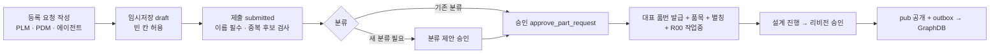
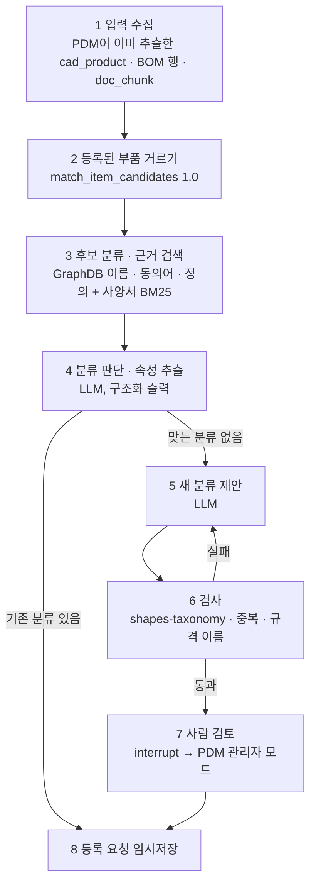

# 통합 품번 · 온톨로지 · 분류 에이전트 설계

PDM 본체 설계: [pdm-design.md](pdm-design.md)

| 파일 | 내용 |
|---|---|
| [db/schema.sql](../db/schema.sql) | 10장(등록 요청 · 분류 제안 · 재고 · outbox), 품번 별칭, `pub` 공개 영역 |
| [db/roles.sql](../db/roles.sql) | 시스템별 접근 권한과 행 단위 제한 |
| [ontology/core.ttl](../ontology/core.ttl) | GraphDB에 올릴 핵심 TBox |
| [ontology/shapes-data.ttl](../ontology/shapes-data.ttl) | 승인 데이터(ABox) 검사 규칙 — GraphDB SHACL |
| [ontology/shapes-taxonomy.ttl](../ontology/shapes-taxonomy.ttl) | 새 분류 제안(TBox) 검사 규칙 — 분류 에이전트 |
| [ontology/examples/sample-abox.ttl](../ontology/examples/sample-abox.ttl) | 설명용 예시 분류 · 재료 · 품목 · BOM |
| [standards/README.md](../standards/README.md) | ECLASS 무료판 받는 법, IEC CDD 무료 범위 (원본 파일은 git 제외) |
| [.env.example](../.env.example) | Claude API · LangSmith(APAC) · DB · GraphDB 설정 항목 |

## 1. 결정 사항

| 항목 | 결정 |
|---|---|
| 품번 | PLM과 PDM이 함께 쓰는 등록 체계로 통합 DB에 등록한다. ERP · MES는 통합 DB에서 품번과 재고 현황을 본다 |
| 추론 | GraphDB |
| 분류체계 | 아직 없다. 표준을 기본으로 하고 QUDT 등을 검토한다. 분류체계에 없는 부품은 에이전트가 새 분류를 제안한다 |
| 에이전트 | LangGraph로 만들고 LangSmith로 관리한다 |
| BOM 공개 | 승인본만 통합 DB · 그래프에 공개한다. 작업중은 다른 팀에 보이지 않고 관리자 모드에서만 본다 (임시저장) |
| 관리자 | 별도 시스템이 아니라 **PDM 안의 관리자 모드**로 만든다 |
| 품번 형식 | `P` + 7자리 일련번호로 시작한다. 다른 시스템과 합칠 때 바뀔 수 있어 바꾸기 쉽게 만들어 둔다 (3.1) |
| 네임스페이스 도메인 | 미정. 정해질 때까지 `ontology.example.com`을 쓴다 |

## 2. 전체 구성

```
   PLM ──┐  등록 요청(임시저장 · 제출)                          ┌── ERP
   PDM ──┼──────────────────────→ ┌──────────────────────────┐ │   품번 · BOM · 재고 조회 (pub)
 분류 에이전트 ─ 제안 · 임시저장 ──→ │ 통합 DB (PostgreSQL)      │←┤
  (LangGraph)                     │  내부: 품목 · 리비전 · BOM  │ │   재고 현황 보내기 (upsert_inventory)
      ↑                           │        문서 · 임시저장 · 제안 │ └── MES
      │ 분류 · 재료 검색            │  pub : 승인 품목 · 승인 BOM  │
      │ (SPARQL)                  │        별칭 · 재고          │
      │                           └────────────┬─────────────┘
      │                                        │ outbox (승인 시 트리거가 기록)
      │                                        ↓ 발행기
      └──────────────────── GraphDB  TBox: 분류체계 · 재료 계열 · 속성(QUDT)
                                     ABox: 재료 등급 · 승인 품목 · 승인 BOM
                                     규칙셋 OWL2-RL, SHACL 검사

   PDM 관리자 모드: 임시저장 · 작업중 · 분류 제안을 모두 보고 검토 · 승인한다 (품번 발급 · 품번 변경 포함)
```

**통합 DB는 PostgreSQL로 둔다.** 이유는 네 가지다.

- **품번 발급**: 순번, 유일성, 트랜잭션이 필요하다. 승인 한 번에 품번 발급 + 품목 + 별칭 + 첫 리비전이 함께 만들어져야 한다.
- **ERP · MES 연동**: SQL이나 REST로 붙는 것이 일반적이다. SPARQL로 붙는 경우는 드물다.
- **재고**: 자주 바뀌는 표 형태의 데이터다.
- **이미 검증한 규칙 재사용**: [pdm-design.md 8장](pdm-design.md)의 승인 잠금과 동시성 규칙을 그대로 쓴다.

**GraphDB가 맡는 일**은 세 가지다.

- **분류체계와 재료 마스터**: TBox와 재료 등급 개체를 둔다.
- **추론 질의**: 승인본 사본으로 "스테인리스강이 들어간 모든 제품" 같은 질의를 한다.
- **에이전트의 분류 검색**: 에이전트가 기존 분류를 찾는 곳이다.

**통합 DB와 PDM DB는 처음에 같은 PostgreSQL에 두고 스키마와 권한으로 나눈다.** 승인과 공개가 한 트랜잭션이라 공개본이 내부 데이터와 어긋날 수 없다. ERP · MES 조회 부하가 커지면 `pub` 조회를 읽기 전용 복제본으로 돌린다.

## 3. 품번 공동 등록



1. **임시저장**: `part_request.status = 'draft'`이다. 빈 칸이 있어도 저장되고, 작성자와 관리자만 본다.
2. **제출**: 이름이 없으면 DB가 거부한다. 제출할 때 `match_item_candidates()`로 이름 · 별칭 · 유사도 기준 중복 후보를 찾아 `duplicate_check`에 남긴다.
3. **분류 확정**: 기존 분류를 고르거나, 새 분류 제안(`class_proposal`)의 승인을 기다린다. 분류가 없으면 승인 함수가 거부한다.
4. **승인 = 품번 발급**: `approve_part_request()` 하나가 다음을 한 트랜잭션으로 한다.
   - 대표 품번 발급(`P` + 7자리 일련번호)
   - 품목 생성 (분류 · 재료 IRI 포함)
   - 별칭 등록
   - 첫 작업중 리비전 R00 생성

   PLM과 PDM이 같은 함수를 부르므로 규칙과 순번이 같다. 같은 요청을 두 번 승인할 수 없고, 별칭이 기존 식별자와 겹치면 전체가 되돌아간다.
5. **공개**: 리비전이 승인되면 `pub`에 보이고, 같은 트랜잭션에서 outbox에 발행 대기가 기록된다.

**규칙**

- 대표 품번은 의미 없는 일련번호다. 분류는 `class_iri`에 둔다. 분류가 바뀌어도 품번은 그대로다.
- 별칭 종류: `legacy`, `erp`, `mes`, `supplier`(`공급사코드:품번`), `customer`, `drawing`, `cad_name`. 같은 종류 안에서 유일해야 하고, `cad_name`만 겹쳐도 된다("Body"는 제품마다 있다).
- 상위 리비전은 하위 품목이 모두 승인된 뒤에만 승인된다(트리거). 그래서 공개 BOM이 공개되지 않은 품번을 가리키는 일이 없다.
- **기존 품번 이관**: 기존 번호는 `legacy` 별칭으로 넣고 대표 품번을 새로 발급한다. 중복 후보는 사람이 확인해서 합친다.
- **승인은 관리자 모드에서만**: 승인 함수가 DB에서 직접 사용자 역할(`admin` · `approver`)을 확인한다. 일반 사용자 화면에서 API를 잘못 불러도 품번이 발급되지 않는다.

### 3.1 품번 형식을 나중에 바꿀 때

지금 형식(`P` + 7자리)은 잠정이다. 다른 시스템과 합치면서 형식이 바뀌거나 번호를 옮겨야 할 수 있으니, 바꾸는 지점과 방법을 정해 두었다.

| 바꿀 것 | 위치 | 방법 |
|---|---|---|
| 새로 발급하는 번호 형식 | `issue_item_no()` ([db/schema.sql](../db/schema.sql)) | 함수 하나만 바꾼다. 다른 시스템의 순번을 따라야 하면 이 함수가 그 규칙을 쓴다 |
| 그래프의 형식 검사 | `sh:pattern` ([ontology/shapes-data.ttl](../ontology/shapes-data.ttl)) | 위 함수와 같이 바꾼다 |
| 이미 발급된 번호 | `renumber_item(품목, 새 번호)` | 관리자 모드 전용. 한 트랜잭션으로 처리한다 (아래) |
| 품목 테이블의 품번 열 | `item.item_no` | 형식 제약을 일부러 두지 않았다. 다른 시스템의 번호도 그대로 받을 수 있다 |

`renumber_item()`이 한 트랜잭션으로 하는 일:

1. 옛 번호를 `legacy` 별칭으로 남긴다.
2. 품번을 새 번호로 바꾼다.
3. 그래프 발행 대기에 기록한다.

새 번호가 이미 쓰이고 있거나 옛 번호 별칭이 겹치면 전체가 되돌아간다. 이렇게 바꿔도 다음은 그대로 유지된다.

- **ERP · MES**: `pub.part_identifier`에서 옛 번호로 새 번호를 찾는다.
- **CAD · BOM 매칭**: 옛 번호가 별칭으로 남아 있어 정확 일치(1.0)로 찾는다.
- **그래프 IRI**: 품목 IRI는 품번이 아니라 `item.iri_key`(발급 당시 품번, 이후 바꿀 수 없음)로 만든다. 번호를 바꿔도 IRI와 그것을 가리키는 그래프 데이터는 그대로다. 옛 번호를 새 품목에 다시 발급하는 일도 막힌다.

**합칠 때의 두 방향**

- **우리 번호가 대표로 남는 경우**: 다른 시스템의 번호를 `erp` · `legacy` 등 별칭으로 넣는다.
- **다른 시스템 번호가 대표가 되는 경우**: `renumber_item()`으로 바꾼다. 우리 번호는 `legacy` 별칭으로 남는다.

어느 쪽이든 테이블 구조는 바뀌지 않는다.

## 4. 공개 범위와 임시저장

| 데이터 | 작성자 | 다른 팀 (PDM 화면) | PDM 관리자 모드 | ERP · MES | GraphDB |
|---|---|---|---|---|---|
| 등록 요청 임시저장 · 제출본 | O | — | O | — | — |
| 작업중 · 검토중 리비전과 BOM | O | — | O | — | — |
| 분류 제안 (승인 전) | 에이전트 | — | O | — | — (검토 저장소만) |
| 승인 품목 · 승인 BOM · 별칭 | O | O | O | O (`pub`) | O |
| 재고 현황 | — | O | O | O (`pub`) | — |

**DB가 막는 것** ([db/roles.sql](../db/roles.sql)). PostgreSQL 18에서 역할별로 접속해 확인했다.

| 역할 | 할 수 있는 것 | 막힌 것 |
|---|---|---|
| `erp_reader` · `mes_reader` | `pub`의 승인 품목 · BOM · 별칭 · 재고 읽기 | 내부 테이블은 이름조차 보이지 않음, 임시저장 조회 불가 |
| `inventory_feed` | `pub.upsert_inventory()` 실행 | 그 밖의 읽기 · 쓰기 |
| `class_agent` | 추출 결과 · 품목 번호 · 분류 읽기, 분류 제안(`proposed`) · 등록 요청(`AGENT` 임시저장) 쓰기 | 제출 · 승인 · 품번 발급 · 다른 시스템 명의 쓰기 (행 단위 제한), 자기 것 아닌 임시저장 조회 |
| `pdm_app` | 전부 읽기 · 쓰기 (일반 화면과 관리자 모드 모두 이 서버를 거친다) | 감사 로그 수정 · 삭제, 관리자 모드가 아닌 사용자의 승인 · 품번 변경 (함수가 사용자 역할 확인) |
| `graph_publisher` | `pub` 읽기, 발행 상태 갱신 | 공개되지 않은 BOM 등 내부 테이블 |

**API가 막는 것**: PDM 화면에서 작업중 데이터와 임시저장을 작성자와 관리자 모드(`app_user.role` = `admin` · `approver`)에게만 보여 주는 것.

**관리자 모드 기능**

- 임시저장 · 작업중 · 검토중 전체 보기
- 등록 요청 승인 · 반려 (품번 발급)
- 분류 제안 검토 (승인 · 수정 · 거절 · 기존 분류에 합치기)
- 품번 변경 (`renumber_item`)
- 그래프 발행 상태 보기 (outbox의 미발행 · 실패 건)
- 감사 로그 조회

## 5. 재고 현황

- **재고의 주인은 ERP · MES다.** 통합 DB는 품번 기준 최신 값(`inventory_balance`)만 받아 두고, 이력은 ERP에 있다.
- **입구는 `pub.upsert_inventory(품번, 출처, 사업장, 위치, 현재고, 할당, 단위, 기준시각)` 하나다.**
  - 기준시각을 비교해서, 늦게 도착한 옛 값은 무시한다(검증함).
  - 등록되지 않은 품번은 거부한다.
- 조회는 `pub.inventory`로 한다. 가용 수량 = 현재고 − 할당이다.
- 연동 방식(변경될 때마다 호출할지, 주기적으로 배치할지)은 ERP · MES 쪽 사정에 맞춘다.

## 6. 분류체계와 온톨로지

### 6.1 표준 후보

| 영역 | 후보 | 쓰는 방식 |
|---|---|---|
| 부품 분류 · 속성 사전 | ECLASS (뼈대), IEC CDD (전기 · 전자 보완) | 분류 · 속성마다 표준 IRDI를 `opdm:standardIrdi`로 대응. 정의 문장을 그대로 가져오기 전에 라이선스 범위 확인 |
| 구매 분류 | UNSPSC | ERP 구매 연동용 대응만 |
| 단위 · 수량 종류 | QUDT (CC BY 4.0) | 속성 정의에 `opdm:quantityKind` · `opdm:unit`(QUDT IRI) + `opdm:unitIrdi`(IEC 62720 단위 IRDI, QUDT의 `qudt:iec61360Code`에서 가져옴) |
| 이름 · 동의어 · 표준 대응 | SKOS | `prefLabel`(ko · en), `altLabel`(동의어 — 에이전트 검색에 중요), `exactMatch` |
| 출처 · 이력 | PROV-O, Dublin Core | 에이전트 실행 기록, 근거 구절, 폐기 · 대체(`dct:isReplacedBy`) |
| 재료 등급 표기 | JIS · KS · ASTM · EN | 같은 등급의 규격별 표기를 동의어로: SUS304(JIS) = STS304(KS) = AISI 304 = 1.4301(EN) |

**ECLASS와 IEC CDD 비교** (2026년 10월 공개 자료 기준)

| | ECLASS | IEC CDD (Common Data Dictionary) |
|---|---|---|
| 무엇인가 | 산업 전반의 제품 분류 · 속성 표준 | IEC 61360 데이터 사전. 표준 데이터 요소와 부품 클래스를 담은 국제 표준 DB |
| 운영 | ECLASS e.V. (독일 비영리 협회, 2000년 기업들이 설립, 한국 지역 사무소 있음) | IEC SC 3D (ISO TC 184/SC 4와 공동 작업반), IEC가 호스팅 |
| 범위 | 전 산업. 기계요소(세그먼트 23), 전기 · 자동화(27), 기계 · 장치(36), 유공압(51) 등. 약 5만 클래스 · 2.3만 속성 (16.0) | 전기 · 전자 부품(IEC 61360-4), 공정 자동화 기기(IEC 61987), 저압 개폐기(IEC 62683), 단위 · 수량 종류(IEC 62720), 재료 · 형상 일부 |
| 구조 | 4단계(세그먼트 › 메인 그룹 › 그룹 › 서브그룹), 맨 아래에 속성 목록. Basic(평평한 속성, CSV · XML) / Advanced(블록 · 다중도 · 측면, XML만) | 클래스 계층과 클래스별 속성, 값 목록 · 단위 · 자료형. 표준끼리 상호 참조 |
| 식별자 | IRDI (예: `0173-1#01-…`) | IRDI (예: `0112/2///62720#UAA609`) |
| 갱신 | 매년 릴리스 (16.0: 2025년 11월) | 변경 요청 → 채택 항목은 약 6개월 안에 표준에 반영 |
| 언어 | 31개 언어 (12개는 기본 다운로드, 나머지는 요청). **한국어판 여부는 확인 필요** | 항목마다 다국어 이름 · 설명을 둘 수 있으나 대부분 영어 |
| 이용 조건 | **유료**: 16.0 기준 €700부터(한 번 구매, 회사 규모에 따라 다름), 회원 할인. 무료 "Asset" 판(영어 · 독일어, 범위 확인 필요) | **열람 무료**(로그인 필요). 내용은 IEC 저작권이고, 식별자 · 버전 · 이름 같은 일부 항목만 대응 · 교환 용도로 자유롭게 쓸 수 있다. 대량 반출은 라이선스 확인 |
| 연계 | 자산관리셸(AAS) · 디지털 제품 여권 · BMEcat · AutomationML에서 널리 쓰임. ERP · 공급사 데이터 교환에 유리 | IEC 제품 표준과 바로 연결. AAS에서도 IRDI로 참조 |
| 주의 | 16.0의 클래스 정의 약 2.3만 건은 AI로 생성됐다(정의 출처 속성에 표시). 가져올 때 출처를 확인한다 | 기계 부품(볼트 · 베어링 · 감속기) 범위가 좁다 |

**추천: ECLASS를 뼈대로, IEC CDD는 보완으로 쓴다.** 협동로봇에는 기계 부품과 전기 · 전자 부품이 섞여 있다.

- **ECLASS**: 기계요소부터 전기 · 자동화까지 한 체계로 덮는다. ERP · 공급사와 데이터를 주고받을 때 가장 널리 쓰인다.
- **IEC CDD**: 모터 · 센서 · 전자 부품의 속성 정의와 단위(IEC 62720)를 참고하고, IRDI로 대응만 한다. 무료라 먼저 살펴보기 좋다.
- **회사 고유 분류**: ECLASS 아래 끝 단계에만 둔다. 한국어 이름은 회사가 관리한다(`skos:prefLabel@ko` 필수 규칙).
- **진행 순서**: ECLASS 무료 Asset 판과 IEC CDD 열람으로 우리 부품 목록이 얼마나 덮이는지 먼저 확인한다. 맞으면 ECLASS 정식 라이선스를 산다.
- **IRDI 대응 방식**: 두 표준의 IRDI는 IRI가 아니라 `skos:exactMatch`에 그대로 쓸 수 없다. 그래서 문자열 주석 `opdm:standardIrdi`로 대응한다. 한 분류가 두 표준에 모두 대응될 수 있다.

**진행 현황**

- **ECLASS**: 무료 Asset 판(16.0)을 받는 중이다. 계정이 필요해서 직접 받는다. 절차는 [standards/README.md](../standards/README.md)에 있다. 파일이 들어오면 변환과 우리 부품 커버리지 리포트를 만든다.
- **IEC CDD 무료 범위**
  - 브라우저로 열람만 한다. 자동 수집은 사이트가 막고 접속도 기록된다.
  - 사용권의 "free attributes"(IRDI · 버전 · 이름)만 우리 분류 · 속성에 단다.
  - 단위는 QUDT의 `qudt:iec61360Code`로 IEC 62720 단위 IRDI를 받아 `opdm:unitIrdi`로 붙였다(밀도 g/cm³ = `UAA469`, 질량 kg = `UAA594`). 테스트로 QUDT 값과 대조했다.

**IRDI와 IRI는 무엇이 다른가**

| | IRDI | IRI |
|---|---|---|
| 출신 | 데이터 사전(레지스트리)의 항목 번호 (ISO/IEC 11179 · ISO 29002 계열) | 웹 표준(RFC 3987)의 웹 주소 형식 이름 |
| 생김새 | `0173-1#01-AAA001#001` = 등록 기관 # 종류 · 항목 코드 # 버전 | `https://ontology.example.com/onto-pdm/class/C0101` |
| 유일함을 보장하는 쪽 | 국제 코드로 등록된 기관 (ECLASS, IEC …) | 도메인 소유자 |
| 버전 | **식별자 안에 들어 있다.** 버전이 오르면 문자열이 바뀐다 | 보통 넣지 않는다. 버전은 따로 둔다 (`owl:versionIRI`) |
| 찾아보기 | 그 사전(ECLASS, IEC CDD)에서 찾아야 한다. 주소가 아니다 | 주소 자체로 웹에서 열리게 만들 수 있다 |
| RDF에서 | 스킴(`https:`)이 없고 `#`이 IRI에서는 다른 뜻이라 노드 이름으로 못 쓴다 → **문자열 값으로 둔다** | 노드 이름 그 자체 |
| 주로 쓰는 곳 | ECLASS · IEC CDD · 자산관리셸(AAS) · ERP · 공급사 데이터 교환 | 온톨로지 · GraphDB · Linked Data |

우리 방식은 이렇다.

- **그래프 안**: 그래프 안의 이름은 모두 IRI다.
- **표준과의 연결**: IRDI를 문자열 주석(`opdm:standardIrdi`, `opdm:unitIrdi`)으로 단다. 버전까지 그대로 저장한다.
- **표준 버전이 오를 때**: 버전 부분을 뺀 앞부분으로 같은 개념인지 비교한다.
- **AAS · ERP로 내보낼 때**: 이 문자열을 그대로 쓴다.

### 6.2 핵심 구조 ([ontology/core.ttl](../ontology/core.ttl))

- **클래스**: `opdm:Item`(조달 구분: 조립품 · 가공품 · 구매품 · 표준품), `opdm:Material`, `opdm:ItemRevision`, `opdm:BomLine`, `opdm:Product`. 분류(무엇인가)와 조달 구분(어떻게 구하나)은 독립이라, 품목은 두 클래스 모두의 개체가 된다.
- **분류 클래스**는 `opdm:Item` · `opdm:Material` 아래에 둔다. IRI는 의미 없는 코드(`cls:C0101`)로 두고, 이름은 SKOS에 둔다.
- **재료**: 계열(스테인리스강)은 클래스, 등급(SUS304)은 개체다. 물성은 등급 개체에 한 번만 적는다.
- **BOM**: 품목 → 현재 승인 리비전 → BOM 줄(수량 · 도면 번호) → 자식 품목.
  - `opdm:hasComponent`는 이 경로를 잇는 속성 사슬이고, `opdm:hasComponentTransitive`가 모든 단계를 잇는다.
  - 수량 누적은 SPARQL로 할 수 없어서 PostgreSQL `bom_explode`가 계산한다.
- **별칭**: `opdm:altPartNumber`의 하위 속성(레거시 · ERP · MES · 공급사 · CAD 이름)으로 둔다. 추론으로 모두 `altPartNumber`가 되어 한 번에 찾을 수 있다.
- **물성 · 질량**: 속성 정의에 단위를 고정한다(밀도 g/cm³, 질량 kg). 질량에는 출처를 같이 적는다.
  - `cad_mass`: CAD 질량 값
  - `cad_estimate`: 메시 부피 × 밀도로 추정
  - `measured`: 실측
- **일부러 쓰지 않은 것**: `owl:FunctionalProperty`, `InverseFunctionalProperty`, `hasKey`, `sameAs`. 이것들을 쓰면 값이 둘일 때 추론기가 두 개체를 같은 것으로 합쳐 버린다. "하나만" 규칙은 SHACL로 검사한다.

### 6.3 검사 규칙

| 파일 | 어디서 | 검사 |
|---|---|---|
| `shapes-data.ttl` | GraphDB 운영 저장소 (SHACL 켬) | 대표 품번 정확히 하나 · 형식, 이름, 현재 리비전 하나, 가공품 · 표준품은 재료 필수, 밀도 · 질량 양수, BOM 줄 자식 하나 · 수량 양수, 제품의 최상위는 조립품 |
| `shapes-taxonomy.ttl` | 분류 에이전트 (pySHACL) | 상위 분류는 이미 있는 클래스 하나(트리), 한국어 이름 하나, 정의 필수, 같은 상위 아래 이름 · 동의어 중복 금지, 이름에 규격 값(M3, 8x20, 10mm)이 있으면 경고 |

### 6.4 GraphDB 구성

- **저장소 두 개**
  - 운영: 승인본만 둔다. 규칙셋 OWL2-RL, SHACL을 켠다.
  - 검토: 승인 전 분류 제안을 미리 넣어 추론과 검사 결과를 확인한다. 저장소를 나눠 두면 저장소 단위로 권한을 나눌 수 있다.
- **named graph**: `tbox/core`, `tbox/classification`, `tbox/qudt`, `materials`, `pdm/items`, `pdm/bom/{품번}-{리비전}`
  - `tbox/qudt`: QUDT 단위 · 수량 종류(CC BY 4.0, 출처 표시 필요)를 그대로 올린다. 에이전트와 SPARQL이 단위 → IEC 단위 IRDI를 바로 찾을 수 있다. `core.ttl`은 QUDT 스키마와 같이 올려도 속성 종류가 충돌하지 않게 만들었다(테스트로 확인).
- **발행기**
  - outbox를 순서대로 처리한다. 대상 named graph를 발행 시점의 승인본으로 통째 바꾸므로 여러 번 반영해도 결과가 같다.
  - 실패하면 재시도 횟수와 오류를 남긴다.
  - 여러 발행기가 같은 건을 처리하지 않도록 `FOR UPDATE SKIP LOCKED`로 가져간다.

## 7. 분류 에이전트 (LangGraph + LangSmith)

### 7.1 역할과 한계

STEP · BOM · 사양서에서 아직 등록되지 않은 부품을 찾는다. 그 부품에 대해 기존 분류를 지정하거나 새 분류를 제안하고, 속성 값을 뽑아 **등록 요청 임시저장과 분류 제안까지만** 만든다. 승인, 품번 발급, 운영 TBox 수정은 DB 권한으로 막혀 있다.

### 7.2 흐름



| 단계 | 방식 | 내용 |
|---|---|---|
| 1 입력 수집 | 코드 | 파일을 다시 파싱하지 않고 PDM이 저장한 추출 결과를 읽는다 |
| 2 등록 부품 거르기 | 코드 | 별칭 포함 정확 일치(1.0)는 건너뛴다 |
| 3 후보 검색 | 코드 | GraphDB에서 분류 이름 · 동의어 · 정의 후보, 사양서에서 근거 구절 |
| 4 분류 판단 | LLM | 후보 중 선택 또는 "맞는 분류 없음", 신뢰도, 근거 구절 id, 속성 값(규격 · 길이 → 단위) |
| 5 새 분류 제안 | LLM | 상위 분류(기존), ko · en 이름, 정의, 필요한 속성(기존 속성 우선, 새 속성은 QUDT 수량 종류 · 단위), 표준 대응 후보, 근거 |
| 6 검사 | 코드 | 실패하면 오류를 붙여 5로 한 번 되돌린다. 두 번째도 실패하면 "검사 실패"로 사람에게 넘긴다 |
| 7 사람 검토 | LangGraph interrupt | 승인 · 수정 · 거절 · 기존 분류에 합치기. 며칠 걸려도 Postgres 체크포인터로 이어서 진행한다 |
| 8 기록 | 코드 | `class_proposal`(proposed), `part_request`(AGENT 임시저장) |

### 7.3 지킬 규칙

- 운영 TBox에 직접 쓰지 않는다. DB 권한과 행 단위 제한으로 강제한다.
- 근거 없는 제안은 받지 않는다. `class_proposal.evidence`가 비면 DB가 거부한다.
- **분류를 남발하지 않는다.** 값만 다른 것(M3 볼트, M4 볼트)은 속성으로 처리한다. 새 분류는 "다른 속성 묶음이 필요한 새 종류"일 때만 만든다.
- 새 분류를 제안하기 전에 표준 분류에서 먼저 찾는다.
- 한 실행에서 같은 종류의 부품이 여러 개 나오면 제안을 하나로 묶는다.

### 7.4 Claude 사용

- **모델**: `claude-opus-5-5`. 단계별로 effort를 정한다. 분류 판단(대량)은 `low`~`medium`, 새 분류 제안은 `high`다. 여러 모델을 섞기 전에 같은 모델의 effort 조절부터 측정한다. 프롬프트 캐시는 모델별이라 모델 하나가 유리하다.
- **호출**: LangGraph 노드 안에서 공식 `anthropic` Python SDK를 직접 부른다. 결과는 구조화 출력(`client.messages.parse` + Pydantic 스키마)으로 받는다.
  - Opus 5.5는 강제 도구 호출(`tool_choice`의 `any` · `tool`)을 400 오류로 거부한다.
  - 그래서 "도구를 강제해서 JSON을 받는" 방식은 쓰지 않는다. 일부 래퍼는 이 방식이 기본값이니 주의한다.
- **프롬프트 캐싱**: 분류체계 요약(코드 · 이름 · 동의어 · 정의 · 속성)을 시스템 프롬프트 앞부분에 고정하고 캐시한다. 부품별 입력은 그 뒤에 둔다. 실행을 시작할 때 분류체계 버전을 고정해서, 실행 도중에 캐시가 깨지지 않게 한다.
- **초기 대량 분류**(기존 품번 이관): Message Batches API를 쓴다. 비동기로 돌고 비용이 절반이다.
- **거절 처리**: `stop_reason`이 `refusal`인지 확인하고, 서버 측 fallback 옵션을 켠다.
- **보안**: 사양서 본문과 CAD 이름이 Anthropic API와 LangSmith로 나간다. 사내 데이터 정책을 확인하고, LangSmith는 셀프호스팅이나 입력 가리기를 검토한다.

### 7.5 LangSmith

- **추적**: 실행마다 입력 파일 id, 검색된 분류 후보, LLM 입출력, 검사 결과를 남긴다. `class_proposal.agent_run_id`로 제안과 실행을 잇는다.
- **평가 데이터셋**: 사람이 분류한 부품을 정답으로 둔다. 지표는 세 가지다.
  - 분류 정확도
  - 남발률: 기존 분류가 있는데 새로 만든 비율
  - 속성 추출 정확도
- **피드백**: 관리자의 승인 · 수정 · 거절을 그 실행에 피드백으로 기록하고 데이터셋에 더한다.
- **프롬프트 버전 관리**: 프롬프트나 모델 설정을 바꿀 때마다 데이터셋으로 회귀 평가를 돌린다.
- **모니터링**: 비용과 지연을 본다.

### 7.6 LangSmith 배포 방식

| | 클라우드 (Plus 요금제) | 셀프호스팅 (Enterprise 추가 기능) |
|---|---|---|
| 비용 | 사용자당 월 $39, 기본 추적 월 1만 건 포함, 그 뒤는 사용량 과금 (2026년 10월 공개 요금) | Enterprise 계약(견적 비공개) + 인프라 비용 + 운영 인력 |
| 데이터 위치 | 리전 선택: US · EU · APAC. 한국 전용 리전은 없다. 만든 뒤 리전을 옮길 수 없다 | 사내 |
| 운영 | 없음 | Kubernetes(Helm) 위에 ClickHouse · PostgreSQL · Redis · 블롭 저장소를 직접 운영하고 업그레이드도 직접 한다 |
| 보관 기간 | 기본 14일, 확장 보관은 유료. 확장 보관 상한이 최근 줄었다는 보도가 있어 계약 전에 확인한다 | 직접 정한다 |
| 시작 속도 | 바로 | 계약과 구축에 수 주 이상 |
| 보안 | DPA 제공, SOC 2 Type 2. 추적 데이터가 외부에 저장된다 | 외부 저장 없음 |

**추천: 지금은 클라우드(APAC 리전, Plus)로 시작하고, 운영 전환 전에 보안 심사 결과로 셀프호스팅 여부를 정한다.**

이유는 세 가지다.

1. **지금 필요한 것**은 평가 데이터셋을 만들고 프롬프트를 반복해서 고치는 일이다. 운영 부담 없이 바로 시작하는 쪽이 이득이다.
2. **장기 기록은 LangSmith에 두지 않는다.** 근거 · 검사 결과 · `agent_run_id` · 감사 로그는 PostgreSQL에 남는다. 그래서 LangSmith 보관 기간에 기대지 않는다.
3. **판단 기준은 데이터 정책 하나다.** "LLM API로 보내는 것과 같은 데이터를 LangSmith에 저장해도 되는가"를 본다. 사양서 본문을 Claude API로 보내는 것이 허용되면, LangSmith 클라우드도 같은 심사 범위에서 다룰 수 있다. 둘 다 안 되면 LLM 쪽부터 다시 정해야 한다.

**무료인가**

| 방식 | 비용 |
|---|---|
| 클라우드 Developer | 무료. 1명, 월 5천 추적까지 (결제 수단을 등록하면 초과분은 과금) |
| 클라우드 Plus | 사용자당 월 $39 |
| 셀프호스팅 | **무료가 아니다.** Enterprise 요금제의 추가 기능이라 라이선스 키(영업 계약)가 필요하다. 여기에 Kubernetes · ClickHouse 등 인프라 비용과 운영 인력이 든다 |

**클라우드 설정 순서** (설정할 것이 많지 않다)

1. [apac.smith.langchain.com](https://apac.smith.langchain.com)에서 조직을 만든다. 리전은 나중에 옮길 수 없다.
2. Developer(무료)로 시작하고, 팀원이 붙으면 Plus로 올린다.
3. 프로젝트를 만든다: 개발용 `onto-pdm-classifier-dev`, 운영은 나중에 `-prod`로 따로 둔다.
4. API 키를 발급해서 서버의 `.env`에만 둔다(`.env`는 git에 올라가지 않는다).
5. 환경 변수 4개를 넣는다([.env.example](../.env.example)).
   - `LANGSMITH_TRACING=true`
   - `LANGSMITH_ENDPOINT=https://apac.api.smith.langchain.com`(끝에 `/` 없이. US 주소를 쓰면 APAC 키가 인증에 실패한다)
   - `LANGSMITH_API_KEY`
   - `LANGSMITH_PROJECT`
6. 민감 데이터 처리를 정한다. 두 가지 방법이 있다.
   - 전부 숨김: `LANGSMITH_HIDE_INPUTS` · `LANGSMITH_HIDE_OUTPUTS`
   - 본문만 가림: 에이전트 코드에서 `Client(hide_inputs=함수)`로 사양서 본문만 구절 id로 바꾼다.

   평가에는 구조가 필요하므로 본문만 가리는 방식을 추천한다.
7. 보관 기간은 기본 14일 그대로 둔다. 오래 남길 기록은 PostgreSQL에 있다.
8. 보안 심사가 필요하면 지원팀에 DPA(데이터 처리 부속 계약)를 요청한다.

**클라우드를 쓰는 동안 지킬 것**

- 추적에서 사양서 본문과 CAD 이름을 숨기거나 가린다. 구절 id만 남긴다(SDK의 입력 · 출력 숨김 설정).
- 평가 데이터셋은 공개해도 되는 부품이나 가공한 예시로 만든다.

**셀프호스팅으로 옮길 신호**

- 보안 심사에서 외부 저장을 허용하지 않는다.
- 추적량이 많아져 사용량 과금이 Enterprise 비용에 가까워진다.
- 보관 기간을 길게 직접 정해야 한다.

## 8. 검증한 것

| 대상 | 환경 | 결과 |
|---|---|---|
| 스키마 기능 (등록 · 관리자 모드 승인 · 별칭 · 품번 변경 · 공개 뷰 · 재고 · outbox 포함) | PGlite(PostgreSQL 16.4), PostgreSQL 18.4 | 64개 통과 |
| 동시성 (순환 BOM · 승인 중 변경 · 삭제 경쟁 · 덮어쓰기) | PostgreSQL 18.4, 연결 2개 | 5개 통과 |
| 역할별 공개 범위 · 권한 | PostgreSQL 18.4, 역할별 접속 | 25개 통과 |
| SHACL 데이터 · 분류 제안 검사, OWL 2 RL 추론 질의, QUDT 단위 · IEC 단위 IRDI 대조, QUDT 스키마와 충돌 없음 | rdflib 7.6 · pySHACL 0.40 · owlrl 7.6, QUDT 최신 공개본 | 27개 통과 |

**아직 확인하지 않은 것**

- GraphDB 자체에서 OWL2-RL 규칙셋과 SHACL 엔진이 같은 결과를 내는지. 특히 `sh:or`, `sh:class`가 하위 클래스까지 따라가는지
- 발행기, 분류 에이전트, 관리자 화면은 아직 코드가 없다

## 9. 구현 순서

1. **통합 DB**: `schema.sql` + `roles.sql` 적용, 등록 요청 · 승인 API, `pub`으로 ERP · MES 시범 연동, 재고 수신
2. **분류체계 초안**: 표준 선택 → 상위 2~3단계 분류와 재료 계열 → GraphDB 저장소(OWL2-RL, SHACL)에 `core.ttl`과 함께 올림
3. **발행기**: outbox → GraphDB, 기존 승인본 일괄 발행
4. **기존 품번 이관**: 기존 번호는 별칭으로, 대표 품번 발급, 중복 후보 검토
5. **분류 에이전트**: 평가 데이터셋을 먼저 만들고 → LangGraph 흐름 → 관리자 검토 화면
6. **추론 질의 화면**: 재료별 사용 제품, 규제 물질 추적, 제품 무게 집계

## 10. 결정 현황

| 항목 | 상태 |
|---|---|
| 관리자 | **결정**: PDM 안의 관리자 모드 (4장) |
| 대표 품번 형식 | **잠정**: `P` + 7자리. 다른 시스템과 합칠 때 3.1 절차로 바꾼다 |
| 뼈대 표준 | **추천**: ECLASS + IEC CDD 보완 (6.1). ECLASS 무료 Asset 판 다운로드 대기 → 커버리지 확인 뒤 확정 |
| IEC CDD | **진행**: 무료 범위(IRDI · 버전 · 이름)만 사용. 단위 IRDI는 QUDT 경유로 붙임 |
| LangSmith 배포 | **결정**: 클라우드(APAC)로 시작. Developer(무료) → Plus. 셀프호스팅은 유료(Enterprise)라 운영 전환 전 보안 심사로 결정 (7.6) |
| 네임스페이스 도메인 | **대기**: 미정. 정해지면 `ontology/*.ttl`의 `ontology.example.com`만 바꾼다 |
| 재고 연동 주기 | 미정: 변경 이벤트인지 배치인지 |
| LLM · LangSmith로 보낼 수 있는 데이터 범위 | 미정: 보안 심사 |

## 참고 자료

- ECLASS: [Wikipedia](https://en.wikipedia.org/wiki/ECLASS), [16.0 구매 페이지](https://eclass.eu/shop/en/product/eclass-16-0), [16.0 변경 내용](https://eclass.eu/support/content-creation/release-process/information-on-releases/release-160), [Basic · Advanced](https://eclass.eu/en/eclass-standard/basic-advanced)
- IEC CDD: [Wikipedia](https://en.wikipedia.org/wiki/IEC_Common_Data_Dictionary), [cdd.iec.ch](https://cdd.iec.ch), [사용권 계약](https://cdd.iec.ch/cdd/iec61360/iec61360.nsf/License?openPage)
- LangSmith: [요금](https://www.langchain.com/langsmith-pricing), [호스팅 방식](https://docs.langchain.com/langsmith/enterprise), [셀프호스팅](https://docs.langchain.com/langsmith/self-hosted), [리전 FAQ](https://docs.langchain.com/langsmith/regions-faq)
