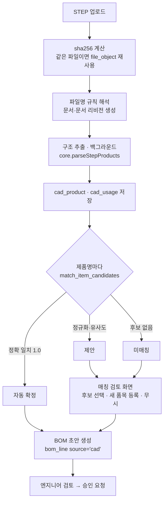
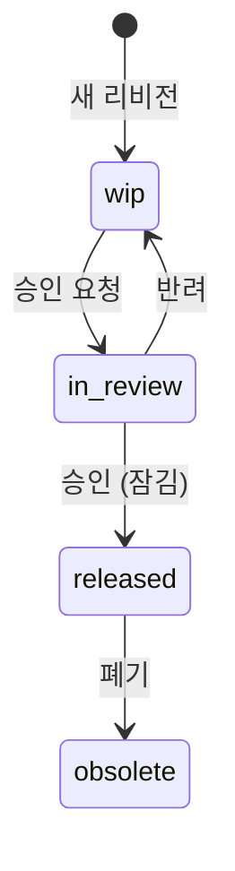
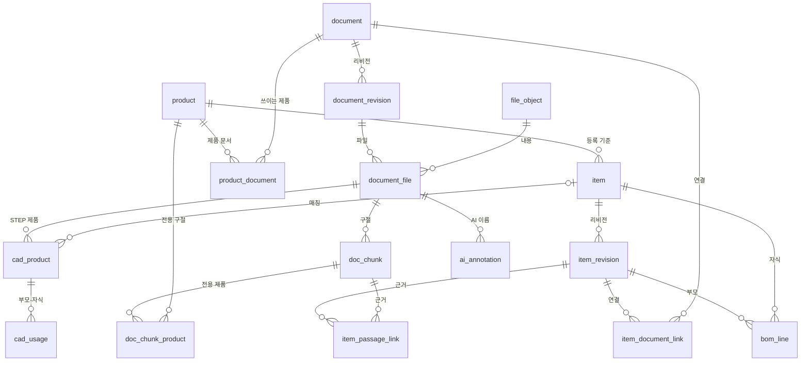

# Onto PDM 설계 — CAD · 사양서 · 설명서 · BOM 통합 관리

DB 스키마: [db/schema.sql](../db/schema.sql) (PostgreSQL 15 이상), 접근 권한: [db/roles.sql](../db/roles.sql)
통합 품번 · ERP/MES 공개 · GraphDB 온톨로지 · 분류 에이전트: [integration-ontology-design.md](integration-ontology-design.md)

## 1. 목표

- CAD 파일, 사양서, 설명서, BOM을 **품목(품번)** 기준으로 묶어 PostgreSQL에 저장·관리한다.
- 지금 있는 분해도 스튜디오(`explode-studio`)를 품목 상세 화면의 3D 뷰어로 붙인다.
- 자동 매칭은 **제안**까지만 하고, 확정은 사람이 한다. 거절한 제안도 남겨서 다시 제안하지 않는다.
- 승인된 리비전은 DB 트리거로 잠가서 API에 실수가 있어도 바뀌지 않게 한다.

## 2. 핵심 개념

| 개념 | 설명 | 테이블 |
|---|---|---|
| 제품(모델) | HCR3A 같은 모델. 사양서·설명서 검색의 "모델명" 기준 | `product` |
| 품목 | 품번 하나 = 부품 또는 조립품 | `item` |
| 품목 리비전 | R00, R01 … 승인되면 잠김 | `item_revision` |
| 문서 | CAD 3D, 도면, 사양서, 설명서, BOM 시트 | `document`, `document_revision` |
| 파일 | 실제 파일. sha256으로 중복 제거, 파일 저장소에 보관 | `file_object`, `document_file` |
| BOM | 부모 리비전 → 자식 품목 + 수량 + 도면 번호 | `bom_line` |
| 매칭 | 제품↔문서, 품목↔문서, 품목↔사양서 구절, CAD 제품명↔품목 | `product_document`, `item_document_link`, `item_passage_link`, `cad_product` |

품목과 문서를 나눈 이유: 사양서 한 권이 부품 수십 개를 설명하고, 부품 하나에는 CAD·도면·설명서가 여러 개 붙는다(다대다). 하나로 합치면 사양서가 부품마다 복제된다.

제품과 문서도 다대다다. 시리즈 공용 설명서처럼 한 문서가 여러 제품(HCR3A, HCR5A …)에 쓰이므로 `document`에 제품 컬럼을 두지 않고 `product_document`로 잇는다.

## 3. 시스템 구성

```
브라우저
 ├─ 목록 · 상세 · BOM 편집 · 매칭 검토 화면
 └─ explode-studio 뷰어 ── loadUrl('/api/files/:id/content'), loadSpec(...)
          │  REST (JSON, multipart)
Node.js API 서버 (Fastify + pg)
 ├─ core.js 재사용: parseStepProducts · chunkText · buildSpecIndex · searchSpec (DOM 없이 동작)
 ├─ AI 호출 (지금의 server/claude-endpoint.mjs 를 이 서버로 합침)
 ├─ PostgreSQL ─ 메타데이터 · 구조 · 매칭 · 감사 로그
 ├─ 파일 저장소 vault/ab/cd/<sha256> ─ 처음엔 로컬 디스크, 나중에 NAS · S3(MinIO)
 └─ 백그라운드 작업 ─ 파싱 · 색인 · 매칭 (처음엔 document_file.parse_status 폴링으로 충분)
```

- 파일 본체는 DB(bytea)에 넣지 않는다. CAD는 수십~수백 MB라 백업·복제가 무거워진다. DB에는 sha256, 크기, 저장 경로만 둔다.
- ORM 없이 `pg` + SQL 마이그레이션을 권장한다. 트리거, 부분 유니크 인덱스, 재귀 CTE를 SQL 그대로 쓰는 편이 단순하다.
- 앱은 트랜잭션을 열 때마다 `SET LOCAL app.user_id = '<id>'`를 실행한다. 감사 로그와 승인자 기록이 이 값을 쓴다.

## 4. 기능 목록

### 4.1 기준정보 CRUD

| 대상 | 등록(C) | 조회(R) | 수정(U) | 삭제(D) |
|---|---|---|---|---|
| 제품 | 수동 등록 | 목록·검색 | 이름·설명 | 소프트 삭제 (품목·문서가 참조하면 거부) |
| 품목 | 수동 · BOM 시트 가져오기 · CAD 추출 | 품번·이름·한글명 부분 일치, 상세 | 속성 (리비전과 무관한 기준정보) | 소프트 삭제 (검토중·승인 리비전이 있거나 다른 BOM에 쓰이면 DB가 거부) |
| 품목 리비전 | 새 리비전 (이전 BOM·연결 복사) | 이력, 리비전 비교 | 작업중일 때만 | 작업중일 때만 |
| 문서 · 리비전 | 등록 + 파일 업로드 | 목록, 미리보기, 다운로드 | 체크아웃 → 파일 교체 → 체크인 | 작업중일 때만 |
| BOM 줄 | 줄 추가 · 시트 가져오기 · CAD에서 생성 | 정전개 · 역전개(사용처) | 수량 · 도면 번호 · 비고 | 부모 리비전이 작업중일 때만 |
| 연결(매칭) | 수동 연결 · 자동 제안 | 품목별 · 문서별 | 확정 · 거절, 리비전 고정 ↔ 최신 따라감 | 삭제 |

### 4.2 매칭 · 자동화

- **파일명 규칙 해석**: `Body_HCR3A_R00_3D.stp` → 이름 `Body` · 모델 `HCR3A` · 리비전 `R00` · 종류 `3D`
- **STEP 구조 추출**: 제품 트리 → 품목 매칭 → BOM 초안
- **BOM 시트 가져오기**: 엑셀·CSV → 검증 → 등록, CAD 구조와 비교
- **사양서·설명서 구절 색인**: 부품별 정의, 결합 대상별 조립·분해 절차 제안
- **AI 한글 이름·설명 저장**: 같은 CAD 파일·사양서 조합이면 AI를 다시 부르지 않음

### 4.3 조회 · 뷰어

- 통합 검색: 품번, 이름, 한글명, 문서 제목, 문서 본문(구절)
- 품목 상세 탭: 속성 · 리비전 이력 · BOM 트리 · 사용처 · 연결 문서 · 근거 구절 · 3D 뷰어
- 뷰어 연동
  - 주 CAD 파일을 `studio.loadUrl('/api/files/:id/content')` 로 연다.
  - 저장된 AI 이름·확정된 근거 구절을 뷰어에 넣어서 AI를 다시 부르지 않고 표시한다.
  - 뷰어에서 부품 클릭(`on('select')`) → `cad_product.matched_item_id` 로 그 품목 상세로 이동한다.
  - BOM 도면 번호(`bom_line.find_no`)와 뷰어의 번호 표시를 같은 값으로 맞춘다.

### 4.4 관리

- 승인 흐름: 작업중 → 검토중 → 승인 → 폐기 (검토중 → 작업중 = 반려)
- 권한: `admin` 전체 · `engineer` 등록·수정·승인 요청 · `approver` 승인·반려 · `viewer` 조회
- 감사 로그: 누가 언제 어떤 행을 어떻게 바꿨는지(`audit_log`, 변경 전후 JSON)

## 5. 프로세스

### P1. CAD 업로드 → 품목 매칭 → BOM 초안



1. 업로드할 때 파일을 스트리밍하면서 sha256을 계산한다. 같은 해시가 있으면 저장소에 다시 쓰지 않는다.
2. 파일명 규칙으로 문서(`cad_3d`)와 리비전을 만들고, 같은 이름의 품목이 있으면 `cad_model` 연결을 제안한다.
3. `parseStepProducts()` 결과(`PRODUCT` 이름, `NEXT_ASSEMBLY_USAGE_OCCURRENCE` 부모-자식)를 `cad_product`·`cad_usage`에 저장한다. 같은 부모 아래 반복 등장은 수량으로 합친다.
4. 제품명마다 `match_item_candidates()`로 후보를 찾는다. 정확 일치만 자동 확정하고 나머지는 사람이 고른다.
5. 확정된 `cad_usage`를 부모 품목의 **작업중 리비전**에 `bom_line(source='cad')`로 넣는다. 수동으로 넣은 줄(`source='manual'`)은 건드리지 않는다.
6. CAD 구조와 관리 BOM은 일부러 분리해 둔다. CAD의 가상 조립 노드나 구매품 묶음은 `ignored`로 두면 BOM에 들어가지 않는다.

### P2. 사양서 · 설명서 등록 → 부품별 근거 구절

1. 문서(`spec` 또는 `manual`)를 등록하고 쓰이는 제품마다 `product_document`로 연결한다. 이미 등록된 설명서는 다시 올리지 않고 연결만 추가한다.
2. 텍스트를 뽑는다(pdf.js Node 빌드, 페이지 번호 유지). `chunkText()`로 자른 구절을 `doc_chunk`에 저장한다. 구절은 문서 파일에 한 번만 저장하고 모든 제품이 같이 쓴다.
3. **제품 전용 구절 표시**: 연결된 제품이 둘 이상이면, 구절 본문이나 바로 위 제목에 일부 제품의 모델명만 나오는 구절을 `doc_chunk_product`로 그 제품에 묶는다. 모델명이 없거나 모든 모델명이 나오면 공통 구절로 둔다. 자동 판정이 틀리면 검토 화면에서 고친다(`source='manual'`).
4. 제품마다 BOM을 정전개해서 부품 목록을 얻고, 그 제품에 해당하는 구절(`chunks_for_product()` = 공통 + 전용)에서만 부품마다 질의(부품명 + 상위 조립품명 + 모델명)로 `searchSpec()` 상위 구절을 찾아 `item_passage_link(purpose='definition', status='suggested')`에 넣는다. 그래야 HCR3A 부품에 HCR5A 전용 절차가 붙지 않는다.
5. 결합 대상별 절차: 같은 부모 아래 형제·부모 품목을 결합 대상으로 보고, 두 이름이 함께 나오는 구절을 `purpose='assembly'`, `mate_item_id`로 넣는다.
6. 사용자가 확정·거절한다. 확정한 구절은 뷰어 정보 패널의 "정의", "결합 대상 기준 조립·분해 절차"에 먼저 나온다.
7. 공용 설명서의 새 리비전이 승인되면, 그 리비전을 따라가는 제품(`document_revision_id`가 비어 있는 연결)마다 3~5단계를 다시 돌린다. 이전 리비전에 고정한 제품은 그대로 둔다.

> 지금 정의 문장 추리기와 결합 대상 절차 로직은 화면 코드인 `source/app.js`의 `getManualInfo` 안에 있다. 서버에서 같은 결과를 내려면 이 로직을 `source/core.js`로 옮기고 `tools/build_module.py`로 다시 생성해야 한다.

### P3. BOM 시트(엑셀 · CSV) 가져오기

1. 업로드 → 컬럼 지정(품번, 이름, 수량, 레벨 또는 부모 품번, 도면 번호) → 미리보기.
2. 행마다 검증: 품번 매칭, 수량 > 0, 부모 존재, 순환 여부.
3. 미리보기에서 행을 신규 품목 / 기존 품목 / 오류로 나눠 보여 준다.
4. 확정하면 한 트랜잭션으로 품목·리비전·`bom_line(source='import')`을 만든다. 하나라도 실패하면 전부 되돌린다.
5. CAD BOM과 비교한다(같은 부모 기준): CAD에만 있음 / 시트에만 있음 / 수량 다름.

### P4. 리비전 · 승인



- **새 리비전**: 이전 리비전의 `bom_line`, `item_document_link`, 확정된 `item_passage_link`를 복사한 뒤 고친다. 품목마다 열린(작업중·검토중) 리비전은 하나만 둘 수 있다.
- **승인**: 트리거가 리비전 내용, BOM 줄, 주 파일을 잠근다. 미리보기 같은 파생 파일과 해석 결과 갱신은 승인 뒤에도 된다.
- **승인 순서**: 상위 리비전은 BOM의 하위 품목이 모두 승인된 뒤에만 승인된다(트리거). 승인본은 통합 DB `pub`으로 ERP · MES에 공개되기 때문에, 공개 BOM이 공개되지 않은 품번을 가리키면 안 된다.
- **공개**: 승인되면 같은 트랜잭션에서 그래프 발행 대기열(outbox)에 기록된다. 작업중 · 검토중은 PDM 안에서 작성자와 관리자 모드만 본다(임시저장).
- **문서 체크아웃**: `checked_out_by`가 있으면 다른 사람은 파일을 바꿀 수 없다(API에서 검사). 체크인하면 풀린다.

### P5. 삭제 규칙

| 대상 | 규칙 |
|---|---|
| 품목 | 소프트 삭제(`deleted_at`). 검토중·승인 리비전이 있거나 폐기되지 않은 BOM에서 쓰이면 거부 (DB 트리거). 삭제된 품목은 BOM에 새로 넣을 수 없다 |
| 제품 · 문서 | 소프트 삭제. 승인 리비전이 있거나 다른 곳에서 연결돼 있으면 거부 (API에서 검사) |
| 리비전 | 작업중일 때만 실제 삭제. 딸린 BOM 줄·연결도 함께 지워진다 |
| 파일 | `document_file` 행만 지운다. 아무도 참조하지 않는 `file_object`는 정리 작업이 저장소에서 지운다 |
| 승인된 것 | 삭제하지 않고 폐기(`obsolete`) |

## 6. 매칭 규칙

| 방법 | 기준 | 점수 | 처리 |
|---|---|---|---|
| 파일명 규칙 | 정규식 `^(?<name>.+)_(?<model>[A-Z0-9]+)_(?<rev>R\d{2})_(?<kind>3D\|2D)\.(stp\|step)$` (설정으로 바꿀 수 있게) | 1.0 | 자동 확정 |
| 정확 일치 | STEP 제품명 = 품번 또는 품목 이름 | 1.0 | 자동 확정 |
| 별칭 일치 | 레거시 · ERP · MES · 공급사 품번 (`item_identifier`, 종류 안에서 유일) | 1.0 | 자동 확정 |
| CAD 이름 별칭 | 등록 때 남긴 CAD 이름 (제품마다 겹칠 수 있음) | 0.97 | 제안 |
| 정규화 일치 | `norm_key()`: 대소문자, 공백·`_`·`-`·`.` 무시 | 0.95 | 제안 |
| 유사도 | `pg_trgm` 유사도 0.3 이상 | 0.3 ~ 0.9 | 제안 (후보 5개) |
| BOM 시트 | 품번 일치 | 1.0 | 자동 확정 |
| 사양서 구절 | BM25 (`core.searchSpec`) — `J1`, `M3` 같은 부품 코드가 정확히 맞는다 | BM25 점수 | 제안 |
| AI | 한글 이름·설명 | — | 제안. 수락하면 `item.name_ko`에 반영 |

- 상태는 모두 `suggested → confirmed / rejected`. 거절도 지우지 않고 남겨 두어, 다시 매칭을 돌려도 같은 제안이 나오지 않게 한다.
- 문서 연결(`product_document`, `item_document_link`)은 두 가지다. `document_revision_id`가 있으면 그 리비전에 **고정**, 비어 있으면 **최신 승인 리비전을 따라감**. CAD 모델은 보통 고정, 사양서·설명서는 보통 따라감. 공용 설명서는 제품마다 따로 정할 수 있다(예: 단종 제품은 옛 리비전에 고정).

## 7. DB 설계



### 테이블 요약

| 영역 | 테이블 | 핵심 컬럼 · 제약 |
|---|---|---|
| 사용자 | `app_user` | `login_id` 유일, `role` |
| 제품 | `product` | `code`(모델명) 유일, `root_item_id` 최상위 조립품 |
| 품목 | `item` | `item_no`(품번) 유일, `name` / `name_ko`, `item_type`, `attributes jsonb` |
| | `item_revision` | `(item_id, rev)` 유일, `rev_seq` 정렬, `status`, 열린 리비전 하나 |
| 문서 | `document` | `doc_no` 유일, `doc_type` (cad_3d · drawing · spec · manual · bom_sheet · other) |
| | `document_revision` | `status`, 체크아웃(`checked_out_by`) |
| 파일 | `file_object` | `sha256` 유일, `storage_key` |
| | `document_file` | 원래 파일명, 형식, `role`(primary · derived · attachment), `parse_status`, `analysis jsonb`(뷰어 캐시) |
| BOM | `bom_line` | `(parent_revision_id, child_item_id)` 유일, `quantity > 0`, `find_no` 부모 안에서 유일, `source` |
| 매칭 | `product_document` | `(product_id, document_id)` 유일, 고정/따라감, `is_primary`(대표 문서) |
| | `item_document_link` | `link_type`, 고정/따라감, `match_method`, `confidence`, `status` |
| CAD 구조 | `cad_product` · `cad_usage` | STEP 제품명, 매칭된 품목, 부모-자식 수량 |
| 구절 | `doc_chunk` | 구절 본문, `tsvector` + `pg_trgm` 색인 |
| | `doc_chunk_product` | 제품 전용 구절 표시. 행이 없으면 공통 구절. `source`(auto · manual) |
| | `item_passage_link` | `purpose`(definition · assembly · disassembly · reference), `mate_item_id`(결합 대상), BM25 점수, 일치 단어 |
| AI | `ai_annotation` | (CAD 파일, 사양서, 부품 이름) 유일, 한글 이름, 설명, 근거 구절 id |
| 감사 | `audit_log` | 테이블, 행 id, 작업, 작업자, 변경 전후 JSON |

### 설계 결정

- **BOM의 부모는 리비전, 자식은 품목.** 하위 부품이 R01로 올라가도 상위 조립품 BOM을 고칠 필요가 없다. 자식 리비전은 조회할 때 규칙으로 고른다: `released`(최신 승인본, 없으면 최신 작업본 — 생산 보기) / `latest`(최신 — 설계 보기).
- **같은 자식은 BOM 한 줄**, 위치는 `ref_designator`로 구분한다. CAD 추출 결과도 같은 방식(수량으로 합침)이라 비교가 쉽다.
- **잠금은 DB 트리거로**: 상태 전이 검사, 승인 리비전 수정 금지, 승인 리비전의 BOM·주 파일 변경 금지, BOM 순환 금지.
- **CAD 구조는 BOM과 따로 저장**(`cad_product`, `cad_usage`): CAD 구조와 관리 BOM은 같지 않다. 다시 추출해도 사람이 고친 BOM이 덮이지 않는다.
- **한국어 검색**: `simple` 설정의 `tsvector`(단어 단위, 부품 코드에 강함)와 `pg_trgm`(부분 일치)을 함께 둔다. 형태소 단위 검색이 필요해지면 PGroonga나 pg_bigm을 검토한다.
- **유일 제약 `NULLS NOT DISTINCT`** 를 쓰므로 PostgreSQL 15 이상이 필요하다.

### 함께 들어 있는 함수 · 뷰

| 이름 | 용도 |
|---|---|
| `effective_revision(item, rule)` | 규칙에 맞는 품목 리비전 |
| `bom_explode(root_revision, rule, max_depth)` | 정전개. 단계, 도면 번호, 수량, 루트 1개당 총수량 |
| `where_used(item)` | 역전개(사용처). 폐기 리비전 제외 |
| `match_item_candidates(name, limit)` | CAD 제품명 → 품목 후보 (정확 · 정규화 · 유사도) |
| `chunks_for_product(product, document_file)` | 그 제품에 해당하는 구절 (공통 + 전용) |
| `item_current` | 목록용: 품목 + 최신 리비전 + 최신 승인 리비전 |

## 8. 트랜잭션과 동시성 (ACID)

PostgreSQL 트랜잭션 안의 작업은 ACID가 보장된다. 이 시스템에서 따로 챙겨야 하는 것은 세 가지다. ① 여러 단계 작업을 한 트랜잭션으로 묶기, ② 동시에 들어온 변경끼리의 경쟁, ③ DB 트랜잭션 밖에 있는 파일 저장소.

### 원자성 (Atomicity)

- **API 요청 하나 = 트랜잭션 하나.** 아래 작업은 중간에 실패하면 전부 되돌아가야 한다.
  - 새 리비전 만들기 + BOM·연결·근거 구절 복사
  - BOM 시트 가져오기 확정
  - CAD 구조 저장: 이전 추출 결과 삭제 + 새 결과 저장 + `parse_status='done'`
  - 매칭 일괄 확정, 승인
- **감사 로그는 트리거라서 같은 트랜잭션에 들어간다.** 변경이 롤백되면 기록도 남지 않는다.
- **무거운 일은 트랜잭션 밖에서 한다.** STEP 파싱, PDF 텍스트 추출, AI 호출이 그렇다. 결과만 짧은 트랜잭션으로 저장해서 잠금을 오래 잡지 않게 한다.

### 일관성 (Consistency)

DB가 지키는 규칙 (API에 실수가 있어도 깨지지 않음):

| 규칙 | 수단 |
|---|---|
| 품번·문서 번호·리비전 중복 금지, 품목마다 열린 리비전 하나 | 유일 인덱스 (부분 인덱스) |
| 상태 전이 순서, 승인 리비전 수정 금지 | `guard_revision` 트리거 |
| 승인 리비전의 BOM 줄·주 파일 변경 금지 | `guard_locked_parent` 트리거 |
| BOM 순환 금지 | `guard_bom_cycle` 트리거 |
| 쓰이는 품목 삭제 금지, 삭제된 품목 BOM 추가 금지 | `guard_item_soft_delete`, `guard_bom_child` 트리거 |
| 연결한 리비전이 그 문서의 리비전인지 | 복합 외래 키 |
| 수량 > 0, 상태·종류 값 | CHECK 제약 |

API가 지키는 규칙: 문서 체크아웃 검사, 제품·문서 삭제 전 참조 검사, 새 리비전에 무엇을 복사할지.

### 격리성 (Isolation)

- **격리 수준은 READ COMMITTED(PostgreSQL 기본값)를 전제로 한다.** 트리거의 잠금 방식이 이 수준에 맞춰져 있다. REPEATABLE READ 이상으로 올리면 직렬화 실패를 재시도하는 코드가 필요하다.
- **DB가 막는 경쟁**. 실제 PostgreSQL 18에서 두 연결로 재현하고 막히는 것을 확인했다.

  | 경쟁 | 막는 방법 |
  |---|---|
  | 두 사람이 동시에 P→Q, Q→P를 넣어 순환 BOM이 생김 | BOM 구조 변경을 권고 잠금(`pg_advisory_xact_lock`)으로 한 줄로 세운 뒤 검사 |
  | 승인하는 순간 그 리비전에 BOM 줄이 끼어듦 | 부모 리비전을 `FOR SHARE`로 잠근 뒤 상태 검사 |
  | 품목 삭제와 그 품목의 BOM 추가가 동시에 일어남 | 품목 행 잠금 + `FOR SHARE` (어느 쪽이 먼저든 뒤쪽이 거부됨) |

- **덮어쓰기(lost update)는 API가 막는다.** 두 사람이 같은 품목 화면을 열고 차례로 저장하면 앞사람 수정이 사라진다. 조회할 때 `xmin`(행 버전)을 함께 내려 주고, 저장할 때 `UPDATE … WHERE id = $1 AND xmin = $2::xid`로 확인한다. 0행이면 `409 Conflict`를 돌려준다. 스키마 변경 없이 쓸 수 있다.
- **백그라운드 작업 중복은 이렇게 막는다.** 작업자가 파싱할 파일을 `SELECT … WHERE parse_status = 'pending' … FOR UPDATE SKIP LOCKED`로 가져가서, 같은 파일을 두 작업자가 처리하지 않게 한다.
- **잠금 대기 한도를 둔다.** API 연결에 `lock_timeout`(예: 5초)을 걸어 화면이 무한정 멈추지 않게 한다. 교착(deadlock)으로 실패하면 한 번 재시도한다.

### 지속성 (Durability)

- **PostgreSQL 설정**: `fsync`, `synchronous_commit`, `full_page_writes`는 기본값(켜짐)을 유지한다. 백업은 기본 백업 + WAL 보관(시점 복구)으로 한다.
- **파일**: 임시 파일에 받아 `fsync` → 저장소 경로로 이름 바꾸기(같은 디스크라 원자적) → 그다음 DB 커밋. 파일은 내용(sha256) 이름이라 덮어쓰거나 고치는 일이 없다.
- **백업 순서**: DB를 먼저, 파일 저장소를 나중에 백업한다. 지운 파일은 휴지통에 백업 주기보다 길게 보관한다. 그러면 DB 백업이 가리키는 파일은 항상 파일 백업에 있다.
- **파일 손상 점검**: 정기적으로 저장소 파일의 sha256을 다시 계산해 DB 값과 비교한다.

### 파일 저장소와 DB 맞추기

파일 저장소는 DB 트랜잭션에 들어가지 않으므로 순서와 잠금으로 맞춘다. 업로드와 정리 작업은 같은 sha256에 대해 `pg_advisory_xact_lock(hashtextextended(sha256, 0))`을 잡는다. 그래서 "정리 작업이 막 지운 파일을 업로드가 재사용하는" 경쟁이 생기지 않는다.

**업로드**

1. 임시 폴더에 받으면서 sha256을 계산하고 `fsync`한다.
2. `BEGIN` → 그 sha256의 권고 잠금을 잡는다.
3. `file_object`에 없으면 넣고, 있으면 그 행을 쓴다.
4. 저장소에 그 파일이 없으면 임시 파일을 저장소 경로로 옮긴다. 있으면 임시 파일을 지운다.
5. `document_file` 등을 넣고 `COMMIT`한다. 커밋이 실패해 남은 파일은 정리 작업이 치운다.

**정리 작업 (주기 실행)**

1. 아무도 참조하지 않고 만든 지 하루 넘은 `file_object`를 고른다.
2. 하나씩 `BEGIN` → 같은 권고 잠금 → 참조를 다시 확인 → 행 삭제 → 파일을 휴지통으로 옮김 → `COMMIT`한다. 커밋이 실패하면 휴지통에서 되돌린다.
3. DB에 행이 없는 저장소 파일(업로드 중 실패로 남은 것)도 하루가 지나면 휴지통으로 옮긴다.
4. 휴지통은 보관 기간(백업 주기 이상)이 지나면 비운다.

## 9. API

| 영역 | 메서드 · 경로 | 설명 |
|---|---|---|
| 제품 | `GET·POST /api/products`, `GET·PATCH·DELETE /api/products/:id` | |
| 품목 | `GET /api/items?q=&type=&product=&status=`, `POST /api/items`, `GET·PATCH·DELETE /api/items/:id` | 목록은 `item_current` 뷰 |
| 리비전 | `GET·POST /api/items/:id/revisions`, `PATCH·DELETE /api/item-revisions/:id` | POST = 새 리비전(복사 포함) |
| 승인 | `POST /api/item-revisions/:id/{submit,approve,reject,obsolete}` | 문서 리비전도 같은 형태 |
| BOM | `GET /api/item-revisions/:id/bom?depth=1\|all&rule=released\|latest`, `POST /api/item-revisions/:id/bom`, `PATCH·DELETE /api/bom-lines/:id` | |
| 사용처 · 비교 | `GET /api/items/:id/where-used`, `GET /api/bom/compare?a=&b=` | 리비전끼리 또는 CAD↔BOM |
| 문서 | `GET·POST /api/documents`, `GET·PATCH·DELETE /api/documents/:id`, `POST /api/documents/:id/revisions` | |
| 제품 문서 | `GET /api/products/:id/documents`, `POST /api/products/:id/documents`, `PATCH·DELETE /api/product-documents/:id`, `GET /api/documents/:id/products` | 공용 문서는 연결만 추가 |
| 구절 범위 | `PUT /api/chunks/:id/products` | 전용 제품 지정 · 해제 (빈 목록 = 공통) |
| 체크아웃 | `POST /api/document-revisions/:id/{checkout,checkin}` | |
| 파일 | `POST /api/document-revisions/:id/files` (multipart), `GET /api/files/:id/content`, `DELETE /api/files/:id` | content는 Range 지원 — 뷰어 `loadUrl` |
| 연결 | `GET /api/item-revisions/:id/links`, `POST /api/links`, `PATCH·DELETE /api/links/:id` | PATCH로 확정·거절·고정 |
| CAD 추출 | `POST /api/files/:id/extract`, `GET /api/files/:id/cad-structure`, `PATCH /api/cad-products/:id`, `POST /api/files/:id/generate-bom` | |
| BOM 가져오기 | `POST /api/bom-import/preview`, `POST /api/bom-import/commit` | 미리보기는 저장하지 않음 |
| 구절 | `POST /api/files/:id/index`, `POST /api/products/:id/match-passages`, `GET /api/item-revisions/:id/passages`, `PATCH /api/passage-links/:id` | |
| AI | `POST /api/explode-ai` (기존), `GET·PUT /api/files/:id/ai-annotations` | |
| 검색 | `GET /api/search?q=` | 품목 · 문서 · 구절 통합 |

## 10. 구현 순서

1. **기반**: 스키마 적용, API 서버(Fastify + pg), 품목·리비전·문서·파일 CRUD, 업로드·다운로드, 뷰어에서 DB 파일 열기
2. **BOM**: 수동 편집, 정전개·역전개, 엑셀·CSV 가져오기
3. **CAD 매칭**: STEP 구조 추출 → 매칭 검토 화면 → BOM 초안, CAD↔BOM 비교
4. **문서 매칭**: 사양서·설명서 색인 → 근거 구절 제안·확정, AI 이름 저장·재사용
5. **승인·권한·감사 화면**. 그 다음 후보: 설계 변경 관리(ECR/ECO), 다단 결재, 2D 도면 썸네일

## 11. 가정 (정해지면 바꿀 것)

- **품번 체계**: 대표 품번은 PLM · PDM 공동 등록에서 `P` + 7자리 일련번호로 발급한다(형식은 가정). 기존 번호와 CAD 이름은 별칭으로 남는다. 파일명 `이름_모델_리비전_종류.stp` 규칙은 CAD 파일을 품목에 연결할 때만 쓴다.
- **리비전 표기**: `R00, R01 …` (화면 표시는 `rev`, 정렬은 `rev_seq`라 A·B 방식도 그대로 쓸 수 있다).
- **결재**: 승인자 한 명의 1단계 승인. 다단 결재가 필요하면 `approval_step` 테이블을 추가한다.
- **파일 저장소**: 서버 로컬 디스크. `storage_key`만 바꾸면 NAS·S3로 옮길 수 있다.
